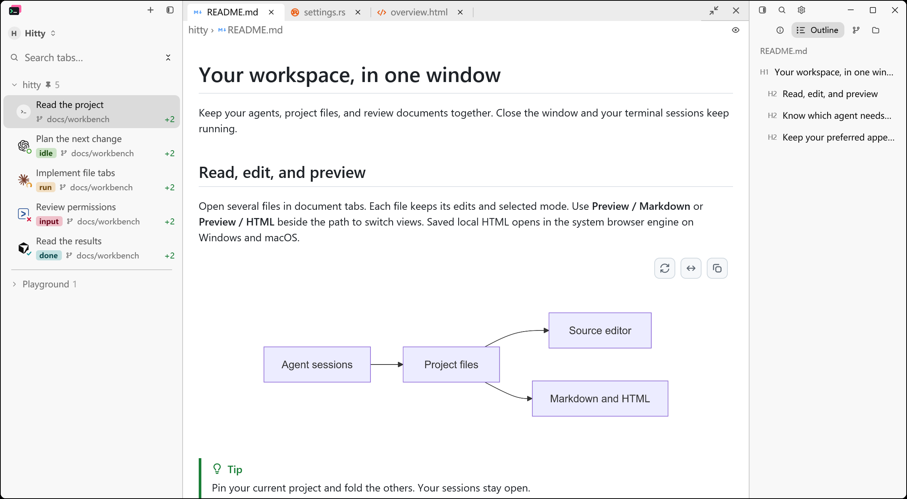
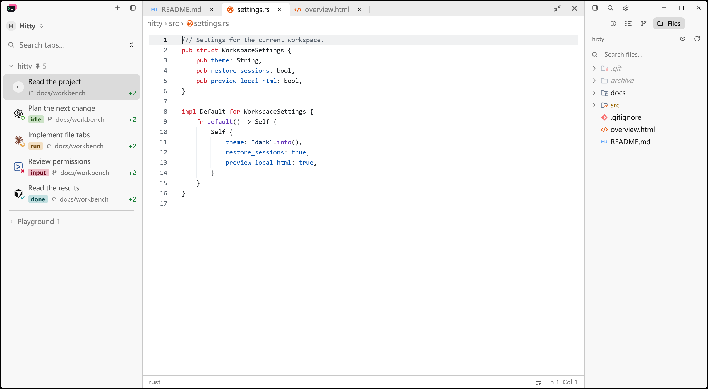
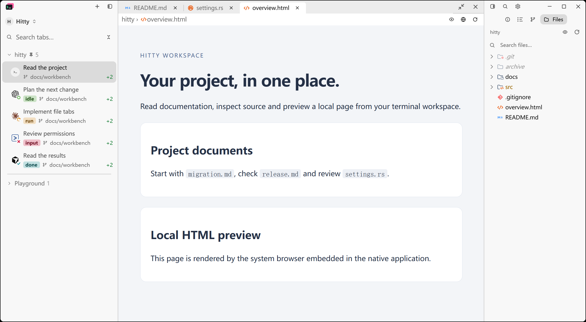

<div align="center">

<picture>
  <source media="(prefers-color-scheme: dark)" srcset="assets/hitty-logo-dark.svg" />
  
</picture>

**为编码 Agent 准备的终端工作台。**

把持久会话、Agent 状态、项目文件和远程工作放进同一个原生应用。

[](https://github.com/cloudy-liu/hitty/releases/latest)
[](https://github.com/cloudy-liu/hitty/actions/workflows/ci.yml)
[](LICENSE)

[**下载**](https://github.com/cloudy-liu/hitty/releases/latest) · [使用文档](docs/index.mdx) · [问题反馈](https://github.com/cloudy-liu/hitty/issues)

[English](README.md) · **简体中文**

</div>

Hitty 把 shell、编码 Agent 和项目上下文放在一起。启动 Agent、检查代码改动、阅读文档、连接远程机器，都可以在当前工作台中完成。后台服务持有终端会话，关闭窗口后，正在运行的任务仍可继续。

## 快速开始

1. 从 [GitHub Releases](https://github.com/cloudy-liu/hitty/releases/latest) **下载适合你系统的包**。
2. **打开 Hitty，在设置中选择 shell**。Windows 支持 PowerShell、CMD，以及自定义 Cmder/Clink 启动命令。
3. **打开项目，启动 `codex`、`claude`、`gemini` 等 Agent**。使用标签页和分屏并行工作，在终端旁打开文件检查结果。

| 平台 | 文件 | 启动方式 |
| --- | --- | --- |
| Windows x64 | `hitty-*-windows-x86_64-setup.exe` / `hitty-*-windows-x86_64.zip` | 正常安装，或完整解压 ZIP 后运行 `hitty-app.exe`。 |
| macOS Apple Silicon | `hitty-*-macos-arm64.dmg` | 将 **Hitty** 拖入 Applications。 |
| macOS Intel | `hitty-*-macos-x86_64.dmg` | 将 **Hitty** 拖入 Applications。 |
| Linux x64 | `hitty-*-linux-x86_64.AppImage` | 赋予执行权限后运行；也提供 `.tar.gz` 压缩包。 |

Windows 包未签名；macOS 使用 ad-hoc 签名，尚未公证，系统可能阻止首次启动。Linux 压缩包需要[安装文档](docs/getting-started/installation.mdx)中列出的系统库。每次发布均附带 `checksums.txt`。

<picture>
  <source media="(prefers-color-scheme: dark)" srcset="assets/screenshots/hitty/workspace-dark.png" />
  
</picture>

*Hitty 的 Windows 原生窗口截图。Agent 状态使用受控演示事件，不发起真实 Agent 请求。[截图说明](assets/screenshots/hitty/README.md)。*

## 核心能力

### 窗口关闭，工作继续

后台服务持有 shell 和运行中的进程。关闭后重新打开窗口，可以接回原来的会话。服务或电脑重启后，Hitty 会恢复保存的工作区和终端屏幕，并在已知会话 ID 时恢复受支持的 Agent 对话。电脑重启不会让原来的 shell 进程继续运行。

通过标签页、分屏、项目分组、置顶和折叠组织工作，并保留布局。[工作区与面板](docs/getting-started/concepts.mdx) · [标签与分屏](docs/window/tabs-and-splits.mdx)

### 看清哪个 Agent 需要你

识别 Claude Code、Codex、Gemini、Cursor、OpenCode 等编码 Agent。每个面板显示工作中、等待输入、空闲或结果未读等状态。桌面通知、托盘提醒和声音让你不必一直盯着终端。

Agent 窗格在终端上方显示名称。在“设置 → 窗口与标签页”中开启任务标题后，还能看到 Agent 写入的当前任务名称。桌面通知也会优先使用来源 Agent 的任务标题。

命令面板可以把选区或仓库 diff 发送给当前 Agent；CLI 可以查询状态，或等待状态变化。状态细节和对话恢复能力取决于具体 Agent 及其集成方式。[Agent 状态](docs/agents/status.mdx) · [会话恢复](docs/agents/sessions.mdx)

### 保留熟悉的 shell，改善终端操作

支持多行提示符编辑、历史建议、补全、终端搜索，以及文件和网址链接。Shell 集成覆盖 PowerShell、bash、zsh、fish 和 Windows CMD/Clink，也支持 Cmder 初始化脚本。历史搜索可以读取 PowerShell 和 Clink 的历史记录。

按自己的习惯设置 shell 程序、启动参数、字体、主题和快捷键。[Shell 集成](docs/reference/shell-integration.mdx) · [提示符编辑](docs/terminal/prompt.mdx)

### 在终端旁阅读、编辑和审查

用文档标签同时打开多个文件，各自保留编辑内容和预览模式。Markdown 预览支持 Mermaid 图表、缩放和平移、代码复制、front matter 与自定义阅读主题。本地 HTML 在 Windows 上使用 WebView2，在 macOS 上使用 WKWebView；Linux 使用源码视图。

浏览文件、搜索源码、以并排或统一布局查看 Git diff、阅读提交历史、管理 worktree。需要专注阅读时，可以把文档展开到整个工作区，再恢复原布局。

右侧面板在终端和文档旁提供信息、大纲、Git 和文件四种视图。大纲列出文档标题、Agent 对话轮次或记录下来的 shell 命令，点击即可跳转。面板展开时，打开含两个及以上标题的 Markdown 预览会自动显示它的大纲；文档关闭后回到你原先选择的视图。[Markdown 主题](docs/customization/markdown-themes.mdx) · [Git 审查](docs/git/source-control.mdx) · [右侧面板](docs/window/side-panel.mdx)

<table>
  <tr>
    <td></td>
    <td></td>
  </tr>
  <tr>
    <td align="center">源码编辑</td>
    <td align="center">本地 HTML 预览</td>
  </tr>
</table>

### 本地、SSH 与 WSL 工作区

通过保存的 SSH 配置连接主机，支持密钥认证、跳板机、SFTP 和端口转发。远程工作区的终端、文件和 Git 操作留在对应机器上；重新连接仍在运行的远程服务时，可以接回原会话。

Windows 包内置 Linux server，可用于连接 WSL 发行版。SSH 和 WSL 连接从桌面界面建立；CLI 可以操作已建立的远程连接。[SSH](docs/remote/ssh.mdx) · [远程工作区](docs/remote/workspaces.mdx)

### 用 CLI 驱动工作台

内置的 `hitty` 命令让脚本和 Agent 查询工作区、运行命令、发送输入、读取终端输出。先启动一次 Hitty，再尝试：

```sh
hitty doctor                 # 检查安装和后台服务
hitty ls                     # 列出工作区
hitty agents                 # 查看 Agent 状态
hitty run -- cargo test      # 输出测试结果，并返回命令退出码
hitty pane ls --json          # 获取脚本可用的面板地址
```

将 `hitty pane ls` 返回的面板 ID 交给 `hitty send`、`hitty capture` 或 `hitty wait`。添加 `--json` 可获得机器可读结果。[CLI 指南](docs/cli/overview.mdx) · [命令参考](docs/cli/reference.mdx)

## 配置成你习惯的样子

大多数选项可以在设置中修改。终端默认使用 **Hack 字体、15 px 字号、1.4 倍行高和浅色主题**。Windows 优先使用 PowerShell 7，未安装时使用 Windows PowerShell。使用 Cmder 时，将 shell 配置为 `cmd.exe`，再填入自己的 `/k` 初始化脚本。

| 平台 | 配置位置 |
| --- | --- |
| Windows | `%APPDATA%\hitty\config.json` |
| macOS / Linux | `~/.config/hitty/config.json` |

使用 `HITTY_CONFIG_DIR` 或 `--config-dir` 指定独立配置目录。[设置](docs/customization/settings.mdx) · [字体](docs/customization/fonts.mdx) · [主题](docs/customization/themes.mdx)

## 构建与贡献

Hitty 使用 Rust 编写，以 GPU 渲染原生界面。需要 stable Rust；Windows 还需要 MSVC C++ 构建工具和 Windows SDK，macOS 需要 Xcode command line tools，Linux 需要[对应的开发库](docs/getting-started/installation.mdx#building-from-source)。

```sh
git clone https://github.com/cloudy-liu/hitty.git
cd hitty
cargo build --locked --workspace --bins --features updater
cargo dev
```

`cargo dev` 使用隔离的 `.hitty-dev` 配置目录。提交代码前运行 `cargo fmt --all -- --check` 和 `cargo test --locked --workspace --features updater`。Windows 完整测试还需要把 Git for Windows 的 `usr/bin` 工具目录加入测试进程 PATH。

通过 [GitHub Issues](https://github.com/cloudy-liu/hitty/issues) 报告问题或提出建议。PR 提交到本仓库的 `main` 分支，详见[贡献指南](AGENTS.md)。

## 致谢与许可证

Hitty 基于 [tty7](https://github.com/l0ng-ai/tty7) 持续开发，采用 [Apache License 2.0](LICENSE)。原始版权和署名均予以保留，具体源码版本及导入说明见[来源记录](docs/provenance/source-baseline.md)。

感谢以下项目及其贡献者提供的基础能力与资源：

- [GPUI / Zed](https://github.com/zed-industries/zed)、[gpui-component](https://github.com/longbridge/gpui-component) 与 [Alacritty](https://github.com/alacritty/alacritty)：界面和终端基础组件。
- [Herdr](https://github.com/herdrdev/herdr)：Apache-2.0 许可的 Agent 屏幕识别规则，[来源说明](assets/agent-detection/README.md)。
- Miguel Solorio 的 [Symbols](https://github.com/miguelsolorio/vscode-symbols)：文件图标，[MIT 许可证](assets/file-icons/symbols/LICENSE)。
- [Hack](https://sourcefoundry.org/hack/)：内置字体，[字体许可证](assets/fonts/hack/LICENSE.md)。
- GitHub、Primer 和 Atom One Dark 的贡献者：阅读及源码配色，[Markdown 归属声明](assets/markdown-themes/GITHUB-NOTICE)与[编辑器主题许可证](assets/editor-themes/README.md)。
- Microsoft：Windows ConPTY 组件，[MIT 许可证](assets/windows/conpty/LICENSE.txt)。

第三方组件和素材分别保留各自的许可证与归属声明。
