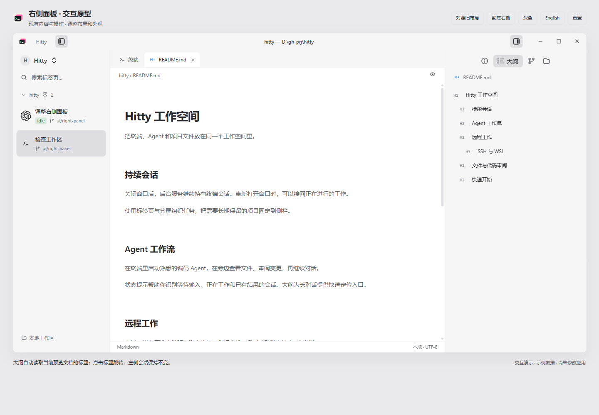

# Hitty 右侧面板交互原型

直接用浏览器打开 [index.html](index.html)。单文件包含所有图标，无需安装依赖或启动服务。

本轮以 Hitty 现有内容和操作为基础，调整右侧模式栏、根目录标题和快捷入口。
详细约定见 [direction-approved.md](direction-approved.md)。应用源码尚未改动。

## 可以检查的交互

- **信息 / 大纲 / Git / 文件**：只有当前模式带文字；再次点击当前模式，按 Hitty 现有行为收起右栏。
- **文件**：根目录折叠、目录展开、搜索、隐藏点文件、刷新反馈、打开示例文件、右键菜单。
- **文件查看**：从右侧文件树打开 MD/HTML，在当前会话内新增文档标签；再次打开复用标签，关闭最后一份文档返回该会话。左侧不新增“阅读项目文档”，右侧操作不改变左侧的数量、顺序、名称或选中项。
- **信息**：会话字段、复制入口、变更入口、进程、端口；切到 Agent 场景还会显示原有对话节点。
- **Git**：分支菜单、提交输入与菜单、暂存/取消暂存、放弃更改确认、分组折叠、历史入口。
- **大纲**：自动跟随当前内容。查看 MD/HTML 时直接读取预览文档的标题层级并可点击跳转；终端与 Agent 场景显示命令或对话条目。无需扩展预览开关。
- **图标**：四个模式图标统一为 16 逻辑像素，30 px 控件高度，按 Otty 参考调整；文件类型图标保持现有资产。
- **外观检查**：深浅色、中英文模式标签、右栏宽度拖动（260–440 px）、聚焦右侧、新旧布局示意对照。

所有文件、命令、对话、PID、端口和 Git 数据都是演示样例。暂存等操作只改变页面内样例。
复制按钮复制样例文字；提交、同步、打开系统应用等入口只反馈演示提示，不执行实际动作。
此原型用于确认布局与入口保留，不代表原生应用的完整行为或可访问性验收。
“旧布局对照”是同一页面的布局示意，不是原生 Before 截图。

## 检查记录

- Chromium 实际渲染：1440 × 1000、1024 × 800；DPR 1。
- 首轮 32 项页面行为检查覆盖模式切换、文件树、搜索、Git、信息和大纲导航。后续 17 项检查覆盖本次修正：文档标签按需创建、自动大纲、重复打开复用、标签关闭、会话归属、左侧内容和选中态不变、四个图标尺寸。
- 中英文四个模式在 260 px 宽右栏均不溢出；浅色与深色界面已目视检查。
- 通过真实浏览器点击检查 Agent 大纲，滚动到对应节点；信息页节点定位不会替换当前模式。
- 没有浏览器 error/warn；没有外部脚本或样式依赖。
- 静态设计扫描中的低对比度和缺失图片源已修正。关于模拟窗口外框/状态栏的内边距提示经目视检查保留：它们是完整窗口边界，而非文字卡片。
- 这些是 HTML 原型检查；原生应用验收须在后续实施后进行。

下面是最新文档流程：左侧保留两个原有会话；README 只在当前会话的文档区域打开，右侧直接显示标题。

## 资产

品牌图标与控件来自本仓库 `assets/app-icon.svg` 和 `assets/icons/`；文件图标按现有
Symbols 映射选择，保持原有颜色。Symbols 的 MIT 署名及许可证已嵌入 HTML 注释。
原型新增的大纲等简单控件图形只服务于布局演示。
