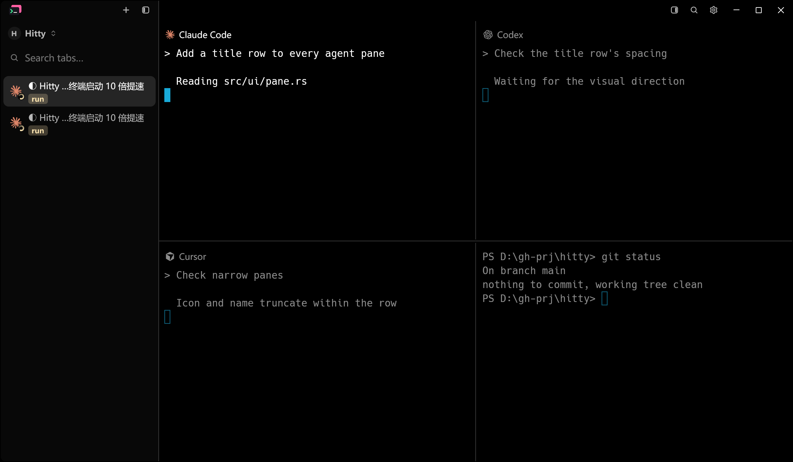
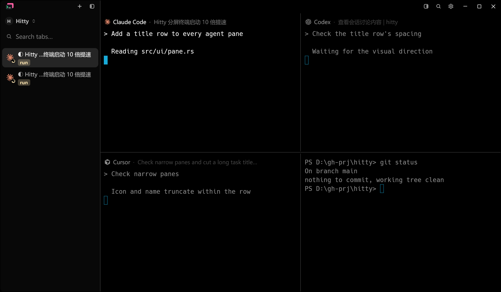
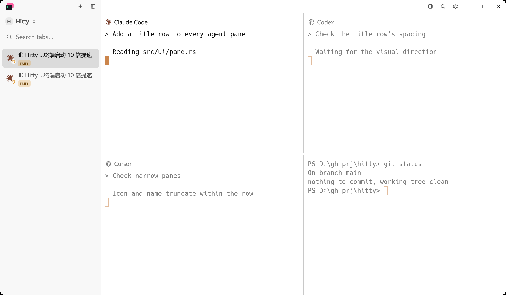
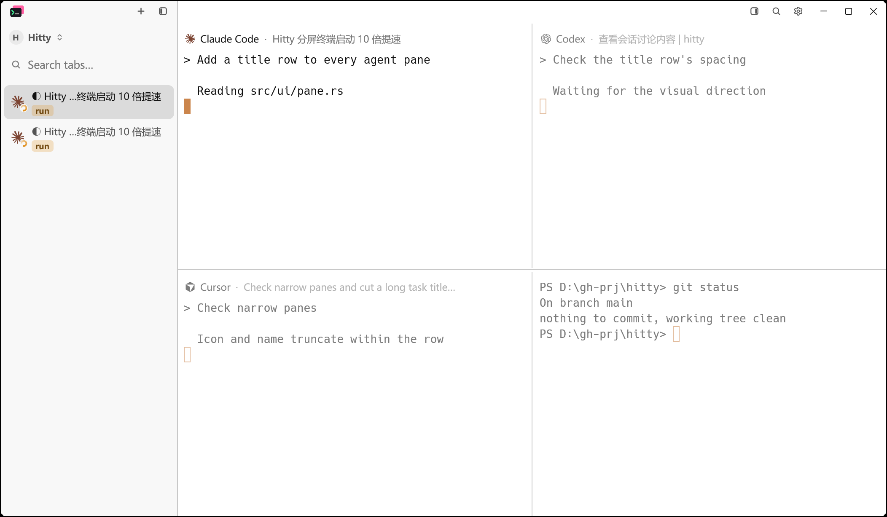
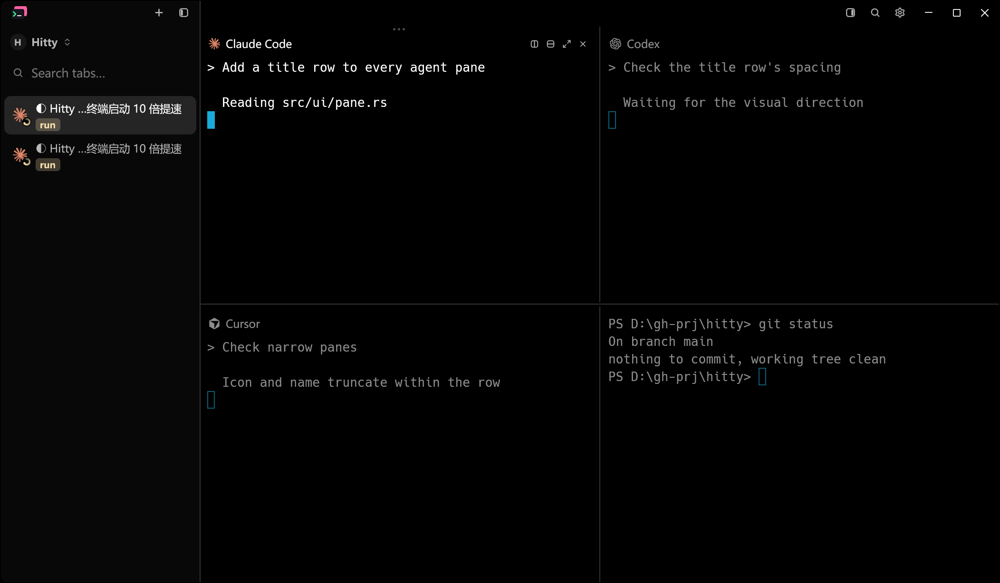
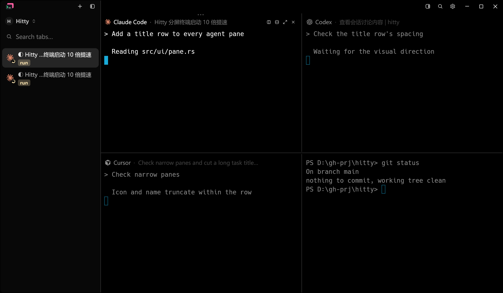
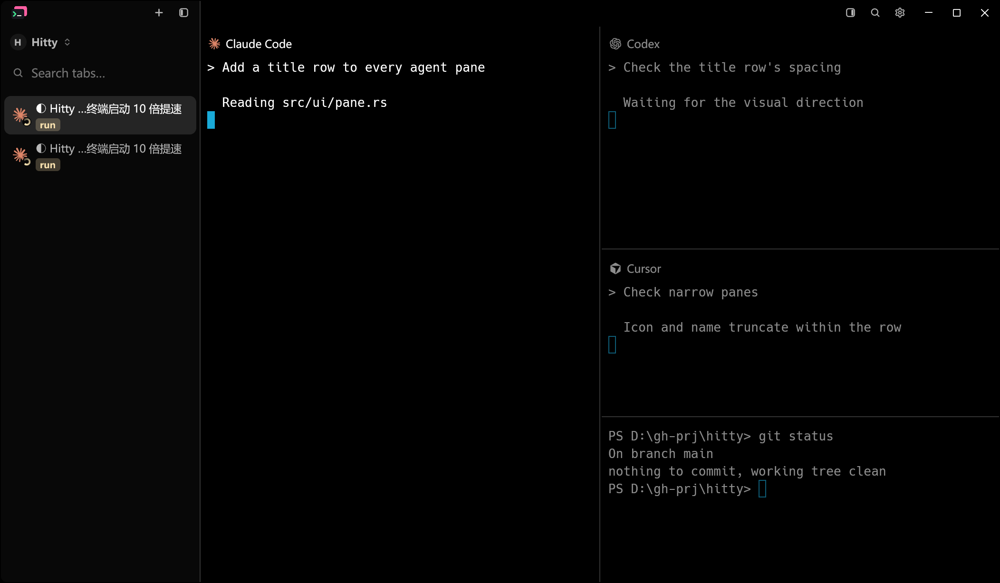
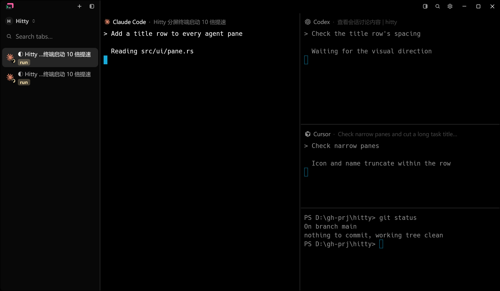
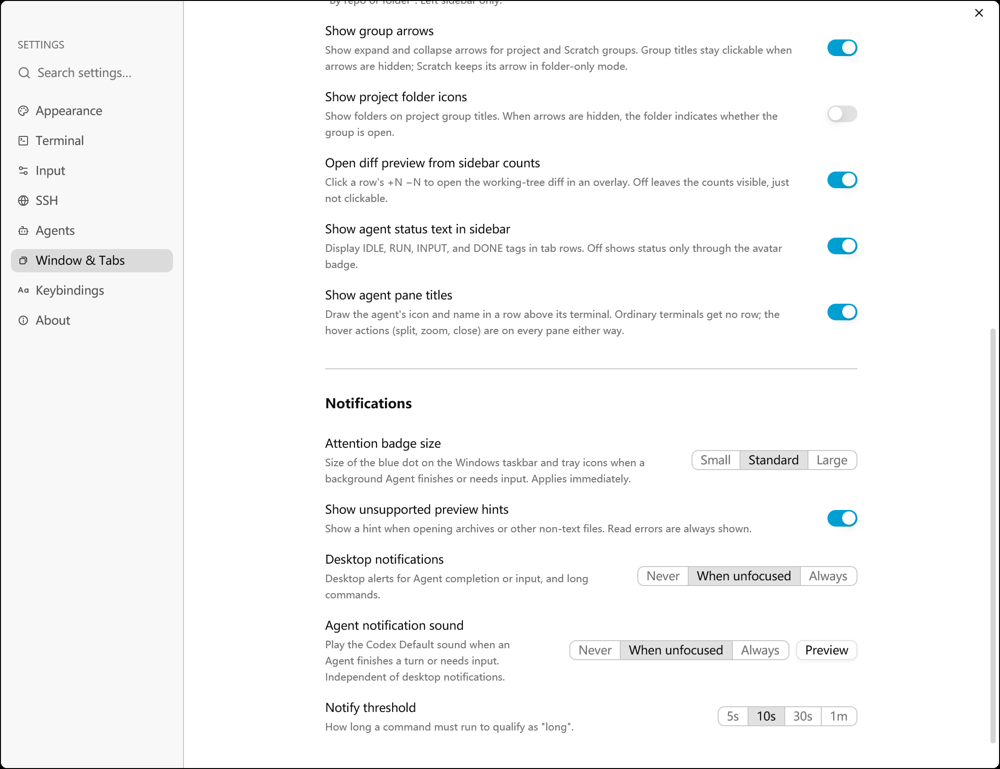
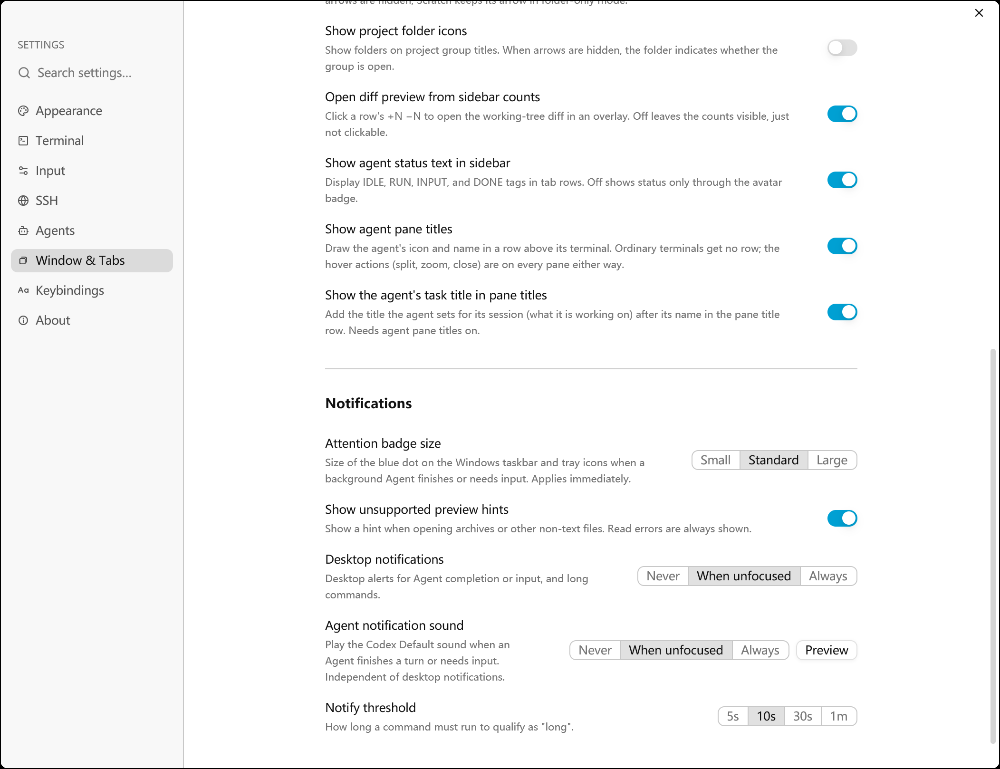

# Agent pane task titles

November 12, 2026. Baseline: `f36c167` (Hitty v0.3.1).

An agent titles its own pane with what it is working on: Claude Code and Codex
write a session title over OSC 0/2, behind a status mark. The sidebar already
names the session with it. A new setting, **Show the agent's task title in pane
titles**, adds that title after the agent's name in the agent pane title row.
It is off by default and needs **Show agent pane titles** on.

The row removes the leading status mark, so it does not change while the agent
works. It shows the name alone when the title is empty, is the agent's own
name, or is a shell path. A session the user has named keeps that name in the
sidebar; the row shows the pane's own title, so each agent pane of a split
shows its own task.

## Native evidence

Both stages render the production `HittyApp` from the same fixture: three agent
panes and one PowerShell pane, each agent pane titled with a task, 1200 × 700
logical window, 175% display scaling. The fixture sets the new setting as JSON,
which the baseline ignores. `scripts/capture-native-window.ps1` (PrintWindow)
captures each scene without moving the real pointer.

| Scene | Before | After |
| --- | --- | --- |
| Dark |  |  |
| Light |  |  |
| Hover toolbar |  |  |
| Narrow column |  |  |
| Settings |  |  |

The After stage was captured from this change applied to the baseline, before
it was committed, so both metadata files record the baseline revision.

## Reproduce

```powershell
python scripts/agent-pane-native-visual.py prepare-before <baseline-checkout>
cargo build --locked --features markdown-visual-tests   # in each checkout
python scripts/agent-pane-native-visual.py capture <baseline-exe> docs/testing/images/agent-pane-task-titles --phase before --repository <baseline-checkout> --scale 1.75 --only task-titles-dark task-titles-light task-titles-hover-dark task-titles-column-dark task-titles-settings-light
python scripts/agent-pane-native-visual.py capture <changed-exe> docs/testing/images/agent-pane-task-titles --phase after --scale 1.75 --only task-titles-dark task-titles-light task-titles-hover-dark task-titles-column-dark task-titles-settings-light
cargo fmt --all -- --check
cargo test --locked --workspace --features updater -- --test-threads=4
```

Build the two checkouts into separate target directories. Sharing one lets
Cargo reuse a workspace crate built from the other checkout.

## Validation

- `cargo fmt --all -- --check`: passed.
- Locked workspace and updater tests: 3,322 passed, 0 failed, 14 ignored.
- The ignored cases are the existing platform/manual tests.
- New unit tests cover the setting's default and round trip, and the title
  cleaning rules: status marks, the agent's own name, empty titles and paths.
- Both capture stages passed. Inspected: all five After images, and the
  Before images for the dark grid and Settings.

## Not covered

- The window-level tests in `src/ui/pane_title.rs` run on Unix only. None was
  added for the task title; Windows coverage is the unit tests and captures.
- No live agent was used. The fixture feeds the titles Claude Code and Codex
  write, as deterministic daemon messages.
