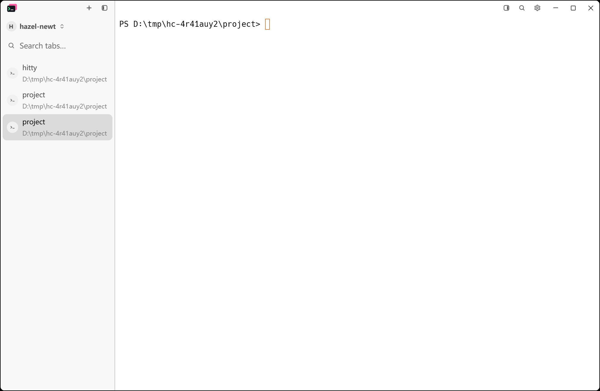
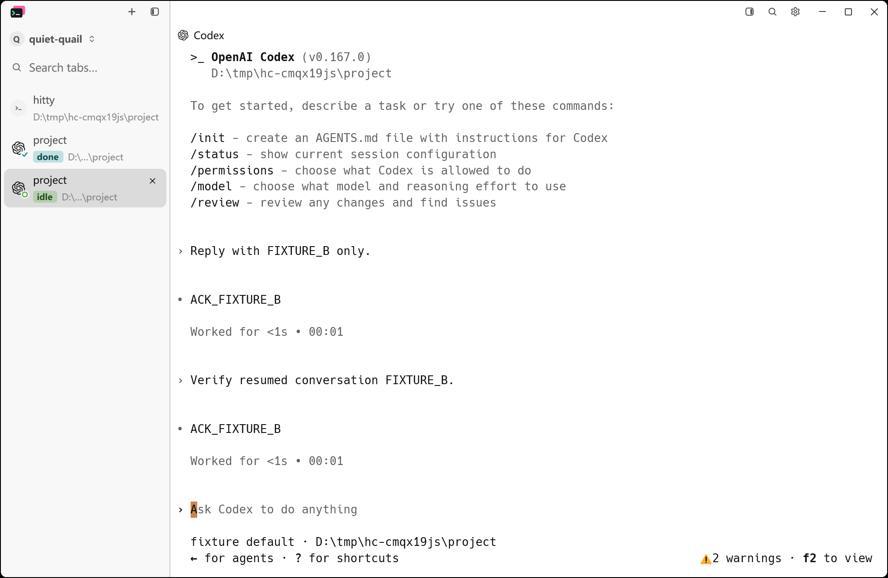

# Agent resume after Windows upgrade and restart

The reported failure is a fresh shell where Codex or Claude Code should have
resumed its original conversation. Multiple Codex clients in one directory are
the important case: a shared app-server inherits its first client's environment,
so its hook process and `HITTY_PANE` do not identify the client receiving input.

## Implementation

Local Codex hooks use verified process ownership. Hooks below a shared Codex
server keep using exact-session/unique-candidate routing and remain unresolved
when ownership is ambiguous. Hitty never selects the newest conversation file.

With `restore_agent_sessions` enabled, native Windows shell panes resolve
`codex`/`codex.exe` through a temporary native launcher. It passes the pane marker
as a session configuration override to the installed Codex. Codex 0.167.0 then
uses an embedded backend, making its hooks and open rollout attributable to that
pane. Directly configured Codex commands receive the same configuration before
their arguments. The installed executables and user Codex configuration are not
modified. Temporary launcher copies share their storage with other panes in the
same daemon, and are removed through the existing pane-integration cleanup.

The process scan treats this launcher as transparent, preserving the original
depth limit for the actual agent's launcher chain. The Windows monitor also
recognizes agents that have become idle before an output-triggered scan ran.
The existing machine store saves exact IDs while the agent is running; recovery
does not depend on reading an exit footer during shutdown.

PowerShell's npm `.ps1` entry point remains a PowerShell entry point, including
multiline arguments. Native argument boundaries, exit status, and batch caller
return behavior have a separate executable-level check.

Absolute paths typed inside a shell and aliases that bypass PATH bypass the
temporary launcher. These launches still use existing hooks, explicit-resume
tracking, and process probes. An ambiguous shared backend cannot be resolved by
directory alone; use a supported local `--no-daemon` invocation in that case.
Other host platforms and native SSH retain their existing launch behavior.

## Reproduce and verify

All checks use isolated application and agent data. The real Codex check uses
the installed CLI and a local mock Responses server, without paid model calls.
A short scratch directory avoids Codex's Windows Unix-socket path limit.

```powershell
cargo build --locked --workspace --bins --features updater --target-dir D:/tmp/hitty-agent-resume-build
python scripts/check-codex-launcher.py D:/tmp/hitty-agent-resume-build/debug/hitty.exe
python scripts/codex-resume-windows-acceptance.py --bin-dir D:/tmp/hitty-agent-resume-build/debug --output D:/tmp/resume-evidence --scratch-dir D:/tmp --shell powershell --abrupt
python scripts/agent-resume-update-acceptance.py D:/tmp/hitty-agent-resume-build/debug D:/tmp/hitty-0.3.1-windows-x86_64.zip D:/tmp/update-resume-evidence
```

The real check starts a private shared server, opens two conversations in the
same directory, waits for both exact IDs to reach `machine.json`, terminates
the isolated application/daemon tree, and launches Hitty twice. It then sends
a new turn through each restored client and checks both original IDs. This is
a process-loss simulation, not a physical Windows reboot.

The updater check uses two Codex fixtures and one Claude fixture in the same
directory. It replaces a portable installation using the real updater and a
private same-version package of the fixed build, then checks exact resume
arguments and a second restart before another hook. It verifies installation
and restoration after update selection/package preparation; it does not claim
to exercise release discovery or the update-dialog click.

## Evidence

Verification results and native PrintWindow captures are recorded under
[`images/agent-resume`](images/agent-resume). The same viewport and settings are
used for the baseline and fixed application.

The v0.3.1 baseline reproduced two missing IDs and restored shells. The private
updater check passed all three original IDs and the consecutive restart.
On 2026-11-12, the fixed Windows build passed the real Codex 0.167.0 check:
both original IDs were saved while running, survived two forced application and
daemon losses, and each restored client completed a new turn on the local mock
provider. The native launcher check also passed literal PowerShell arguments,
multiline script arguments, exit status, and return to a batch caller.

| Released v0.3.1 after restart | Fixed build after restart and a new turn |
| --- | --- |
|  |  |

The final locked workspace run completed with **3,325 passed, 0 failed and 14
ignored**, with no test filters. See the
[verification record](agent-resume-verification.json),
[build log](records/agent-resume-2026-11-12/final-build.log), and
[workspace test log](records/agent-resume-2026-11-12/verified-workspace-tests.log).
