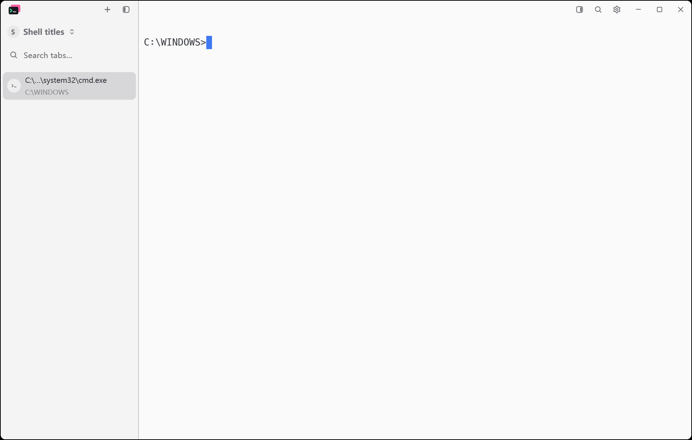
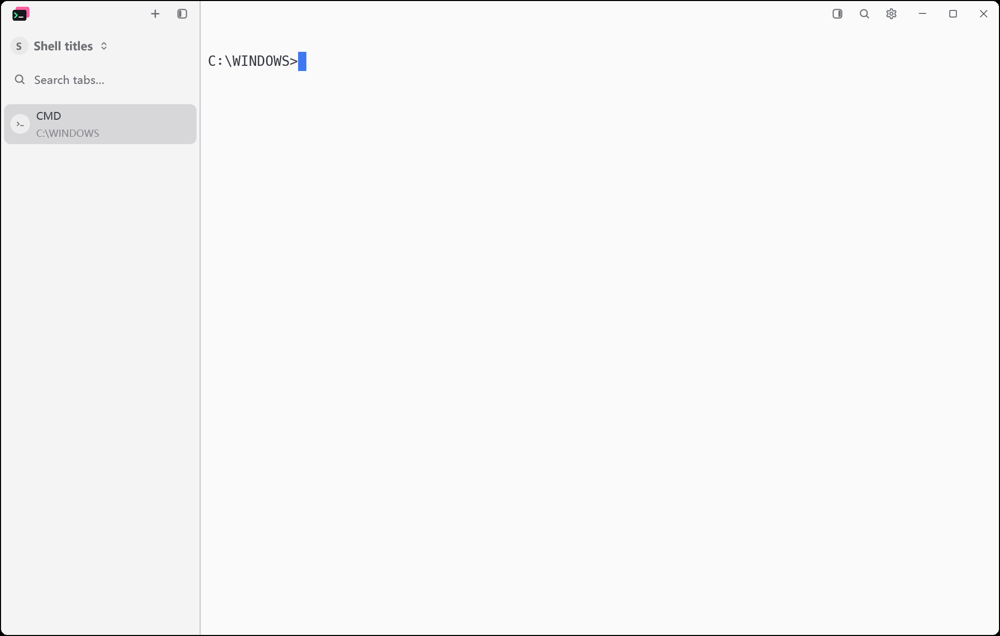
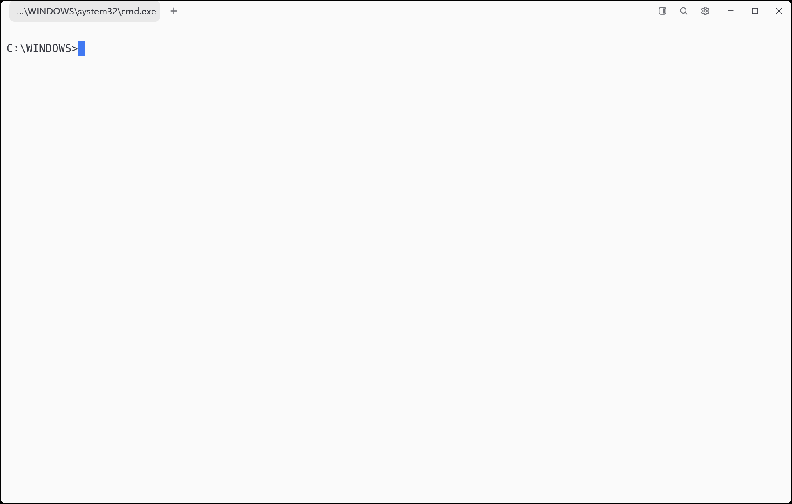
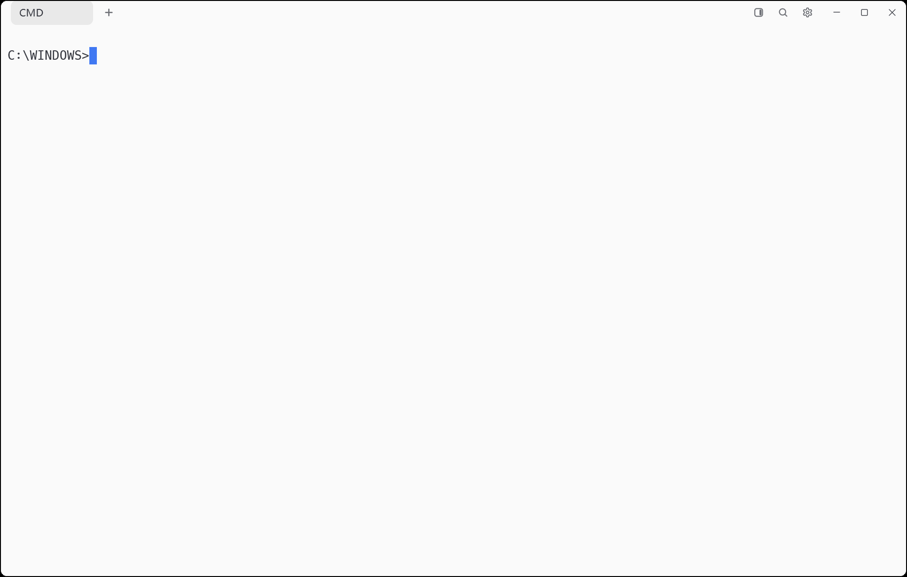

# CMD tab title

November 10, 2026. Baseline: `7802993` (Hitty v0.3.0).

CMD's default terminal title is its executable path. The sidebar, top tab bar,
switcher and CLI now display `CMD` for `cmd`, `cmd.exe`, or an absolute Windows
path ending in `cmd.exe`, ignoring case. The original terminal title remains
available in the tab tooltip. User-assigned tab names, task titles, working
directories and other shell names retain their existing behavior.

## Native evidence

Both stages launch the real application with separate temporary profiles,
the same CMD shell, `C:\WINDOWS` working directory, One Light theme, 1100 × 700
logical window and 175% display scaling. The existing PrintWindow script
captures both layouts without moving the real pointer. Capture metadata
records the binaries, preferences, startup CLI label and physical window size.

| Layout | Before | After |
| --- | --- | --- |
| Sidebar |  |  |
| Top tabs |  |  |

## Reproduce

Build the baseline and changed sources with their locked dependencies. Run
each stage against its corresponding binary directory:

```powershell
cargo build --locked --workspace --bins --features updater --target-dir D:/tmp/hitty-build
python scripts/cmd-tab-title-native.py --stage before --bin-dir <baseline-bin>
python scripts/cmd-tab-title-native.py --stage after --bin-dir D:/tmp/hitty-build/debug
cargo fmt --all -- --check
cargo test --locked --workspace --features updater --target-dir D:/tmp/hitty-build -- --test-threads=4
```

The native harness verifies the CLI's startup label and exercises `title` and
manual tab renaming. The After stage also checks bare executable names, case
and separator variants, PowerShell titles and command/task titles containing
the CMD executable name.

## Validation

- `cargo fmt --all -- --check`: passed.
- Locked workspace binaries with the updater feature: built successfully.
- Locked workspace and updater tests: 3,316 passed, 0 failed, 14 ignored.
- The ignored cases are the existing platform/manual tests.
- Both native capture stages passed; all four saved images were inspected.
