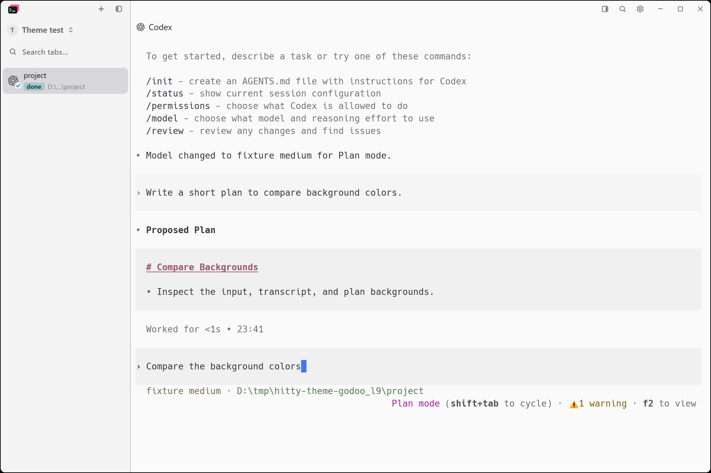
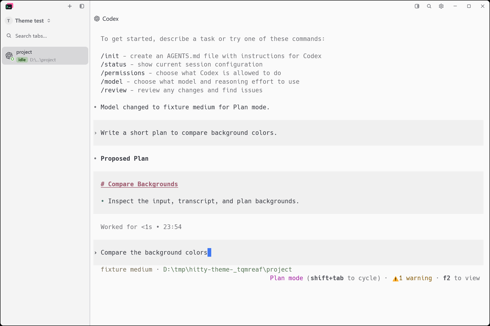
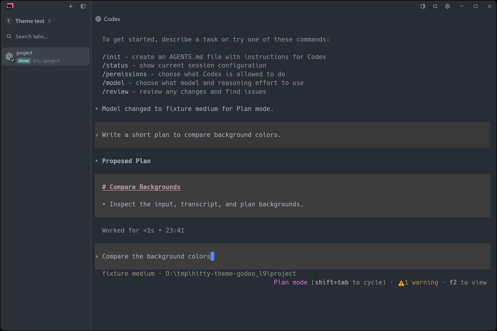
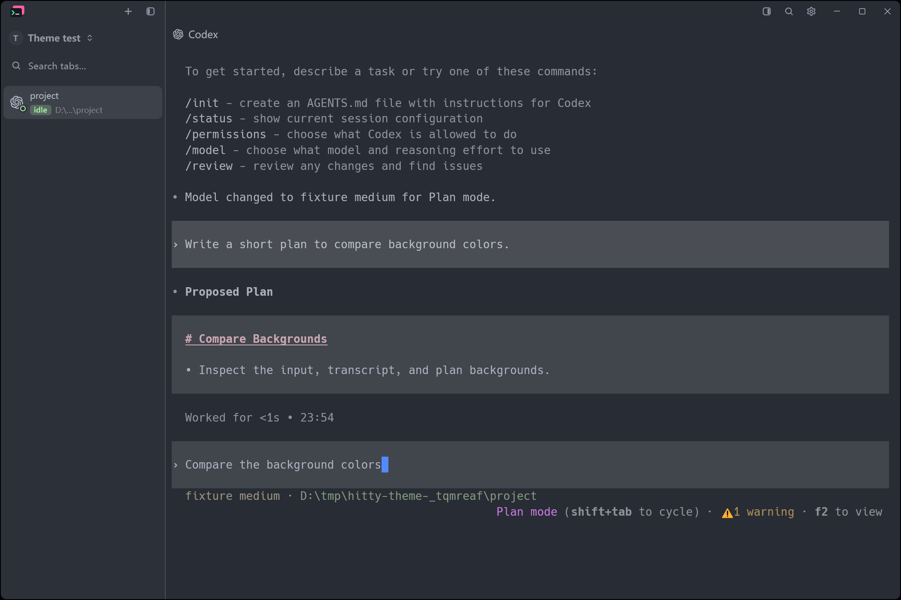
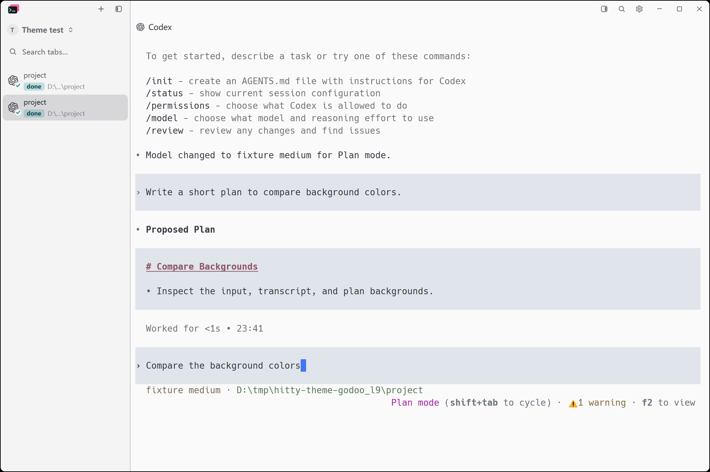
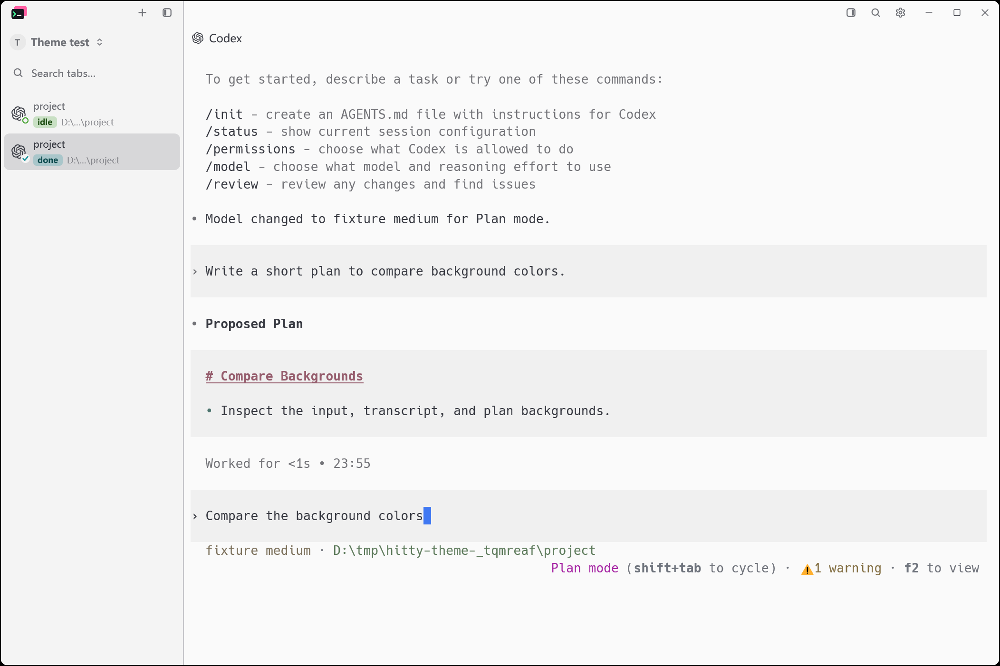

# Codex surfaces across theme changes

Verified on Windows on 2026-11-19 against Codex CLI 0.169.0. The Before build
is `c552bbe`; After is the revision containing this record.

Codex caches its OSC 11 terminal-background reply. Its composer and Proposed
Plan use a different blend from submitted prompts. Hitty now matches these
known truecolor fills against observed replies, restores native dark fills,
and uses the current composer's fill for all three surfaces in light themes.

## Measured results

Each cell lists **submitted prompt / plan and input**. These are sampled pixels
from the full native captures, not calculated target colors.

| Scene | Before | After |
| --- | --- | --- |
| Open in One Light | `#F5F5F5 / #F0F0F0` | `#F0F0F0 / #F0F0F0` |
| One Light to One Dark Pro | `#383838 / #3D3D3D` | `#4A4D54 / #41454C` |
| Fresh One Dark Pro session | `#4A4D54 / #41454C` | `#4A4D54 / #41454C` |
| One Dark Pro to One Light | `#E1E4EB / #E0E4EB` | `#F0F0F0 / #F0F0F0` |

Both One Light → One Dark Pro → One Light and One Dark Pro → One Light →
One Dark Pro restore byte-identical frames within each run. The fixture keeps
the submitted prompt, Proposed Plan, and unsent draft throughout the switches.
Fresh dark fills and the fresh light input fill preserve the baseline colors.

| Scene | Before | After |
| --- | --- | --- |
| Light history compared with the current input |  |  |
| Open session switched to One Dark Pro |  |  |
| Dark session switched to One Light |  |  |

All eight unique images were inspected; the four return images match the
corresponding initial images by SHA-256. [Capture records](images/agent-theme-switch/captures.json)
include all 12 files, their hashes, measured color bands, and binary hashes.
Local timestamps, temporary directory names, and asynchronous sidebar status
can differ between the Before and After runs.

## Reproduce

Use Python with Pillow, Codex CLI 0.169.0, and each Hitty binary directory with
its matching CLI, server, `conpty.dll`, and `OpenConsole.exe`.

```powershell
cargo build --locked --workspace --bins --features updater
python scripts/codex-theme-native.py --bin-dir <before-bin> --codex-bin <codex.exe> --output <before-images>
python scripts/codex-theme-native.py --bin-dir <after-bin> --codex-bin <codex.exe> --output <after-images> --assert-colors --baseline-dir <before-images>
```

The script launches isolated user data and a local Responses fixture, creates
real Codex plan/history/input surfaces, and switches `theme_preset` through
public `config.json` hot reload. It waits for the published appearance to
match the requested preset before capture. Settings selections also update
this configuration and call `apply_theme`; these captures automate hot reload,
not pointer clicks in Settings.

Both runs use One Light / One Dark Pro, 1200 × 800 logical size, Windows 175%
scale (2104 × 1402 captured frame), Hack 15, line height 1.4, and 14 px UI text.
Readable terminal colors are enabled; cursor blinking and inactive-pane dimming
are disabled. No `FORCE_COLOR` override is used. PrintWindow captures do not
move or include the real pointer.

## Regression checks

The native baseline reproduces the dark mismatch. Before light normalization,
`codex_surfaces_follow_the_theme_with_uniform_light_fills` failed on One Light
history `#F5F5F5` instead of the expected composer fill `#F0F0F0`.

```powershell
cargo fmt --all -- --check
cargo check --locked --workspace --all-targets --features updater
cargo test --locked --workspace --features updater -- --test-threads=4
python scripts/sync-agent-detection.py --check
python -m unittest discover -s scripts -p 'test_sync_agent_detection.py'
```

The locked workspace/updater suite passed: **3,343 tests passed, 14 ignored,
zero failures**. The four agent-manifest script tests also passed. Final
command outcomes and local log paths are recorded with the captures.
Regression coverage includes One Light / One Dark Pro and plain Light / Dark,
fresh and cached fills, readable foregrounds, literal mode, and current OSC 11
replies.

## Scope

Native visual acceptance covers Windows at 175% scale with Codex CLI 0.169.0.
Exact correction requires a detected Codex pane, truecolor output, readable
terminal colors, and background replies observed by the attached view. Indexed
colors and views without those replies retain generic correction. Explicit
colors do not identify their semantic purpose, so matching artwork colors
remain a limitation; literal mode bypasses the adapter. Terminal output bytes
and session data are unchanged.
