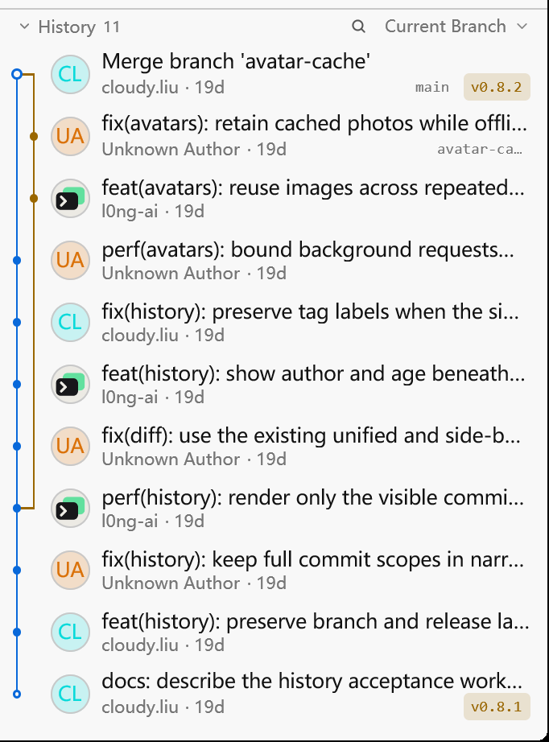
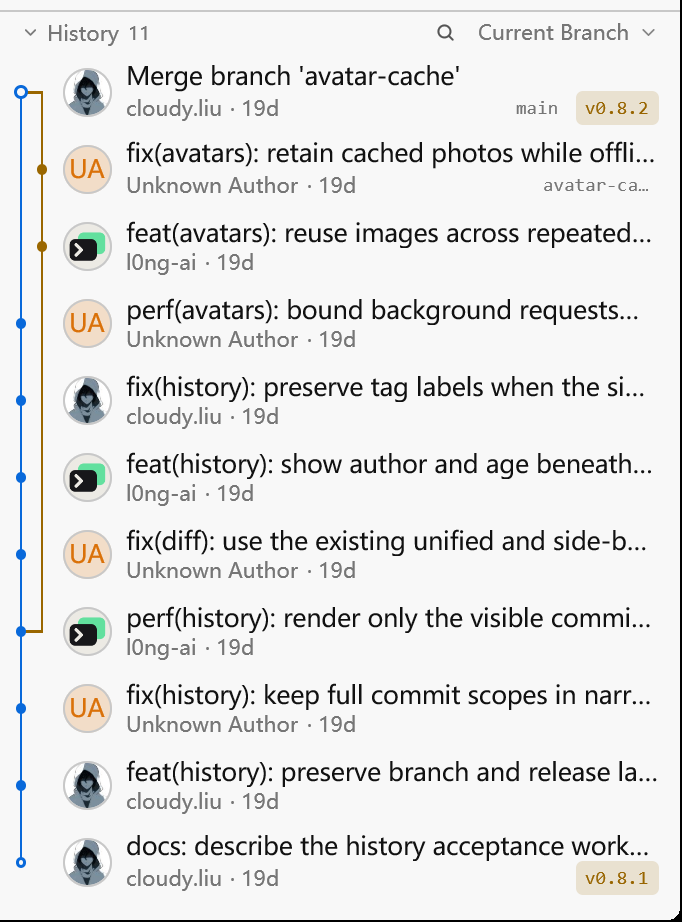

# Git History author avatars

## Reproduction and cause

On 2026-11-09, the ordinary author email in Hitty's recent commits returned
HTTP 404 from Gravatar. GitHub public commit search returned the same email,
linked to account `cloudy-liu` (ID `27288667`), whose avatar returned HTTP 200.
The previous resolver only consulted GitHub for noreply addresses, so the
ordinary email remained an initials avatar.

The fix keeps existing Gravatar photos and direct noreply lookups, and adds a
GitHub public commit lookup when an ordinary email has no usable Gravatar.
The returned commit email must match and its author must have a positive
numeric account ID. Unknown or unlinked authors keep initials. The generic
GitHub email-image endpoint is deliberately unused because unknown emails
also receive a default image with HTTP 200.

## Regression checks

The new regression was run before changing the implementation:

```text
cargo test --locked --bin hitty-app ordinary_email_loads_the_matching_github_author_photo -- --nocapture
Before: FAILED — an ordinary email with a matching GitHub author must show its photo
After:  passed in the avatar suite
```

```text
cargo test --locked --bin hitty-app ui::scm::avatars::tests -- --nocapture
6 passed; 0 failed
```

The full Windows validation also passed:

```text
cargo test --locked --workspace --features updater
3,290 passed; 0 failed; 13 ignored across the workspace

cargo build --locked --features markdown-visual-tests --bin hitty-app
passed
```

Coverage includes normalized ordinary emails, repeated authors, missing
records, unlinked accounts, mismatched emails, invalid IDs, API rate limits,
invalid JSON, unsafe images, offline disk reuse, and failed refresh backoff.
The existing 5,000-row cache check still reports zero requests for both warm
memory and warm disk caches, with peak concurrency of four.

## Native evidence

The Before executable was built from `2df4c0537193f6c9516ed708c06d62c06cc340d1`.
Both executables use the existing `--document-visual` History fixture and
`scripts/capture-native-window.ps1`, with separate empty config directories.
No author images were seeded in either cache.

The scene reuses `scripts/prepare-git-history-captures.py` with three authors:
`cloudy.liu` using the repository's ordinary author email, `Unknown Author`
using `unknown-avatar@hitty.example.invalid`, and the existing `l0ng-ai`
noreply fixture. The same eleven commits and README are used in both captures.

Capture settings: Windows, light appearance, 1200 × 800 logical viewport,
175% scale, 390-pixel History width and 530-pixel History height. Each capture
waits twelve seconds after fixture readiness. PrintWindow captures a
2104 × 1402 frame after a synthetic move to `1,1`; the real pointer is unchanged.

| Before | After |
| --- | --- |
|  |  |

These are identical crops of the actual native captures. The full application
images are [Before](images/git-avatars/before.png) and
[After](images/git-avatars/after.png). Unknown authors retain `UA` and the
noreply author's existing avatar remains visible. Capture settings, crop
bounds and PNG digests are recorded in
[captures.json](images/git-avatars/captures.json).

## Limits

The fallback uses unauthenticated public GitHub commit search and sends the
author email as its query. It cannot discover authors with no linked public
commit, and API or network failures retain initials or an existing cached
photo. The History menu's **Load Author Avatars** switch controls these requests.
