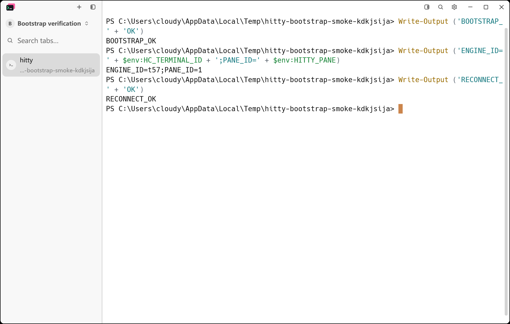

# Herdr-core pane engine: pre-PR review

Reviewed on 2026-11-10 against `origin/main`, pinned to
`7dd21b8f0be2307e7b8b93084f6535f53b052b86`. The initial implementation was
`54e6d8d439860ebd528141f29f25a7e155b4dc35`; its only feature commit was
`feat(daemon): add opt-in herdr-core pane engine`.

```sh
git diff 7dd21b8f0be2307e7b8b93084f6535f53b052b86...54e6d8d439860ebd528141f29f25a7e155b4dc35
```

Two reviewers ran in parallel with separate fresh contexts. Standards sources
were `AGENTS.md`, `GLOSSARY.md`, `CONTEXT.md`, contributor validation, provenance,
dependency-maintenance documentation, and the host-boundary rule. The spec was
[issue #23](https://github.com/cloudy-liu/hitty/issues/23); its historical tty7
names were interpreted using the current Hitty terminology.

## Standards

No hard violations of the documented repository standards were found.
Two **P3 judgement calls** remain as follow-up suggestions:

- **Possible Primitive Obsession:** `hc.rs` flattens structured RPC error kinds
  into text, then classifies loss with
  `text.contains("not_found") || text.contains("finished")`. Recovery decisions
  would be clearer if they matched an error-kind field directly.
- **Possible Duplicated Code:** the test-only `HcReader::new` repeats `Session`
  initialization, including channel binding, condition variables and lifecycle
  flags, and hardcodes cell dimensions. Reader/reconnection tests could use
  the production `Session::attach` constructor instead.

Neither suggestion is a documented-standard breach or a merge blocker.

## Spec

The initial review found three **P2 correctness issues**, all corrected in the
follow-up before submission:

- **Windows input ownership:** skipping `spawn_exit_monitor` for hc panes also
  disabled the only `AgentInputSuspended` poll. An external console editor
  launched by Claude/Codex therefore retained Agent key handling. This violated
  "界面、快捷键……与现在完全一致" and "Windows 的 winproc 祖先链查询继续按 pid 工作".
  The process monitor now polls both engines; only native panes use its exit
  reporter. A public-pane test observes the editor take and return input,
  including its silent return, after synchronizing on Agent detection.
- **Unix login shell:** converting a default-program builder to just its shell
  executable discarded portable-pty 0.8.1's login-shell argv0 behavior. Default
  zsh could skip `.zprofile` and `.zlogin`, violating "shell integration……全部不动".
  Default Unix builders now use `-l`; explicit argv is preserved. A Unix test
  asks Bash for its actual login mode without loading user startup files.
- **Windows exit status:** `.max(0)` converted negative statuses into success,
  violating "退出经 CLOSE 帧加 `finished` 事件拿 exit_code 与 reason" and "退出码正确".
  Both the close and recovery paths now preserve signed status bits. A real-hc
  public-pane regression verifies that `cmd` exit status `-1` stays `-1`.

The independent follow-up confirmed all three production fixes by inspection,
and confirmed that the editor regression waits for actual Agent recognition
before testing ownership transfer. The Standards follow-up found no new
documented-standard breaches or actionable smells in the fixes, fixtures,
CI change, or verification notes.
No additional confirmed findings concerned credit, fallback or shared-core
ownership. Replacing a dead shell remains outside this spike's `keep=false`
policy. Windows acceptance does not establish macOS/Linux runtime acceptance.

Standards: 2 P3 suggestions, 0 hard violations. Spec: 3 P2 findings corrected,
0 outstanding confirmed correctness findings.

## Verification

The original implementation passed the locked workspace/updater suite before
review. The new regressions exposed gaps in that existing coverage: `exit /b
-1` produced `Some(0)`, and disabling the hc ownership monitor timed out waiting
for `AgentInputSuspended(true)` even after Agent recognition.

The CI Test step now uses `--workspace`, so core and server regression tests,
including the Unix login-shell probe, run on the existing platform matrix.
No dependency revisions or CI action versions changed.

The earlier real-agent, IME, Cmder, latency and isolated-core evidence remains
in [Windows spike acceptance](herdr-pane-engine.md). The new editor fixture is
a deterministic local process tree; it does not call an external Agent service.

Two full-concurrency attempts had transient failures: the unchanged Markdown
preview image-budget test reported `SendError` when releasing its ten-second
image gate, and the optional Cmder case timed out waiting for
`CMDER_TEST_INITIALIZED`. Both passed unchanged in isolated reruns (2.65 s and
4.01 s respectively). The final workspace rerun limits test concurrency to
four threads. The failed attempts and isolated retries are retained alongside
the final logs; passing retries do not establish that these races are fixed.

The final Windows command passed with `CARGO_INCREMENTAL=0`, Git for Windows'
`usr/bin` on PATH, and `HITTY_TEST_CMDER_ROOT` set to the installed Cmder runtime:

```powershell
cargo test --locked --workspace --features updater -- --test-threads=4
```

| Suite | Result |
| --- | --- |
| Application | 1,861 passed; 7 ignored |
| CLI unit tests | 138 passed |
| Core | 1,252 passed; 5 ignored |
| Updater | 32 passed; 1 ignored |
| Herdr engine | 10 passed, including Cmder; latency measurement ignored |
| Remaining CLI/server integration suites and doc tests | Passed |

The Unix login-shell regression is platform-gated and was not executed on this
Windows machine. CI provides the cross-platform check; this record does not
claim real-hc runtime acceptance on macOS or Linux.

Formatting, `git diff --check`, the locked all-target workspace/updater check,
and the locked workspace build passed. The first final build could not replace
a binary held by an earlier manual-profile daemon; detaching that daemon
released the file, and the unchanged build passed.

```powershell
cargo fmt --all -- --check
cargo check --locked --workspace --all-targets --features updater
cargo build --locked --workspace
python scripts/bootstrap-native-smoke.py target/debug/hitty-app.exe target/debug/hitty.exe target/herdr-review/gui --phase after --reconnect --pane-engine herdr-core --hc-bin "$env:LOCALAPPDATA/Programs/herdr-core/hc.exe"
```

The rebuilt GUI passed `send`, `capture`, `wait --until free`, engine identity,
and GUI restart: pane `%1` retained hc terminal `t57`. The smoke removed its own
terminal during cleanup. The shared core and holder retained PIDs 34464/24004
and their original creation times. The PrintWindow image was inspected and
contains no pointer; [metadata](herdr-pane-engine-review-windows.json) records
the isolated profile and 1100 x 700 logical-pixel viewport.



Small logs and metadata from `target/herdr-review/` and the earlier acceptance
are archived outside the temporary worktree at
`D:/tmp/hitty-herdr-pr-review-20261110/`. Build artifacts and application
profiles are excluded from that verification archive.

## PR CI follow-up

PR #30 at `f0632cf0d87e10d5a3ffe14be2933580dbf76e54` had two independent
Intel macOS failures on November 10, 2026 (Asia/Shanghai):

- CI run `42655833478`, job `129293943711`, built successfully but failed
  `selected_commit_shows_message_details_above_the_existing_diff` at its
  final `focus.is_none()` assertion. This unchanged test had also failed on
  the imported source baseline, as recorded in the
  [archived bootstrap verification](https://github.com/cloudy-liu/hitty/blob/0a9dedcd5e2aab59f4c72b259b873620348318c7/docs/testing/hitty-bootstrap.md#cross-platform-ci).
- Release run `42655833344`, job `129296730746`, compiled and created the
  macOS ZIP and DMG, then artifact upload failed with
  `Failed to CreateArtifact: Unable to make request: ENOTFOUND`.

The UI fixture opened a commit on the real local host, which dispatched a
background Git probe, then injected its own synthetic diff. Completing that
probe between measuring the breadcrumb and clicking it replaced the fixture
with `NotARepo` and removed the clickable breadcrumb. Ordinary Windows runs
passed 1,000 scheduler seeds; a temporary gate on the real worker reproduced
the exact CI assertion in four consecutive runs (0.04-0.06 seconds each).
Removing the message expansion and scrolling still reproduced the failure.

The fixture now uses an unregistered host and asserts that opening the commit
starts no live Git probe. It retains every original message, scrolling,
clipboard and back-to-all-files assertion. The full original scenario passed
four consecutive runs with the same temporary timing gate after this change.
All timing instrumentation was then removed; application behavior is unchanged.

```text
Before (controlled real probe completion):
  breadcrumb present: false
  assertion failed: overlay.focus.is_none()
  0 passed; 1 failed
After (isolated fixture, same timing gate):
  breadcrumb present: true
  1 passed; 0 failed
```

Final local validation passed:

```powershell
cargo fmt --all -- --check
git diff --check
$env:ITERATIONS = '1000'
cargo test --locked --features updater --bin hitty-app ui::scm::graph::tests::selected_commit_shows_message_details_above_the_existing_diff -- --exact --nocapture
$env:ITERATIONS = '1'
cargo test --locked --features updater --bin hitty-app ui::scm::graph::
```

The isolated test passed all 1,000 scheduler seeds, and all 19 graph tests
passed. Reproduction patches and failed/passing logs are archived under
`D:/tmp/hitty-herdr-pr-review-20261110/ci-followup/`. No dependency, action
version, test exclusion or retry policy changed. Remote checks for this
follow-up are tracked in the PR; local success alone does not establish the
Intel runner result.
