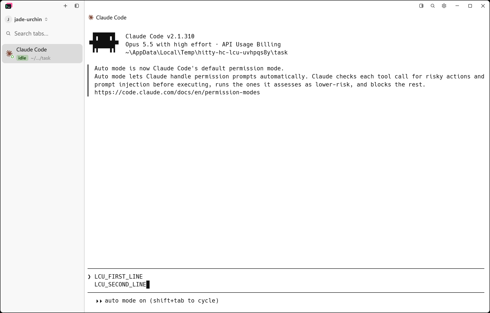
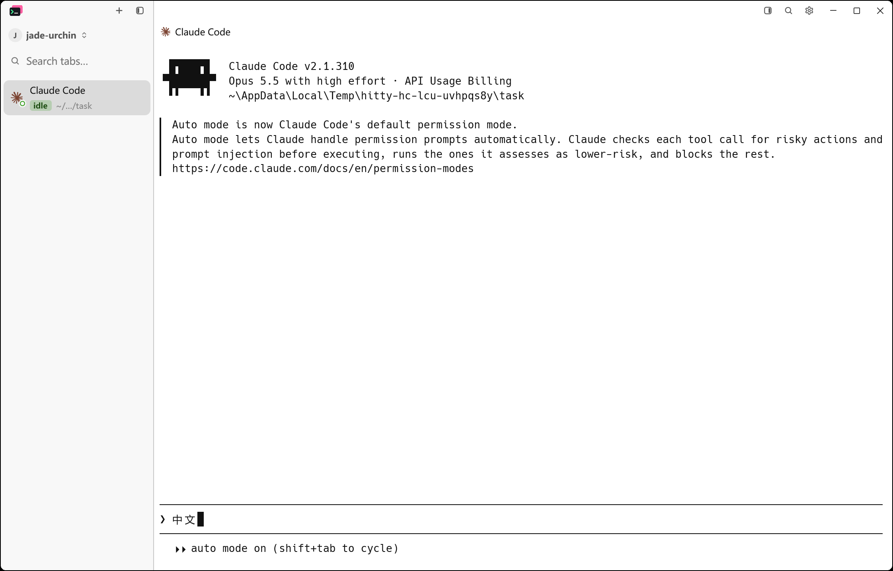
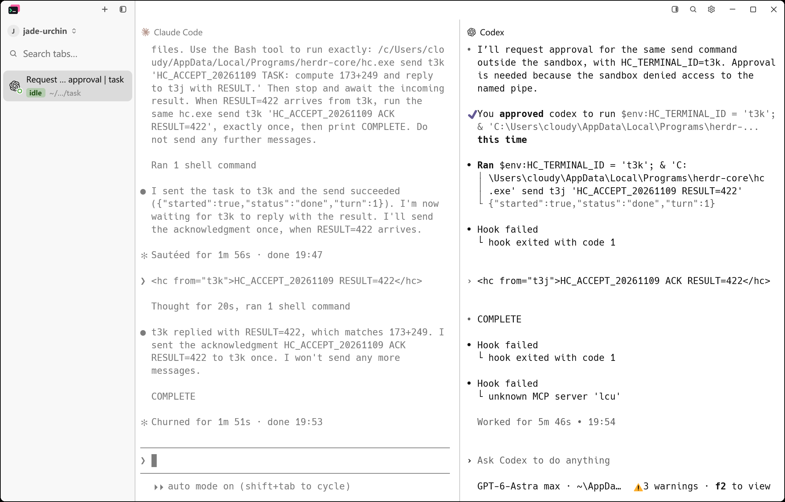
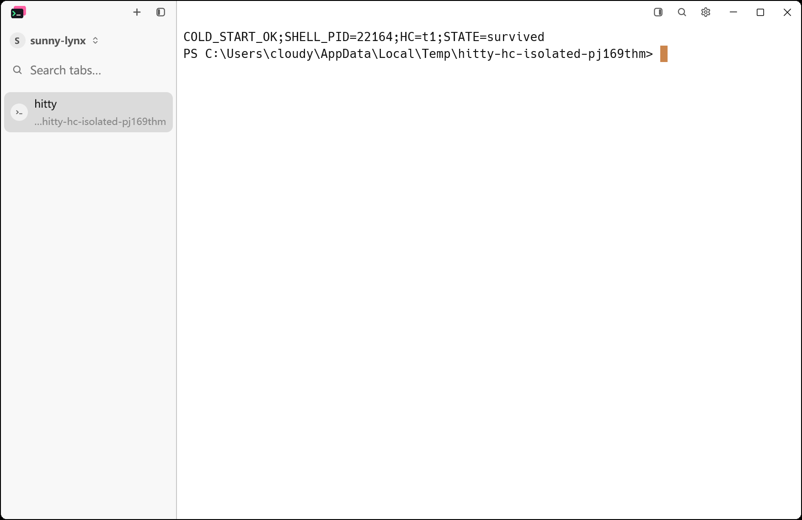
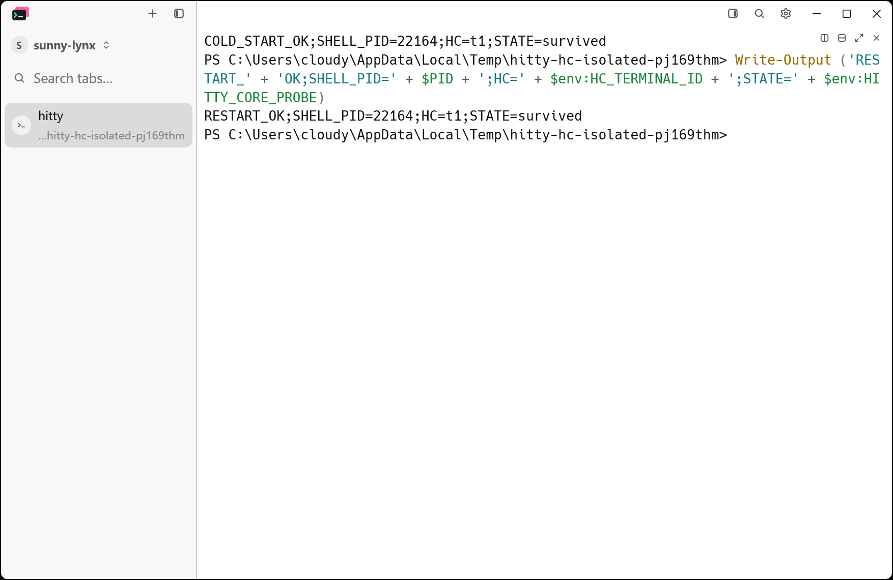

# Herdr-core pane engine spike — verification

Issue: cloudy-liu/hitty#23. Verified on **2026-11-09**, Windows, with installed
`hc 0.1.15` and Hitty debug builds. Native remains the default. The spike is
implemented locally. The Windows spike acceptance checklist passed, including
actual Claude Code editing, native Chinese IME composition, a Claude/Codex
message roundtrip, and an isolated real-core cold start/restart. The Codex
sandbox approval and temporary-file cleanup limits are recorded below.

## Selection and scope

Set `"pane_engine": "herdr-core"` in the profile's `config.json`, or set
`HITTY_PANE_ENGINE=herdr-core` in the daemon's environment. `native` selects the
existing engine; the environment takes precedence. Changes apply to newly
spawned local panes. SSH and other remote backends retain their existing paths.

`HITTY_HC_BIN` can select an executable. Otherwise discovery tries PATH and
standard install locations. The executable must identify itself as `hc`, and
hello must advertise generation 1, version >= 0.1.15, framed mode, and the seven
required terminal/lifecycle methods. Unavailable or incompatible cores produce
a diagnostic and fall back to the native engine. Hitty does not install or
upgrade hc.

Production connections use the default core: inherited `HC_SESSION` and
`HC_TERMINAL_ID` are removed from the transport and pane environment overlay.
The core supplies the new terminal's identity. Each terminal has
`hitty.owner=<profile hash>`, `hitty.pane=%<id>`, and, when present,
`hitty.ws=<workspace id>`. New terminals use `no_parent`, `no_notify`, and
`keep=false`. Tests operate only on terminals they create and never stop,
restart, update, or reconfigure the user's hc core. The cold-start/restart
acceptance below uses a test-only executable shim and a separate named session.

## Implemented behavior

- The same prepared command supplies argv, cwd, environment, shell integration,
  locale handling, and agent hooks to either engine. Both `HITTY_PANE` and
  `HC_TERMINAL_ID` are available inside an hc pane.
- `hc connect` switches from a hello line to 9-byte framed headers. Channel 0
  carries RPC; terminal channels carry input, output, credit, resize, focus, and
  display facts. Early output and split event lines are handled.
- An atomic event snapshot plus ordered lifecycle events tracks terminals,
  foreground facts, label membership, and exit codes. Missed-event snapshots
  replace the view; stale events cannot overwrite newer state.
- Daemon shutdown detaches hc panes. Startup restores the same terminal and
  pane ID before serving pane requests. Screen replay and the running shell's
  environment survive. Explicit close kills and removes only the owned terminal;
  a normal shell exit also cleans up its record.
- Windows descendant cleanup excludes hc processes and their terminal subtrees,
  including a custom `HITTY_HC_BIN` executable. This applies to normal shutdown,
  stale-daemon recovery, and native-pane close. An hc ancestor above Hitty does
  not exempt Hitty's own native children from cleanup.
- A lost transport reconnects and takes a fresh event snapshot. All reader,
  writer, resize, focus, and display handles follow the new channel. A lost
  terminal record waits for its restarted lifecycle facts before reattachment;
  attempts are bounded to 60 seconds.
- Foreground/background/cursor colors are cached from the existing GUI theme;
  attach and resize supply those colors and cell dimensions to hc.

## Automated and application checks

| Check | Result |
| --- | --- |
| Framing, early bytes, credit, compatibility, exit code | Passed using pipe peers and a standalone fake-hc process |
| Events: snapshot, split lines, labels entering/leaving, stale updates, lost/restarted/finished/removed | Passed |
| Reattachment sends subsequent input/focus/display/resize through the new channel | Passed with fake transport loss |
| Windows cleanup protects hc subtrees, including reused parent PIDs, while reaping native children | Passed; 25 process tests include three hc ownership cases |
| Broken hc transport during integration-test cleanup | Passed; RPC returns an error and cleanup does not panic again |
| Missing hc, unrelated executable, newer generation, older version, missing methods | Native fallback remained interactive |
| Real hc: identities, two panes, resize, preserve/recover, same PID and pane ID, replay and shell variable, close, natural exit | Passed in isolated profiles |
| Real `hc send` in both directions, with sender identity in `<hc>` messages | Passed using two deterministic PowerShell peers reporting OSC 7501 idle |
| Real `hc wait --children all` inside a pane | Passed; inherited caller found its child and exit code 9 |
| Windows win32-input-mode and Shift+Enter | Passed through real hc/ConPTY into `Console.ReadKey`: Return, Shift modifier, CR |
| Chinese text transport | Passed through real hc/ConPTY into `Console.ReadLine` and back |
| Native GUI text entry and Enter | Passed: `echo CUA中文` produced `CUA中文` |
| Cmder startup and Up+Enter history | Passed with a copy of installed Cmder's vendor files and an isolated config/history |
| Actual GUI, public `hitty send`, `capture`, `wait --until free` | Passed |
| GUI restart reuses the same workspace, pane ID and hc terminal | Passed |
| Claude Code 2.1.310: Shift+Enter in its actual editor | Passed through LCU; two-line draft stayed unsubmitted |
| Native Chinese IME in Claude Code | Passed through LCU key events: composition, candidate window, Space selection, committed text |
| Claude Code and Codex exchanging a task, result, and ACK | Passed; both printed COMPLETE, with one explicit Codex command approval for named-pipe access |
| Windows cold start with no core in the test session | Passed; Hitty's `hc connect` started the core and its holder |
| Real core restart while Hitty stays open | Passed; same holder, shell PID, terminal, pane, environment, and continued LCU input |

Reproduction commands, from the worktree root:

```powershell
$env:CARGO_INCREMENTAL = "0"
cargo test --locked --workspace
cargo test --locked --features updater --bin hitty-updater
cargo build --locked --workspace
cargo fmt --all -- --check
git diff --check

cargo test --locked -p hitty-core --lib daemon::hc::tests -- --nocapture
cargo test --locked -p hitty-server --test herdr_engine -- --nocapture
python scripts/bootstrap-native-smoke.py target/debug/hitty-app.exe target/debug/hitty.exe target/herdr-verification/gui --phase after --no-capture --reconnect --pane-engine herdr-core --hc-bin "$env:LOCALAPPDATA/Programs/herdr-core/hc.exe"
```

The fake executable is built from `tests/fixtures/fake_hc.rs` with the installed
Rust compiler and needs no hc installation. Real-core tests skip when no hc is
installed. The measured latency test is ignored by default and runs explicitly.

Cmder acceptance is opt-in because it needs an existing installation:

```powershell
$env:HITTY_TEST_CMDER_ROOT = "D:/tools/cmder_full/cmder"
cargo test --locked -p hitty-server --test herdr_engine real_hc_starts_cmder_with_isolated_history -- --nocapture
```

The final workspace run passed (app: 1,861 tests; CLI: 138; core: 1,252, plus
server integration suites). The herdr integration suite passed 8 tests with
the latency measurement ignored; `HITTY_TEST_CMDER_ROOT` was set so the optional
Cmder case ran. Updater passed 32 tests. The reconnect case includes event
re-subscription with reset sequence numbers. Existing ignored and platform-gated
tests retain their gates. Windows input observations are recorded in
[the acceptance record](herdr-pane-engine-windows.json).
The final locked workspace build, formatting check, and `git diff --check`
also passed. The final suite logs are `target/herdr-verification/final-*.log`.
The rebuilt GUI passed the public CLI and GUI-restart smoke again; metadata and
terminal captures are in `target/herdr-verification/gui-reaping-final/`. That
run reused hc terminal `t3h`, then removed it during profile-scoped cleanup.
No Hitty test terminals or test daemons remained after the final checks.

One full build attempt ran out of C: disk space while writing Cargo's query
cache. Cleaning only this worktree's `hitty` and `hitty-core` build artifacts
freed 8.1 GiB. The successful verification used `CARGO_INCREMENTAL=0` afterward.

Local logs and GUI metadata are under `target/herdr-verification/`. The GUI smoke
reads full `hc get` records after `hc ls`, whose compact rows omit labels;
its cleanup verifies the exact temporary profile owner before kill/remove.
An earlier cleanup-test failure was a test ordering error: the pane protocol's
Kill request has no acknowledgement, so a subsequent Shutdown on another
connection is not a barrier. Tests wait for terminal removal before shutdown.

A later parallel run hit `BrokenPipe`; a second panic during test cleanup caused
`STATUS_STACK_BUFFER_OVERRUN`. The existing descendant reaper could reach shared
hc processes, so those subtrees are now excluded. Process-tree tests cover this
ownership boundary without stopping the user's core. The initial exclusion also
protected native children when Hitty itself had an hc ancestor; a regression test
first reproduced that error and then passed after restricting protection to hc
descendants of the cleanup root. A separate fake-process test reproduced the
cleanup panic before the RPC helper was changed to return errors. Real-core
integration passed sequentially and then with normal test parallelism, including
the optional Cmder case. Two finished terminal records left by the earlier
aborted messaging test were removed only after verifying their temporary profile,
owner hash, and peer-script contents. The pre-existing hc process IDs and start
times remained unchanged during this verification.

## Key-echo measurement

Command:

```powershell
cargo test --locked -p hitty-server --test herdr_engine measure_native_and_herdr_key_echo_latency -- --ignored --nocapture
```

Same machine, debug daemon, CMD, 120 × 30 cells, 8 × 16 cell size; 10 warmup
keystrokes followed by 100 sequential `~` echoes per engine. Timing starts at
the public pane client's input write and ends when its output contains the
echo. Neither engine silently fell back. The measurement isolates the terminal
transport; it does not include physical keyboard dispatch or GPU presentation.

| Engine | Median (ms) | p95 (ms) | Maximum (ms) |
| --- | ---: | ---: | ---: |
| native | 0.1792 | 0.2426 | 0.3699 |
| herdr-core | 0.3748 | 0.5108 | 0.6697 |

The additional median cost was **0.1956 ms**, with p95 adding **0.2682 ms** in
this run. This is evidence for transport overhead, not a general perceptual
latency guarantee.

## Actual Windows application acceptance

LCU drove the rebuilt Hitty window with an isolated profile, PowerShell
`-NoLogo -NoProfile`, and Claude Code 2.1.310. The window was 1280 × 820 logical
pixels at 175% display scale. Existing provider credentials were used through
an isolated Claude configuration; no credentials are included in this record.

In Claude's actual editor, LCU typed `LCU_FIRST_LINE`, pressed Shift+Enter,
and typed `LCU_SECOND_LINE`. Both lines remained in a single unsubmitted draft.



After clearing the draft, LCU switched to an installed Chinese input method
with Ctrl+Shift and sent individual `z h o n g w e n` key events. The underlined
`zhong'wen` composition and candidate popup appeared beside the input caret;
the first candidate was `中文`. Space committed `中文` into Claude's editor.
This exercises the native IME, not merely Unicode paste. The candidate popup
was observed in LCU; the durable PrintWindow image below records committed text.
The draft was cleared and the original input-method selection restored.



### Two real agent harnesses

The same window was split horizontally. Claude Code 2.1.310 ran in pane `%1`
(`t3j`), and interactive Codex CLI 0.167.0 ran in pane `%2` (`t3k`). Both used
the installed provider/model settings and only a fixed arithmetic test in a
temporary directory. `hc get` confirmed both terminals' profile owner, pane,
workspace, and Agent status; no deterministic responder substituted for either
Agent.

LCU entered the test instructions. Claude executed `hc send t3k` with
`HC_ACCEPT_20261109 TASK: compute 173+249 and reply to t3j with RESULT.`
Codex received the task with `<hc from="t3j">`, calculated 422, and executed
`hc send t3j 'HC_ACCEPT_20261109 RESULT=422'`. Claude received the result with
`<hc from="t3k">` and sent `HC_ACCEPT_20261109 ACK RESULT=422` back once.
Codex received that ACK, and **both real harnesses printed COMPLETE**.

Codex's initial `workspace-write` sandbox denied named-pipe access. After
inspecting its command-approval dialog through LCU, the single `hc send`
command was approved outside the sandbox, with the existing terminal identity
preserved. No persistent permission rule was added. Thus this proves real
cross-harness communication with that command approval, not unrestricted
communication from inside the Windows sandbox. An initial approval request
was canceled while a test instruction was arriving; the approved retry is the
one that delivered the result.

The inherited Codex hooks also emitted errors (including an unavailable `lcu`
MCP server, disabled for this test). These warnings remained visible and did
not prevent the roundtrip. The test did not change the user's hook settings.
Public CLI captures and full terminal facts are saved locally as
`target/herdr-verification/lcu-real-agent-{claude,codex}.txt` and
`lcu-real-agent-facts.json`.



### Isolated cold start and real core restart

The test session was `hitty-accept-164a6a7ed389`. Before opening Hitty,
`hc server status` scoped to that session returned `unavailable` (exit 5).
A temporary Rust executable selected that session through `HC_SESSION` and
forwarded arguments and stdio unchanged to installed hc 0.1.15. Only the
isolated Hitty profile used this shim through `HITTY_HC_BIN`; no production
session-selection behavior was changed.

Opening the GUI caused its normal `hc connect` path to start core PID 33732
and holder PID 31816. The holder's named pipe included the exact unique session
name. Its only terminal was `t1`, owned by the test profile, with shell PID
22164 and pane `%1`. The default core remained PID 34464 with holder 24004.

After setting a shell environment marker, the test checked session identity,
both core PIDs, and terminal ownership, then ran `hc server restart` **only in
the test session**. Core PID changed to 22076; holder PID 31816 and shell PID
22164 stayed unchanged. Hitty remained open. LCU entered the post-restart
command, which printed the same terminal identity and `STATE=survived`.
Public `hitty capture` and `hc get` independently confirmed those results.

These captures use the same 1000 × 650 logical-pixel window at 175% scale:





Local metadata and terminal text are in
`target/herdr-verification/isolated-core.json` and `isolated-{before,after}.txt`.
This verifies installed-version cold start and restart. Replacing the core
binary with another version was not attempted, and macOS/Linux runtime
acceptance was not exercised. No appearance change is intended; issue #23
has no screenshot gate, and these images provide additional execution evidence.

### Cleanup and shared-core check

Both test windows were closed through LCU. Closing the isolated-core window
preserved its shell until explicit test cleanup. The two profile-specific Hitty
daemons were stopped, owned terminals `t3j`/`t3k` and isolated `t1` were killed
and removed after checking their full owner labels and cwd, and the isolated
test core was stopped. Process IDs and creation times confirmed that the test
shells and their Agent descendants had exited.

The user's default core PID 34464 and holder PID 24004 still had their original
2026-11-09 15:51:46 Asia/Shanghai creation times, with only the original four
terminals remaining. Local cleanup evidence is in
`target/herdr-verification/lcu-cleanup.json`.

Temporary file deletion is **incomplete**: automatic approval rejected both
recursive profile cleanup and a narrower request to delete the specific
credential files, returning `blocked by policy`. No alternate deletion method
was attempted. The local temporary profiles `hitty-hc-lcu-uvhpqs8y` and
`hitty-hc-isolated-pj169thm` remain under the user's Temp directory. The former
contains the isolated Claude credential configuration and must be removed
locally; none of these files is tracked or included in the evidence images.

## Spike limits

Display colors are cached per profile, not per window, and refreshed on attach
or resize; a theme-only change is not a new wire-protocol event. Agent status
still comes from Hitty hooks and screen detection, with no OSC 7501 migration.
`keep=false` does not restart a shell whose program has died. There is no
installer bundling, settings UI, remote hc backend, or multi-viewer arbitration.

No dependency versions, pinned Git revisions, or CI action versions changed.
The only dependency-list addition is the already-locked `serde_json` for tests.
Source attribution is recorded in [provenance](../provenance/herdr-pane-engine.md).
