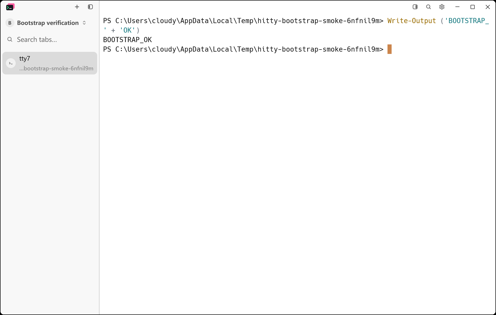
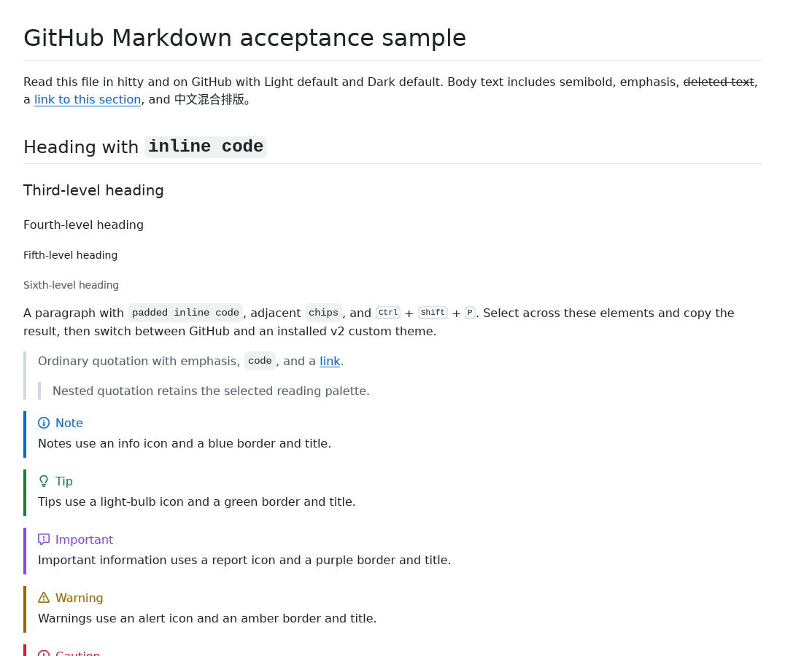
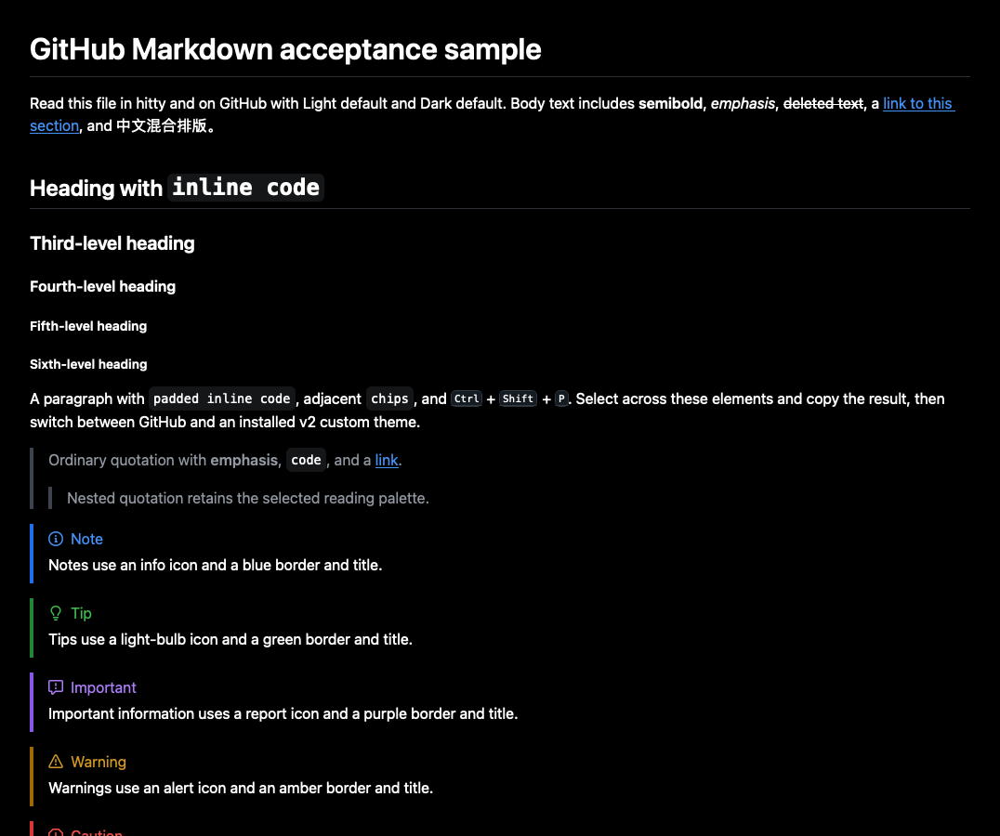
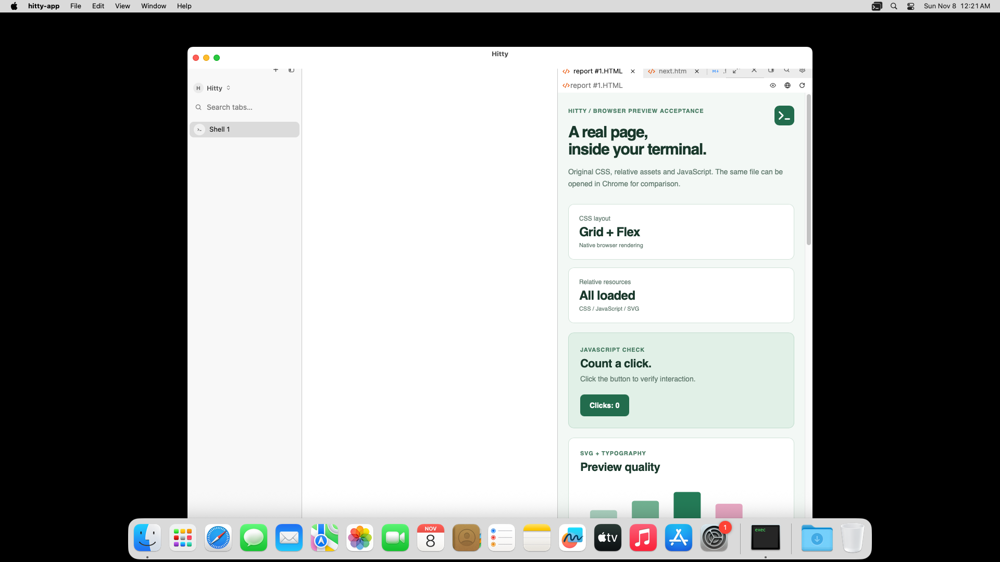
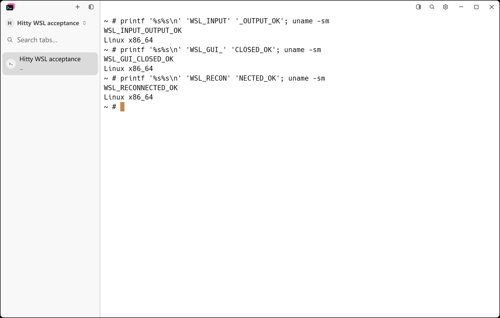
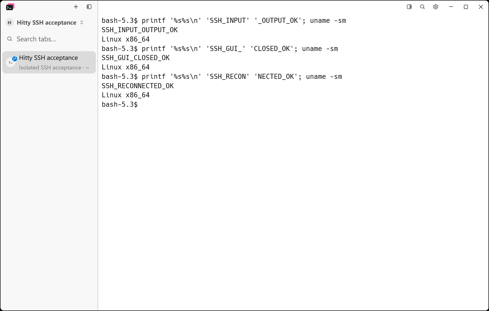
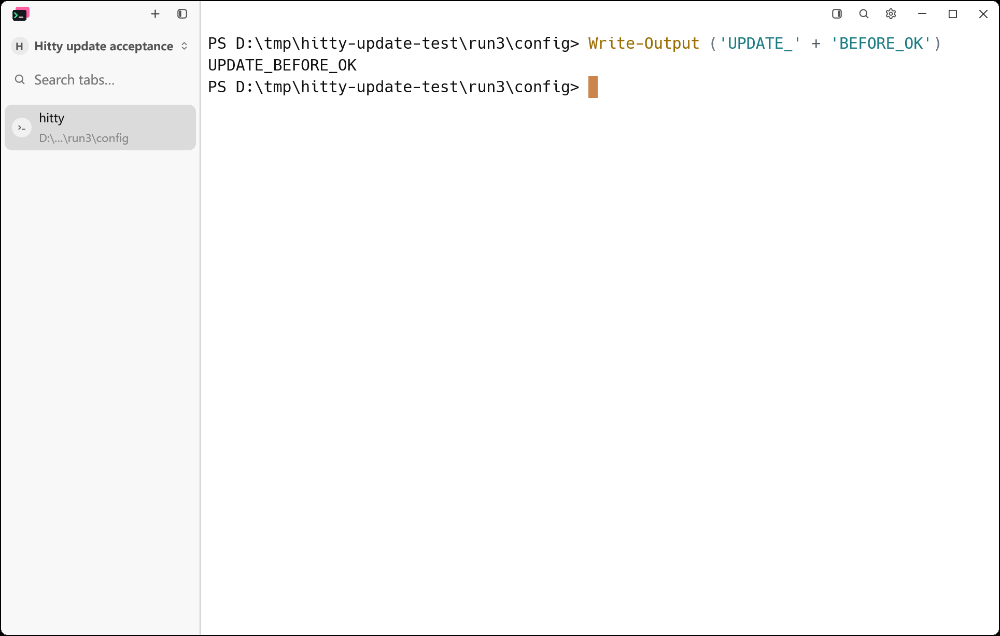
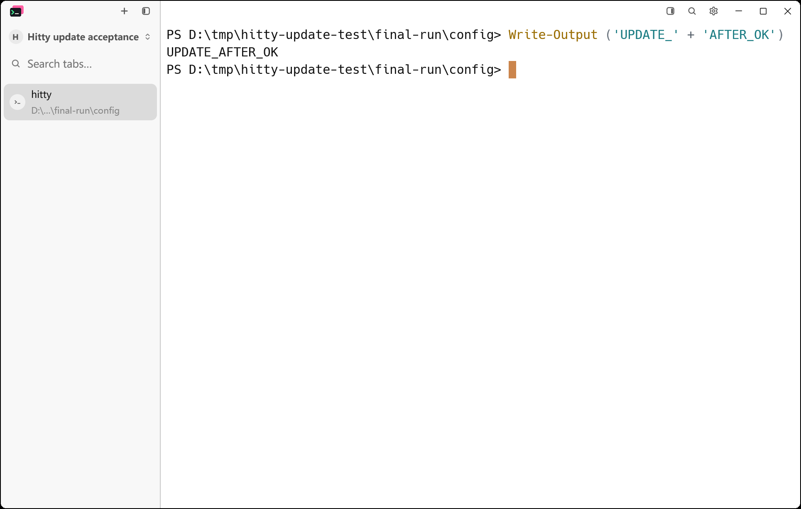
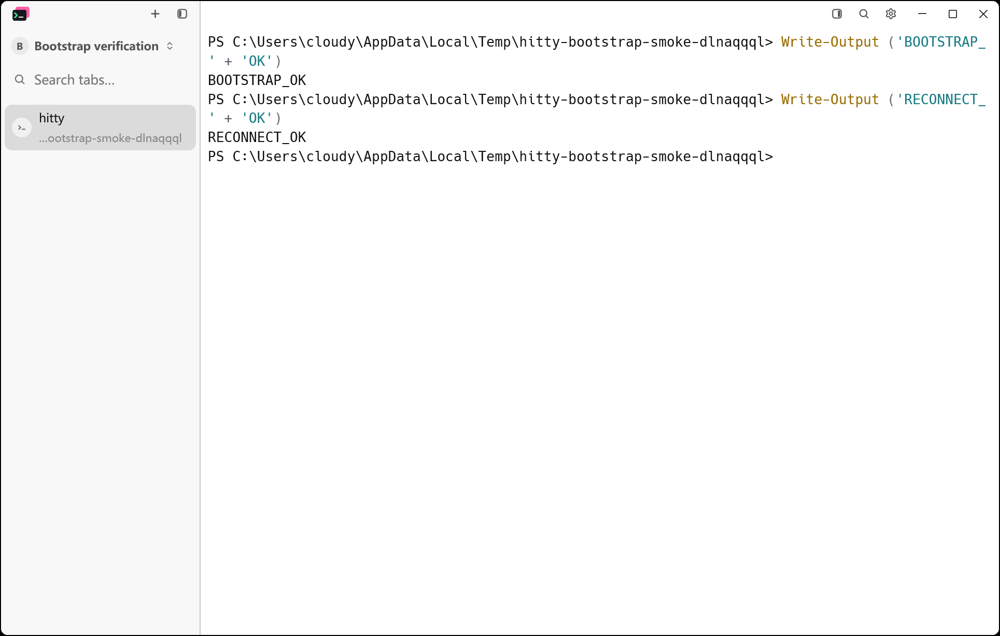

# Hitty bootstrap verification

The source baseline is `4699e7e`, imported from source revision
`7f430a8f5f89a3a2963250b196b0baea02569299`. This record covers the rebranding
work and the three-platform `v0.1.0` publication on November 8, 2026.

## Completed locally

- The baseline's 1,534 imported source files match the source revision's Git
  blobs and executable modes. The existing Hitty README and new project
  guidance/provenance are documented exceptions. The history still has only
  the Hitty bootstrap root, with no imported tags or source ancestry.
- The baseline Windows workspace build passed.
- `cargo build --locked --workspace --bins --features updater` passed for Hitty
  on Windows x86_64, including GUI, CLI, server, and updater.
- `cargo test --locked --workspace --features updater` passed on Windows:
  3,280 tests passed across the standard Rust test summaries, with 13 existing
  ignores. The separate CLI end-to-end harness also passed.
- `cargo metadata --locked --offline --no-deps --format-version 1` resolves all
  four workspace packages at version `0.1.0`.
- All 1,268 external lockfile entries retain their source, version, and checksum.
- The configuration default implementation, original app/tray icons, and
  original license bytes are unchanged.
- Active source, owned crates/skills/scripts, manifests, and build workflows
  have no old product-name occurrences. Historical records and attribution
  retain their truthful source names.
- `python scripts/sync-agent-detection.py --check` verified all 15 pinned
  manifests; its four existing Python tests passed.
- Formatting, changed-file whitespace, Bash/Python/PowerShell packaging syntax,
  wordmark XML, and documentation JSON checks passed.

## Native application evidence

The same smoke harness launched each debug application with a separate temporary
configuration, a 1100 by 700 logical-pixel window, and identical preferences.
Only test isolation settings were overridden: update checks/downloads, CLI PATH
installation, and the tray icon were disabled, and PowerShell used no profile.
The public CLI found the first pane, renamed its workspace, sent a command,
and read back `BOOTSTRAP_OK`. Both runs passed.

The baseline CLI reported `tty7 0.11.1`; the new CLI reported `hitty 0.1.0`.
PrintWindow captured the same 1929 by 1227 frame at 175% scale without a pointer.
Both saved images were inspected. Compare the unchanged application icon and
terminal layout, the changed default tab identity, and successful command output.




The capture commands, shell output, and isolated settings are recorded beside
the images. Reproduce the current application check with:

```powershell
python scripts/bootstrap-native-smoke.py target/debug/hitty-app.exe target/debug/hitty.exe docs/testing/images/hitty-bootstrap --phase after
```

## Final brand presentation

The README and documentation use the exact approved icon-plus-wordmark paths
in separate light and dark variants. The SVGs parsed successfully, the copies
used by the documentation match the source assets, and a local headless Chrome
render was inspected against the supplied reference. This is brand-asset
evidence; the native application screenshots above remain the application proof.


## Cross-platform CI

CI run [42427069652](https://github.com/cloudy-liu/hitty/actions/runs/42427069652)
passed all 10 jobs at `cec12e0aa159d82e8d150765edc2d52c567024d0` on
November 8, 2026 (Asia/Shanghai):

| Target | Locked build, workspace tests, updater tests | Native fixtures |
| --- | --- | --- |
| Windows x86_64 | Passed | Local before/after application evidence above |
| Linux x86_64 | Passed | Markdown and SSH-tab fixture captures |
| macOS ARM64 | Passed | Markdown and HTML preview checks |
| macOS x86_64 | Passed | Markdown and HTML preview checks |

Both Linux musl server architectures, both macOS server architectures,
formatting, pinned Agent detection manifests, and the host boundary check also
passed. The earlier run `42401272370` exhausted the Intel build's 30-minute
limit while compiling. The current workflow allows 45 minutes for that build
and 90 for its job; no tests or visual steps were removed. In this completed
run the cached Intel build took 13m 36s, followed by successful tests and captures.

The two failures recorded on the source baseline both passed in the complete
Intel test job `128567512741`:

```text
ui::markdown_preview::tests::fill_and_restore_preserve_a_partial_markdown_selection ... ok
ui::scm::graph::tests::selected_commit_shows_message_details_above_the_existing_diff ... ok
```

Both passed in that run, but the Markdown test failed again in run
`42438988026` at `085adc0`. Twenty-four isolated Windows runs and 200 scheduler
seeds passed. A controlled image-load completion then reproduced the exact
empty-selection assertion in four consecutive runs: selection was `Selection`
before the image completed and empty after reflow. The component clears a
geometry-based selection when its bounds change. The fill/dock test now uses
stable text so its existing double-click and layout-toggle assertions measure
that action, independently of asynchronous image sizing. Final CI run
`42443650511` passed all 10 jobs at
`30a4413cef465f91430381532dea8dfa3dd738ae`, including 20 scheduler seeds for
each inherited Intel UI regression. Windows CI also passed the two tests that
had hit local wall-clock limits, using its unchanged default-concurrency command.

Representative CI images were downloaded and inspected. The saved files retain
the original artifact bytes; `images/hitty-bootstrap/ci-cec12e0.json` records
their source paths and SHA-256 values. Markdown content, theme colors, and the
HTML page are visible. The ARM64 runner's small desktop clips the fixture
window, so those captures do not establish complete window-layout acceptance.
Both HTML result records passed resource loading, script interaction, refresh,
scroll ownership, tab switching, and navigation-failure recovery.







## Package acceptance

The release workflow was unavailable for manual branch dispatch because it is
not yet on the repository's default branch. It now also builds packaging-related
PR changes with read-only repository access and ad-hoc macOS signing. Branch
runs assemble and verify the complete 12-asset set and SHA-256 file as an Actions
artifact. Only a version tag can reach the existing draft-release job.

Package runtime checks exercise the extracted application and public CLI with
isolated user data, then restart the GUI and verify the existing pane still
accepts commands. The Windows check additionally installs into a temporary
location, checks its product registration, runs the installed app, and uninstalls
it on the disposable CI runner. The smoke harness extension passed locally with
the Windows debug build. Linux x86_64 and both macOS architectures passed this
runtime check in run
`42438988023`. Windows portable and installed copies both passed startup,
command output, and GUI reconnect; installation metadata also matched. The
subsequent uninstaller exited with code 1, so that run did not meet Windows
package acceptance. Its stop helper included the invoking uninstaller in the
installation-directory process sweep. A subprocess regression reproduced the
same exit code with an `unins000.exe` parent and a live `OpenConsole.exe` child.
The correction preserves the helper's caller chain in both termination and
image-unlock checks. The regression then passed and confirmed the orphan was
still terminated. Rebuilt Windows package job `128618527627` in run
`42443650571` then passed the complete portable, installation, session-reconnect,
and uninstall checks. The uninstall log reports successful removal with no
restart. Linux and macOS ARM64 package checks also passed on this final source
head. macOS Intel then passed as well; package run `42443650571` completed
successfully at `30a4413cef465f91430381532dea8dfa3dd738ae`. All 12 program
assets were downloaded and independently verified against the workflow's
SHA-256 output. The complete set is retained locally at
`D:/tmp/hitty-0.1.0-verified-assets`, and the checksum manifest is retained in
`images/hitty-bootstrap/release-checksums.txt`. Windows markers, bundled WSL
server bytes, both macOS bundle identities, versions, and updater paths were
also inspected. The tag-only draft-release job was skipped, as intended.

## Actual SSH and WSL deployment

A disposable `Hitty-Acceptance-20261108` WSL2 distribution ran Alpine x86_64.
The production WSL installer copied the Linux musl server from package run
`42438988023`, verified its digest, and started it. Its first report recorded
`installed`, `confirmed`, and `launched`; a second connection recorded all three
as false and reused the running service. The installed SHA-256 was
`330f69e50b257905521d1516032015b7e76356854add68c7818c4bba0b3f82dd`.

The same distribution hosted an actual OpenSSH server bound to loopback, with
an ephemeral account and key. Hitty's SSH router authenticated, transferred the
server through SFTP, launched it in that account, and completed the control
handshake at build `0.1.0`, control v8, pane protocol v7. The bundled CI binary
supplied the asset; a public GitHub release download was not exercised.

Separate Windows debug application instances loaded isolated remote workspaces.
The production client APIs sent shell commands and read their output before
closing the GUI, while it was closed, and after restarting it. Both routes kept
the same pane ID and server instance throughout. The native captures show all
three markers and Linux output, and were inspected at the same 1100 by 700
logical-pixel window size and 175% display scale.

The small `hitty-core` acceptance examples exercise these production seams;
they restrict deployment to the disposable fixture names/account. The SSH
installation additionally requires the expected CI asset digest.
`images/hitty-bootstrap/remote-acceptance.json` records the exact results and
source-log hashes. Personal Ubuntu data and real SSH profiles were not used.
Test clients and
the temporary distribution were stopped after capture. Automatic approval
review blocked unregistering that distribution, so its stopped files remain
under `D:/tmp/hitty-remote-acceptance` for later cleanup.





## Portable update between Hitty packages

An unpublished test-only `0.0.0` build was produced from a separate checkout
with only the workspace version changed. Its actual GUI, CLI, and updater were
packaged into a portable ZIP. The final candidate ZIP from run `42443650571`
was installed over it using that older Hitty updater, with isolated user data.

The verifier rejected an incorrect SHA-256, accepted the real archive, waited
for the old GUI to exit, replaced the files, and relaunched `hitty 0.1.0`.
The workspace was restored and accepted another command; the custom font-size
setting and an unmanaged user file were preserved. This verifies portable
package replacement, not GitHub release discovery or an Inno all-users update.
The before/after images were inspected at the same viewport and scale.
`images/hitty-bootstrap/portable-update-result.json` records the exact artifact.





## First-release scope and acceptance

On November 8, the maintainer clarified the task as copying the accepted source
snapshot, renaming it in Hitty, and checking the affected behavior before the
three-platform `v0.1.0` release. The existing functionality is the baseline;
exhaustive retesting of unchanged features and new signing work are separate.

A fresh local pass used the final Windows portable package with
`scripts/bootstrap-native-smoke.py --reconnect` and the original
`scripts/capture-native-window.ps1`. The PrintWindow script is byte-identical to
the source checkout. Command output and GUI reconnect passed, and the saved
image was inspected. The source import was independently compared again:
1,534 of 1,535 source files have identical Git blobs and modes in the import
commit; the only replacement is README.md. Hitty-specific metadata is additive.



The focused functional and packaging checks are complete: four desktop targets,
remote servers, local input/output and persistence, real SSH/WSL connections,
Windows installation/removal, portable updates, and all 12 assets/checksums.
The release retains the inherited distribution posture: Windows is unsigned,
and macOS is ad-hoc signed without notarization. Inno/macOS/Linux
version-to-version updates and a full ARM64 desktop capture remain explicitly
unverified follow-up coverage, rather than newly added rename acceptance gates.

## Published v0.1.0

The maintainer authorized publication after the focused local regression.
PR #2 was merged with its separate source-import history intact. Tag `v0.1.0`
points to `444c8f2d29dd47bb19fb901dd958b9a95b16451d`.

The tag's production source, assets, manifests, dependency pins, packaging
scripts, and packaged README match verified implementation `30a4413`; only
project guidance, documentation, and evidence differ. Its 12 verified program
assets from run `42443650571` were promoted into an unpublished draft with
`checksums.txt`. The redundant tag rebuild was cancelled before its draft job.
Every uploaded asset's name, size, and GitHub SHA-256 matched the locally
verified file before publication.

The release was published at 05:17:17 UTC (13:17:17 Asia/Shanghai) on
November 8, 2026. GitHub's latest-release endpoint returns `v0.1.0`, all 13
public download endpoints respond successfully, and the downloaded public
checksum manifest matches the verified local manifest. The durable release
record is `docs/testing/hitty-v0.1.0-release.json`. Known distribution and
unchanged-feature coverage limits above remain explicit.

## Follow-up regression checks

A later default-concurrency local run passed 1,850 GUI tests but hit two existing
wall-clock fixture limits: `agent_ctrl_v_pastes_text_and_alt_v_reaches_the_agent`
(socket read at one second) and
`markdown_edits_release_image_budget_and_ignore_old_completions` (image gate at
ten seconds). Both passed individually with the same binary. The full
workspace/updater suite then passed at four test threads: 3,281
standard Rust tests, 13 existing ignores, plus the custom CLI end-to-end harness.
`images/hitty-bootstrap/local-final-tests.json` records the command and log hash. No
assertions or production behavior were changed for these two tests, and CI
retains its standard invocation.

The rename initially exposed capitalization expectations and a color fixture
whose crate name changed byte length. Expectations now use the displayed Hitty
name; the captured color fixture uses an equal-width neutral name so all
original token offsets and colors remain valid.

The complete test run also exposed intermittent clicks on animated dialogs and
notifications. The file-tree subset reproduced the failure under parallel
execution; the individual test and serial subset passed. Adding a 100 ms gap
between reading a checkbox's bounds and clicking made the same assertion fail
deterministically. The component uses a 250 ms wall-clock entrance animation,
so advancing the test executor does not finish the movement. The affected tests
now complete the animation and redraw before measuring click targets. The delay
remains in the regression test, and 10 parallel subset runs (310 executions)
passed after the correction. Production animation behavior is unchanged.

Linux CI also found an inherited integration test that still required old-data
adoption, which is explicitly outside Hitty's scope. It now verifies that a
successful fresh server startup leaves data in other directories untouched,
for both default and explicitly selected profiles. That correction passed Linux
and macOS ARM64 CI. A local WSL offline attempt could not resolve the uncached
pinned framework checkout and did not execute the test.
