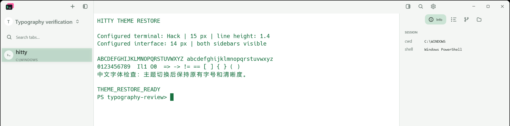
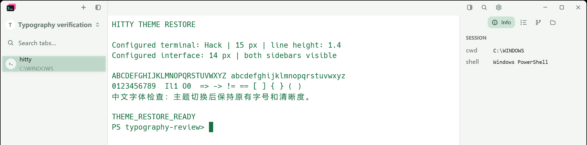
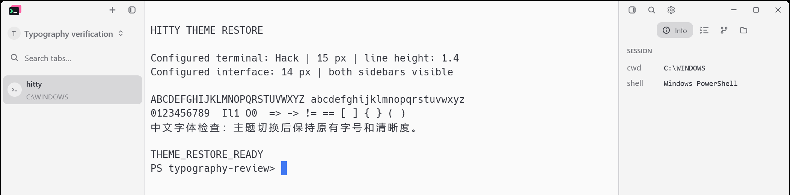
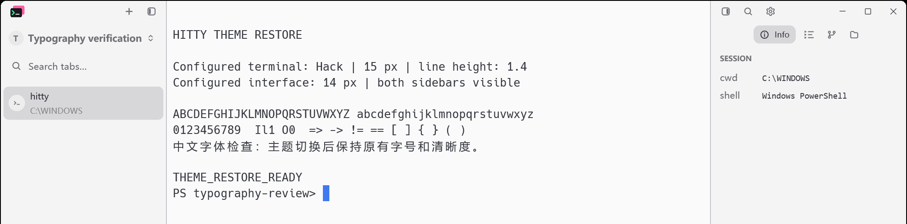

# Otty themes with Hitty typography

November 10, 2026. Branch: `fix/otty-hitty-typography`.

The final reviewed scope retains only **Solarized Light**, displayed without
an Otty suffix, and removes the other 24 profiles from #31. Its internal ID
stays `otty-solarized-light` for existing preferences. The original 13 Hitty
themes remain. The importer cannot regenerate the rejected candidates.

The initial 25-profile typography work and its evidence below are historical.
The final selection, current tests and new native captures are recorded in
[Solarized Light acceptance](solarized-light-selection.md). This remains an
alternative to complete removal in #33; the two PRs should not merge together.

## Reproduced regression

In v0.3.0, selecting Acrylic Dark changed a configured 15 px terminal to
13 px. Imported token sizes also replaced the 14 px interface rem, tab labels
used separate absolute sizes, and cell-height adjustments changed the
configured terminal line height. Installed font stacks could replace both
the terminal face and the global interface face. Returning to an original
theme did not restore the global interface face.

The initial regression test failed on the actual application preview path:

```text
cargo test --locked --bin hitty-app otty_theme_switches_preserve_hitty_font_metrics -- --nocapture
otty-acrylic-dark: terminal font metrics must match Hitty
left: ("Hack", 13.0, 1.4)
right: ("Hack", 15.0, 1.4)
```

With the global sizes corrected, the surface regression still failed because
an imported tab changed Hitty's medium weight (500) to regular (400). This
confirmed that local text overrides also needed removal.

The original native round trip failed its image comparison for the Left
layout. Its Top baseline was taken after that round trip and already had the
changed interface font, so the passing Top comparison is not evidence that
the original Top path was correct.

## Adaptation contract

| Setting | Imported and original themes |
| --- | --- |
| Interface face | Hitty's existing system interface font |
| Interface size | `ui_font_size`, using the existing rem hierarchy |
| Tab label sizes and weights | Hitty's existing Left/Top label rules and measurement |
| Terminal face, size and line height | `font_family`, `font_size`, `line_height` directly |
| Font fallbacks, emphasis faces and features | Existing terminal preferences |
| Device scaling and glyph rendering | Existing GPUI renderer and native display scale |
| Colors, transparency, backdrops, card geometry | Active theme profile plus explicit user overrides |

Font stacks, sizes, weights, cell-height adjustments and font blending remain
in the source profiles for duplicate/edit round trips. They no longer control
runtime typography. No DPI compensation, shader change, font redistribution,
dependency upgrade or configuration migration is introduced.

Every theme application replaces the active style, background, palette and
native appearance. The imported profile no longer mutates the global font,
so selecting an original theme or canceling a preview cannot leave that
imported font behind.

## Reproduce

Use a directory containing the matching application, CLI and runtime files:

```powershell
$env:CARGO_TARGET_DIR = 'D:\tmp\hitty-build'
cargo build --locked --workspace
cargo test --locked --workspace
cargo test --locked --features updater --bin hitty-updater
python scripts/import-otty-themes.py --check
python scripts/otty-typography-native.py --stage before --bin-dir <v0.3.0-bin>
python scripts/otty-typography-native.py --stage after --bin-dir D:\tmp\hitty-build\debug
```

The Before command is expected to fail the restored-pixel assertion on the
affected v0.3.0 binary. Both stages use fresh isolated configuration/data
directories, a 1200 x 800 logical viewport, Hack 15 px, interface 14 px, line
height 1.4, the same English/Chinese sample and an open Info panel. Automatic
updates, tray registration and CLI installation are disabled. The harness
does not use the installed application's profile or move the real pointer.

The historical After stage selected each of the 25 profiles in Left and Top layouts,
returning to One Light after each selection. Every return image and terminal
output hash must match its baseline. Each capture also checks native dark
mode and records window DPI, plus DWM backdrop type when the OS supports that
query. Available native values are compared after returning. Identical return
images share one saved file per layout, with an independent hash for every
capture event.

## Automated coverage

The GPUI application test previews all 25 themes with both default terminal
typography / 14 px interface and a custom face / 19 px terminal / 18 px
interface / 1.8 line height. It reads a real `TerminalView` and the rendered
window's rem size. GPUI's test window uses a fixed 2.0 display scale.

A second application test covers all 25 imports against all 13 original
Hitty themes, both committed selection and preview cancellation: 650 return
paths. It compares component theme state, terminal palette, background fill,
opacity, image, chrome surfaces and resolved native appearance, and requires
the imported style profile to be cleared.

The surface test checks imported tab/titlebar styling cannot replace Hitty's
text size or weight. The existing import, alpha/geometry, cursor and backdrop
tests continue to cover profile preservation and explicit material overrides.

## Native evidence and limits

Before images and capture hashes are under `images/otty-hidpi/before/`.
After images and capture hashes are under `images/otty-hidpi/after/`.
Both runs used Windows x86_64 build 22000 at native DPI 168 (175%), with
2104 x 1402 physical frame captures. Before used the official v0.3.0 ZIP
(SHA-256 `40f6bba2d904a21858ca77977b52f357837ee2b656bb3a711e33b76f4e2a216c`),
verified against the published checksums.

The After matrix passed all 104 capture events: 50 imported-theme selections,
50 immediate returns, two baselines and two final return rechecks. Every
return image is byte-identical to its layout's baseline, and every terminal
capture has the same text hash. The initial One Light Left screenshot is also
byte-identical across Before and After. All 50 imported selections were
inspected in the saved native-pixel crops: Left/Top label sizes and the right
panel follow Hitty's text hierarchy. Crop page boundaries and the gaps between
regions are evidence layout, not application clipping. Full frames retain
the entire English/Chinese terminal sample.

`otty-hidpi-adaptation-verification.json` records log hashes and results:

| Check | Result |
| --- | --- |
| Locked workspace build | Passed |
| Locked workspace tests | 3287 passed, 13 ignored, 0 failed across 18 suites |
| Locked updater tests | 32 passed, 1 ignored, 0 failed |
| Focused Otty regressions | 4 passed, including 650 return paths |
| Packaged source profiles | All 25 hashes verified |
| rustfmt, detection manifests/tests, host boundary, diff whitespace | Passed |
| Native Windows 175% typography and content restoration | Passed |
| Mock GPUI 200%, default and enlarged/custom typography | Passed |

April before, with smaller terminal and interface text:



April after, using Hitty typography:



One Light after returning from the old import, showing the changed UI face:



One Light after the correction, identical to the untouched Hitty baseline:



PrintWindow captures application content, not the compositor's material
pixels. This Windows build rejected DWM attribute 38 with
`HRESULT -2147024809`; the harness records its value as unavailable rather
than claiming to verify it. Native light/dark mode and DPI were readable and
restored on every return. The application tests verify the resolved backdrop
request and transparent surface state. Actual compositor material restoration
remains **unverified**, so the PR stays draft under the repository's visual
acceptance rule. This work intentionally follows Hitty's rendering;
it does not promise identical Otty rasterization or WinUI material pixels.
Native macOS/Linux and other Windows display scales require separate visual
acceptance.
