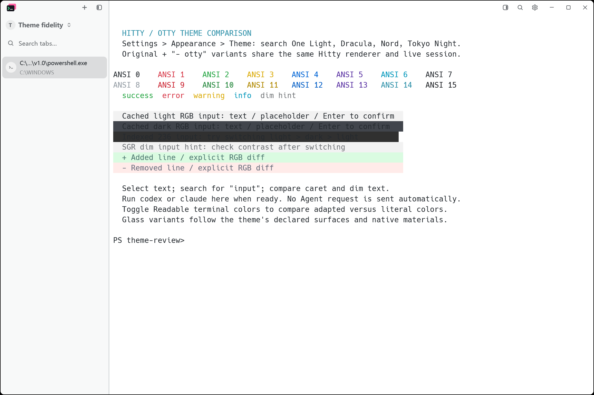
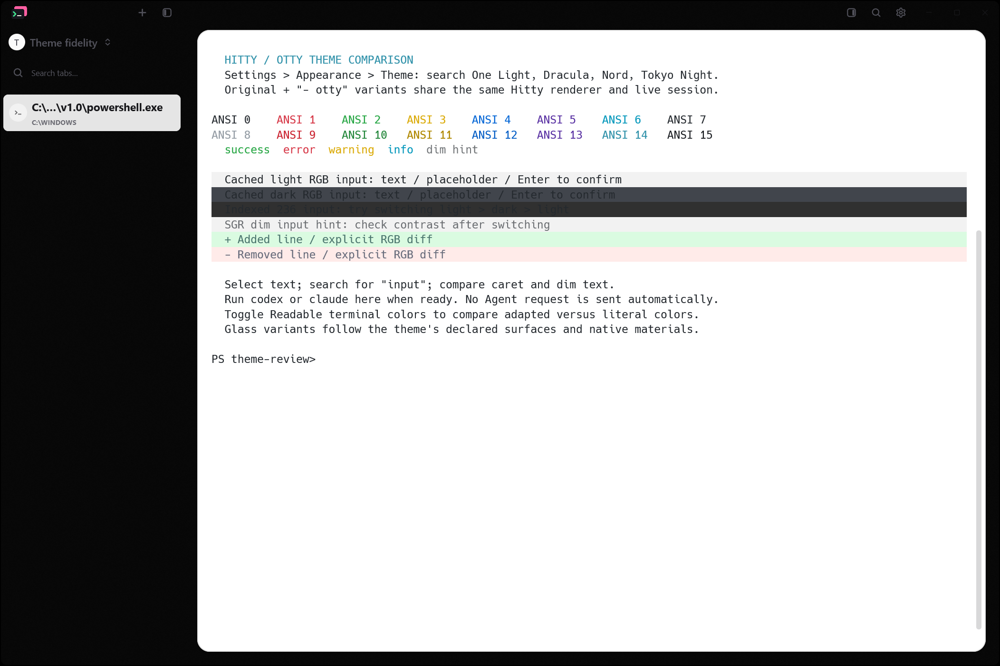
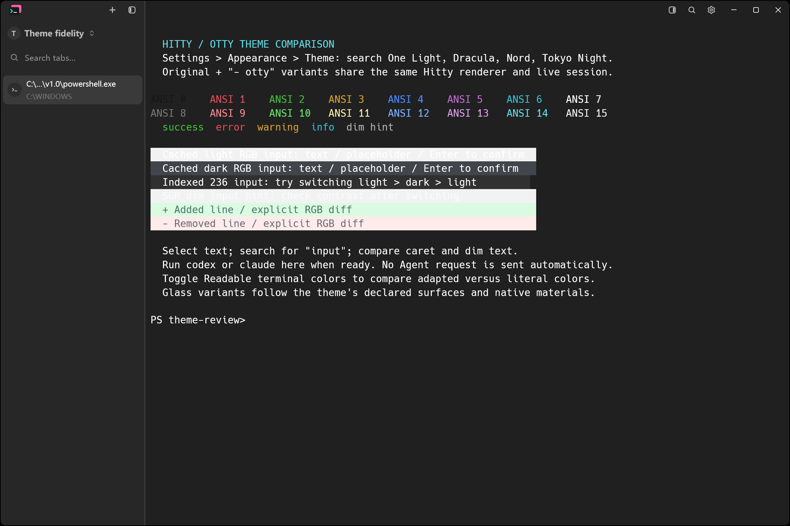
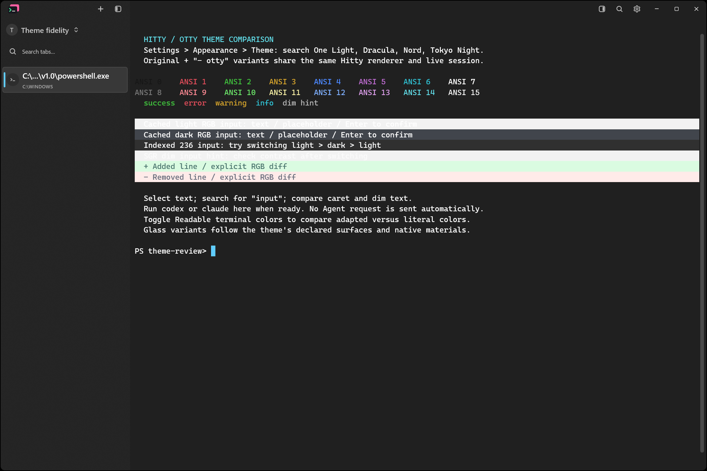
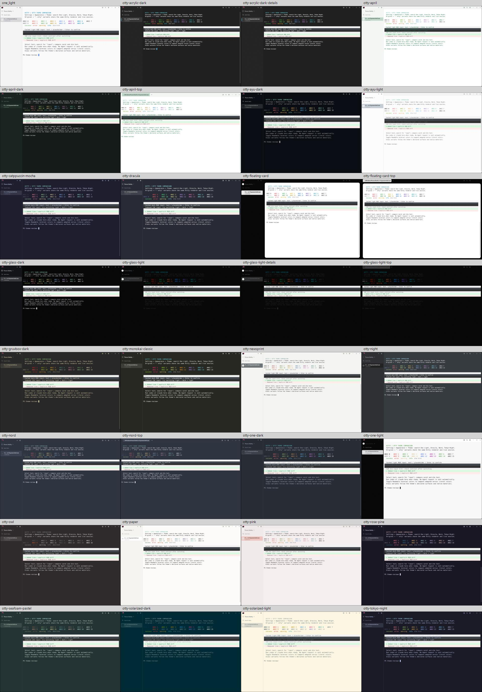

# Otty theme profile migration

November 10, 2026. Branch: `feat/otty-theme-fidelity`.

The branch adds all 25 Otty 1.6.0-beta theme configuration profiles alongside
Hitty's original 13 presets. Profiles are named **Theme name - otty** and keep
separate IDs. This supersedes the local palette-only comparison experiment.

The requested acceptance target is a complete reproduction. **That target is
not yet met:** profiles and supported chrome rendering are implemented, but
native material and text-rasterization differences remain. Keep the PR draft.

## Implemented behavior

| Source declarations | Hitty behavior |
| --- | --- |
| Terminal foreground, background, ANSI16 | Authored colors, including a fully transparent default terminal background |
| Selection background and foreground | Separate selection fill and selected glyph ink |
| Cursor color and text, block/bar/underline overrides | Shape-specific cursor paint and explicit block-cursor glyph ink |
| UI foreground/primary, secondary, tertiary, accent, semantic tokens | Separate chrome colors; terminal ink stays independent |
| Window, sidebar and details-panel backgrounds | Independent surfaces with original alpha values |
| Windows material overrides | Native DWM backdrop, per-theme light/dark mode and sidebar-only material masking |
| Tab and horizontal-tab overrides | Active/hover/unfocused fills, borders, weights, radii, shadows and dimensions |
| Container card | Source margin, padding, corner radius, border and shadow; Top layout margin override |
| Divider, titlebar and sidebar dimensions | Painted divider metrics, titlebar height/focus ink, default sidebar width |
| Font stacks, size and cell-height adjustment | Installed font selection, live terminal refresh and configured zoom offset |
| Nested YAML profile | Duplicate/edit and reload retain platform/state declarations |

Imported profiles default to literal terminal colors. Their optional readable
palette has its own persisted preference, `theme_style_legible_palette`.
Original presets keep the existing preference and defaults. Explicit user
backdrop, opacity and terminal font choices remain available.

`assets/themes/otty/manifest.json` records source and packaged hashes and
original author metadata. The stdlib importer can verify the shipped profiles
without an Otty installation. No dependencies, pinned revisions or CI action
versions changed.

## Reproduce locally

```powershell
Start-Otty-Theme-Review.cmd -Build
```

This creates an isolated application under `.hitty-dev-otty-fidelity/`, with
updates, CLI installation and the tray disabled. Existing daily application
profiles are not used. Choose an **- otty** entry in Appearance, switch between
Left and Top session layouts, and compare with the original named preset.
The sample contains ANSI, dim text and intentionally literal RGB fills.
White text on a cached light fill is expected with readable colors disabled.

```powershell
python scripts/import-otty-themes.py --check
cargo fmt --all -- --check
cargo check --locked --workspace --all-targets --features updater
cargo build --locked --workspace --bins --features updater
cargo test --locked --workspace --features updater
```

For native Before/After capture, retain the older application/CLI/server
binaries in a directory, then use:

```powershell
python scripts/otty-theme-fidelity-native.py --stage before --bin-dir <older-bin>
python scripts/otty-theme-fidelity-native.py --stage after --bin-dir <new-bin>
```

The Before stage makes palette-only fixtures from the packaged profiles.
Each stage uses a fresh isolated profile, the same PowerShell sample, fixed
working directory and prompt, 1200 x 800 logical window, font settings and
native material overrides. It captures all 25 imports, a legacy preset before
and after switching, four Top layouts and two details-panel scenes.
There are 33 capture events and 32 unique PNGs per stage.

Capture uses the existing PrintWindow script without moving the real pointer.
Each capture record includes binary, image and terminal-text hashes, pane ID,
viewport information and configuration. Returning to the original preset must
restore the original terminal text in the same pane. The After harness also
reads DWM's immersive-dark-mode attribute and checks it against each theme.

## Evidence

Before is main (`7dd21b8`) plus palette-only fixtures. After includes the full
style renderer. Both capture runs report identical 2104 x 1402 physical frame
bounds. Actual PNGs and capture records are under
`images/otty-theme-fidelity/`. All 64 saved PNGs were inspected via contact
sheets; Floating Card, Acrylic Dark, Glass Light and Nord were also inspected
at window scale. `otty-theme-fidelity-verification.json` records command results.

Floating Card, Before:



Floating Card, After (PrintWindow omits the compositor's background material):



Acrylic Dark, Before:



Acrylic Dark, After:



All native After scenes:



## Remaining acceptance work

- **Native material parity is unverified.** PrintWindow captures GPUI content
  but omits the DWM-composited backdrop, leaving transparent Glass regions
  black. A live computer-use inspection confirmed transparency and background
  blur, but it is diagnostic, not a saved reproducible visual acceptance pair.
  No native Otty reference-window comparison was captured.
- Windows uses DWM acrylic/Mica. The source's WinUI acrylic color and
  luminosity-opacity controls are approximated with a surface tint, and
  sidebar-only material is masked with opaque content. The two systems do not
  produce identical material pixels.
- macOS `glass`, `vibrancy-thin` and `vibrancy-regular` share the existing blur
  backend; Linux uses the existing compositor-dependent behavior. No macOS or
  Linux native visual acceptance was performed on this Windows machine.
- `terminal.font-blending = "linear"` is preserved in YAML but does not switch
  GPUI's glyph shader. Fonts unavailable on the machine fall back; Otty's
  privately loaded font files are not redistributed.
- `container.tabs-bottom.margin` is preserved but has no runtime layout in
  Hitty, which offers Left and Top session tabs. `tab-bar.separator` retains
  its data; its bundled profile also declares the applied bottom border.
- Component-library popups keep their existing shadow implementation; the
  source token shadow is applied to Hitty's command palette. Hitty's session
  metadata, toolbar and document structure remain its own.

Tests for the original Hitty designs' contrast/distinction guarantees stay
scoped to that authored set. Exact imported palettes have separate preservation
and renderer tests; source colors are not silently changed to satisfy those
Hitty design constraints. Tests additionally cover selection glyph colors,
transparent terminal backgrounds, cursor declarations, backdrop overrides and
returning to the original rendering behavior.
