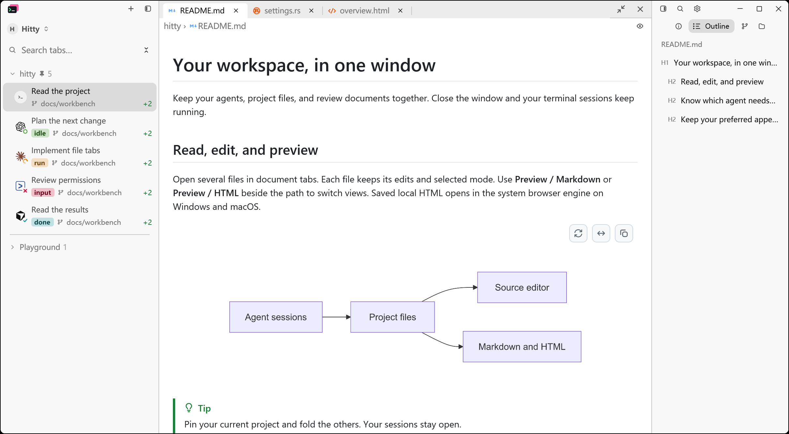
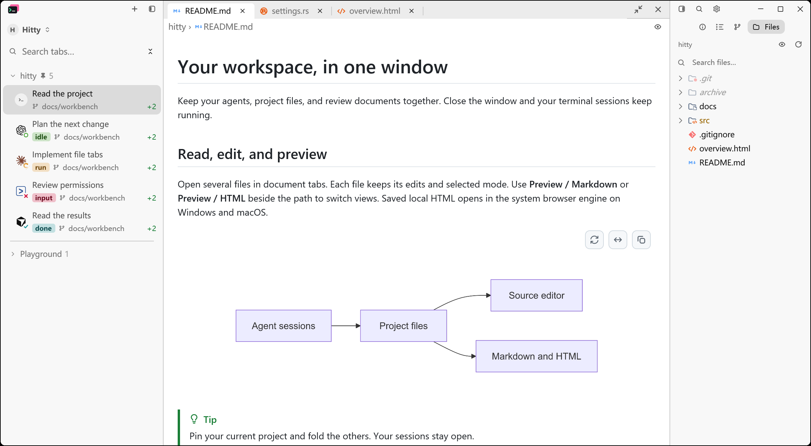
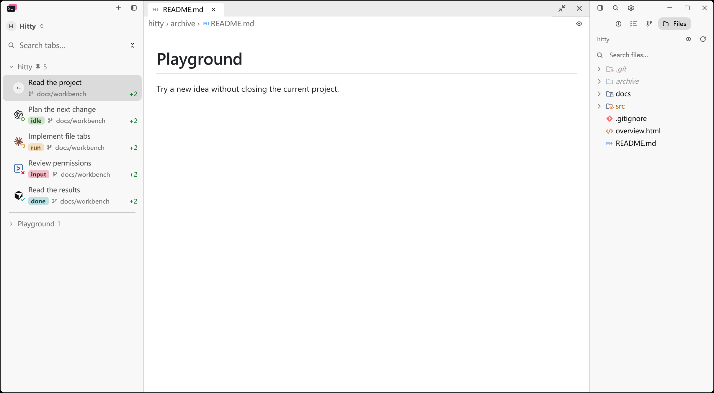

# Outline follow for Markdown previews

The maintainer asked on November 11, 2026 for the right panel to show a
Markdown document's outline when the document is opened, instead of leaving the
two unrelated, and approved the proposed rules. Comparison baseline: `f36c167`.

## Behavior checked

- With the panel open, a Markdown preview with two or more headings shows its
  outline without the reader switching modes. The mode tiles light Outline.
- The reader's mode is not replaced or written to the configuration. It returns
  when the document closes, another kind of file comes to the front, or the
  document switches to Markdown source.
- A mode the reader asks for — a tile, the palette, a shortcut — while the
  outline has or would take the panel outranks the follow until that session
  has no open file left, including for documents opened afterwards. The choice
  belongs to its session: another session's documents still follow, and hiding
  the document column or switching sessions does not end it.
- Asking for a mode with no document, another kind of file, or a document with
  too few headings in front is not an override.
- A diff in front of the document has the column; closing it returns the
  outline.
- A closed panel stays closed when Markdown opens. Opening it with the toggle
  shows the outline; opening it onto a named mode shows that mode.
- A document with fewer than two rendered headings leaves the panel as it is.
  The count is the entries the Outline would draw.
- Clicking the lit Outline tile puts the panel away, as for a chosen mode.

Nine application-level tests in `src/ui/code_editor.rs` drive these through the
document column, the mode tiles and session switching. With the per-frame
decision disabled, the four original tests that expect the outline failed and
the two that expect no change passed. Restoring an override that ends when the
column is hidden, and headings parsed only while the panel is open, fails the
two tests written for those cases.

HTML previews, Agent turns and shell commands keep their existing Outline
content and are not followed. Local HTML headings still need the reader to
choose Outline.

## Reproduction

```sh
cargo test --locked --workspace --features updater
cargo build --locked --features markdown-visual-tests --bin hitty-app
python scripts/prepare-readme-captures.py <new-temporary-scene-directory>
```

Run `workspace-light.json` through `hitty-app --config-dir <isolated-directory>
--document-visual <options>` with `hover_at: [1, 1]`, and capture the process
with `scripts/capture-native-window.ps1 -ProcId <pid> -Out <image.png>
-MoveTo "1,1"`. The fixture opens the panel on Files before any document.

| Scene | Change to the generated options |
| --- | --- |
| Follow, Before and After | Remove `panel_mode` |
| Reader's choice | Keep `panel_mode: "files"`, which is asked for after the document opens |
| Single heading | Remove `panel_mode`; set `files` to `["archive/README.md"]` |

`scripts/prepare-readme-captures.py` now names `panel_mode: "files"` so the
README scenes keep showing the file tree beside the document.

## Native captures

Actual Windows PrintWindow captures with isolated configuration: 1380 × 760
logical viewport, 175% display scale, light appearance, 240 px panel, the same
sample project and pointer position `(1,1)`. Session labels are fixture data.
Metadata beside each image records the binary and image hashes.

| Before | After |
| --- | --- |
|  |  |

After only, inspected:

| Reader asks for Files while reading | Single-heading document |
| --- | --- |
|  |  |

## Validation results — 2026-11-12

Windows x86_64, isolated fixture data:

| Check | Result |
| --- | --- |
| Locked workspace tests with updater | 3,328 passed; 0 failed; 14 existing ignored |
| Locked native application build | Passed with `markdown-visual-tests` |
| Formatting | Passed |

macOS and Linux have not been inspected locally.
