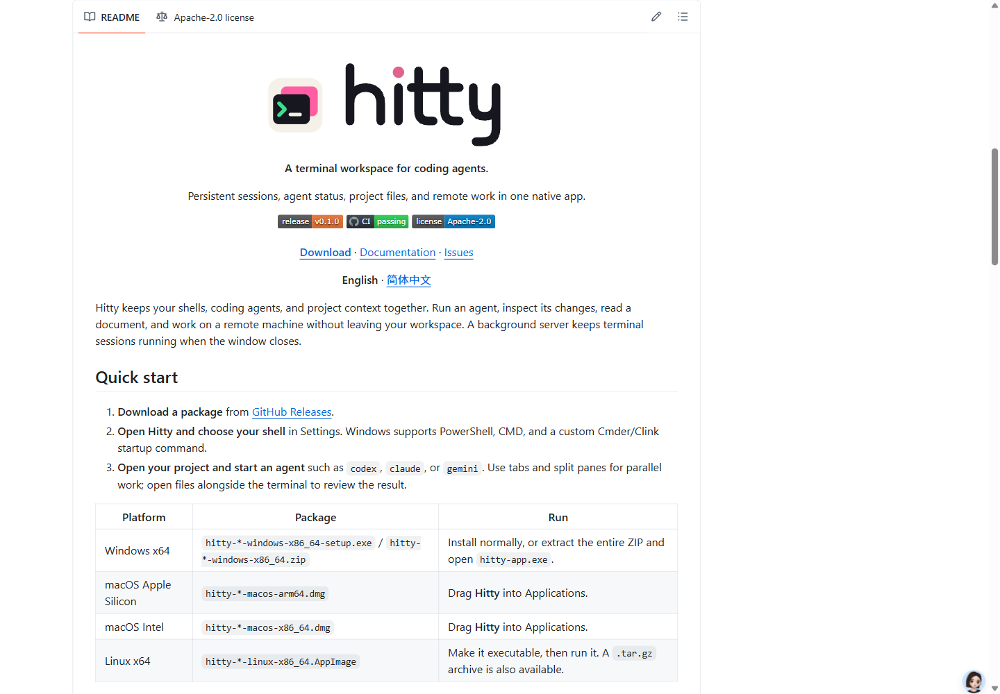
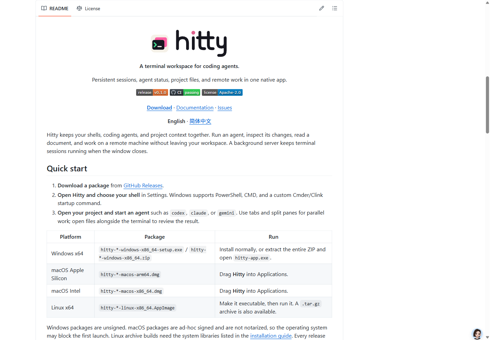
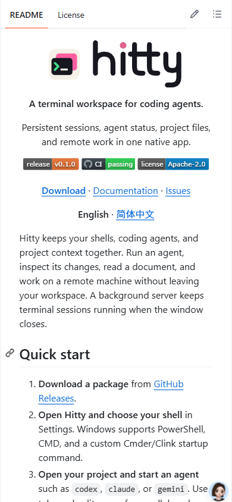

# Product README presentation

The README introduces Hitty through its capabilities, installation, and first
workflow. English is the default; the Chinese page uses the same information
hierarchy and reciprocal language navigation. The approved icon-plus-wordmark
SVGs are unchanged, with a 240 px display width and responsive shrinking.

## Native images

Built the existing opt-in application fixtures with:

```sh
cargo build --locked --features markdown-visual-tests --bin hitty-app
```

Used `scripts/prepare-readme-captures.py` and the original
`scripts/capture-native-window.ps1` PrintWindow harness. All four new application
captures were inspected: light workspace, dark workspace, source editor, and
native HTML preview. Each uses a separate temporary configuration directory.
The fixture branches before ordinary application startup and hook refresh.
No live Agent or remote connection is implied by the controlled sample states.
Capture metadata and PNG digests are in `assets/screenshots/hitty/captures.json`.

## GitHub rendering

The logo was reduced on November 8, 2026 after reviewing its visual weight in
the README. Before (`d3f8350`) and After (`9b182c5`) show GitHub's actual rendered
README at the same 1440 by 1000 CSS-pixel viewport, scale factor 1, light
appearance, and article offset of approximately 80 px below the viewport top.
The logo changes from 360 by 144 px to 240 by 96 px, remains centered, and
brings the introduction and quick start 48 px higher. Both saved images were
inspected; badges and embedded product images still load successfully.





At 390 by 844 CSS pixels, the 240 by 96 px logo remains centered within the
approximately 325 px article, the three badges fit, and the page has no
horizontal overflow. English and Chinese use the same logo width; their
reciprocal language links resolve to the corresponding rendered files.
The Chinese logo also renders at 240 by 96 px without horizontal overflow.



## Content and attribution checks

- All README relative links and image paths resolve.
- Earlier product names occur only in the final credits sections of both
  READMEs and the documentation introduction.
- GitHub About describes Hitty's capabilities without predecessor branding.
- The root Apache-2.0 license, its original copyright, and bundled third-party
  license files retain their exact bytes.
- Product documentation no longer presents historical benchmark measurements
  as new Hitty measurements or claims running processes survive a reboot.
- No runtime code, preference defaults, dependencies, or hooks were changed.

The GitHub documentation configuration and link checks passed. The live GitHub
README was reviewed; a separately deployed documentation site was not exercised.
