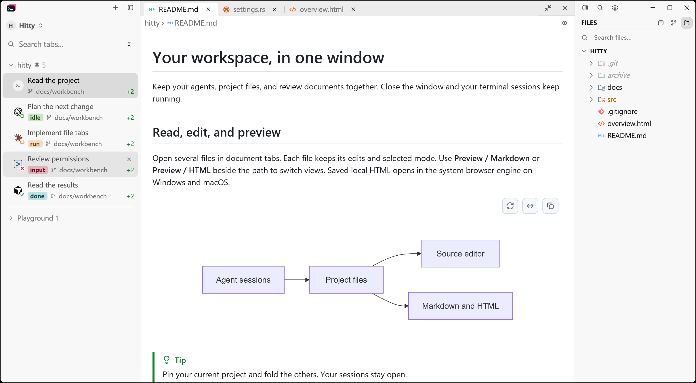
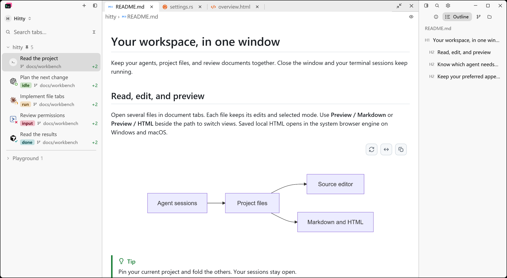
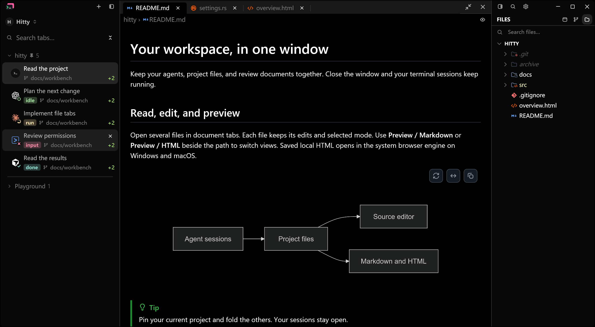
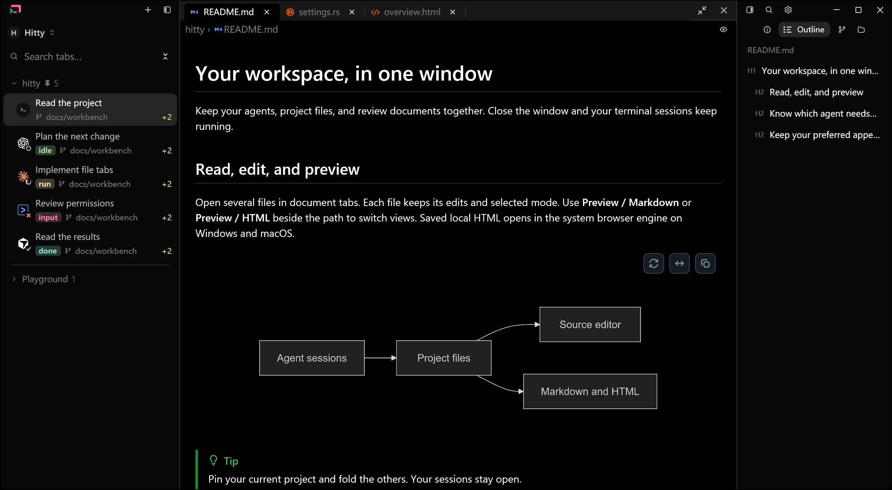
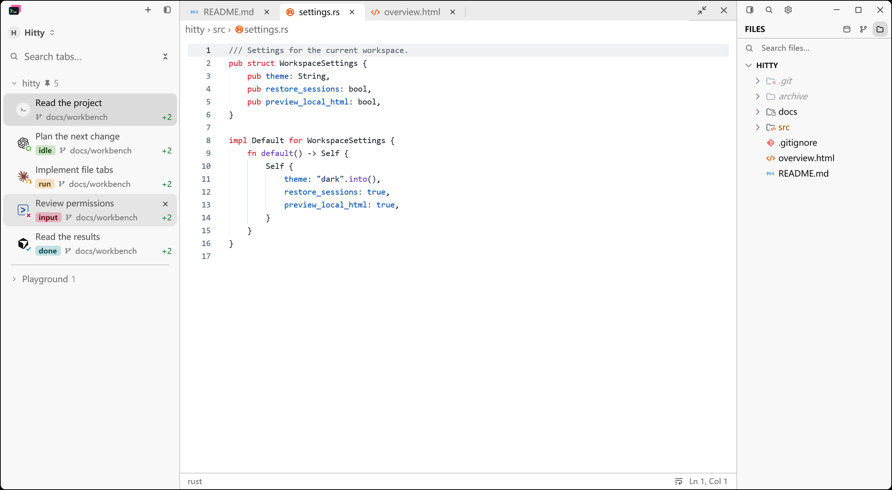
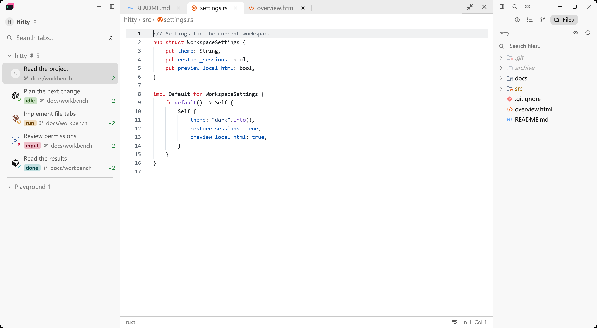
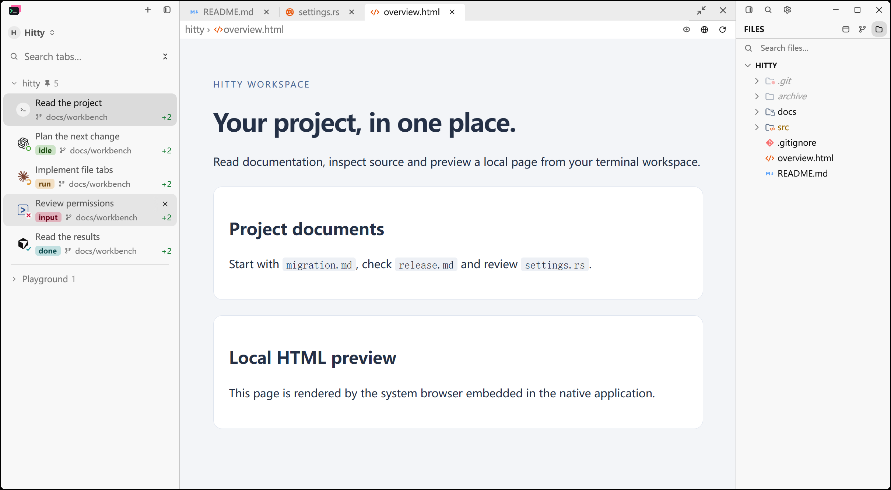
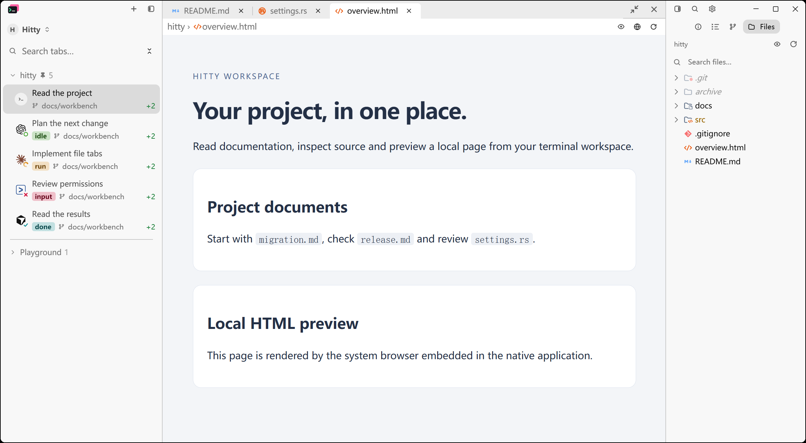

# Current product screenshots

Refreshed on November 12, 2026 from `main` at `0a9dedc` (v0.4.0 plus the
notification task-title fix). English and Chinese READMEs share the same four
native application images. The documentation homepage uses byte-identical
copies of the light and dark workspace images.

The existing document fixture runs with isolated configuration and sample
Agent states. The Markdown scenes show automatic Outline follow; the source
and local HTML scenes show Files. No live Agent or remote connection is implied.
All images use a 1380 × 760 logical viewport, 175% Windows display scale and
the original PrintWindow harness with the synthetic pointer at `(1,1)`.
The real pointer is not moved. Images are unretouched native captures.

Reproduce with:

```sh
cargo build --locked --features markdown-visual-tests --bin hitty-app
python scripts/prepare-readme-captures.py <new-temporary-scene-directory>
```

Launch each scene with `hitty-app --config-dir <isolated-directory>
--document-visual <scene.json>`, wait for its readiness record, then run
`scripts/capture-native-window.ps1 -ProcId <pid> -Out <image.png> -MoveTo "1,1"`.
Binary, image hashes, readiness and exact scene options are recorded in
[capture metadata](../../assets/screenshots/hitty/captures.json).

## Native comparison

Before images are the previously published README assets; After images are
new captures of the corresponding sample project, viewport and appearance.
The old workspace images show Files; the current Markdown scenes show the
automatic Outline behavior. These compare product documentation across versions,
not a runtime UI change made in this documentation update.

| Scene | Before | Current |
| --- | --- | --- |
| Light workspace |  |  |
| Dark workspace |  |  |
| Source editor |  |  |
| Local HTML |  |  |

The locked native build passed. All four refreshed application images were
visually inspected. Relative documentation links and image references were
checked after cleanup. Live GitHub rendering has not been rechecked because
these changes have not been pushed.

Completed right-panel prototypes, superseded native panel captures, early
release verification bundles and old GitHub README layout screenshots have
been removed. Their original bytes remain in Git history. Current feature
acceptance records, published release notes, provenance and licenses remain.
