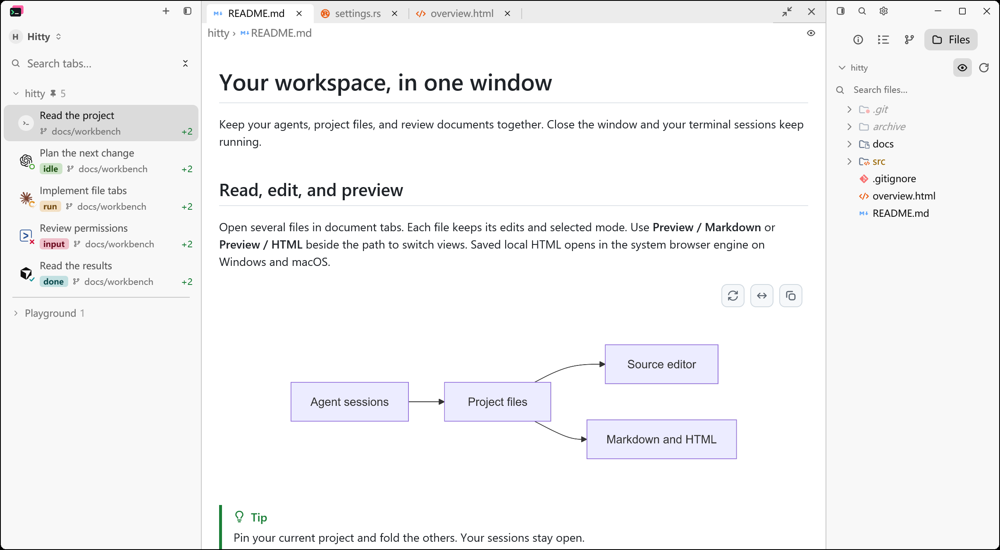
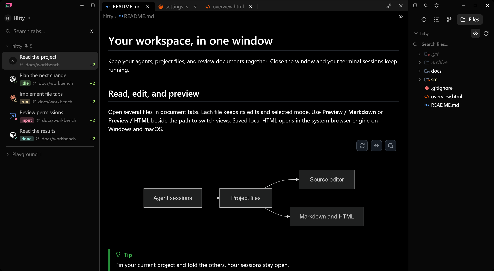
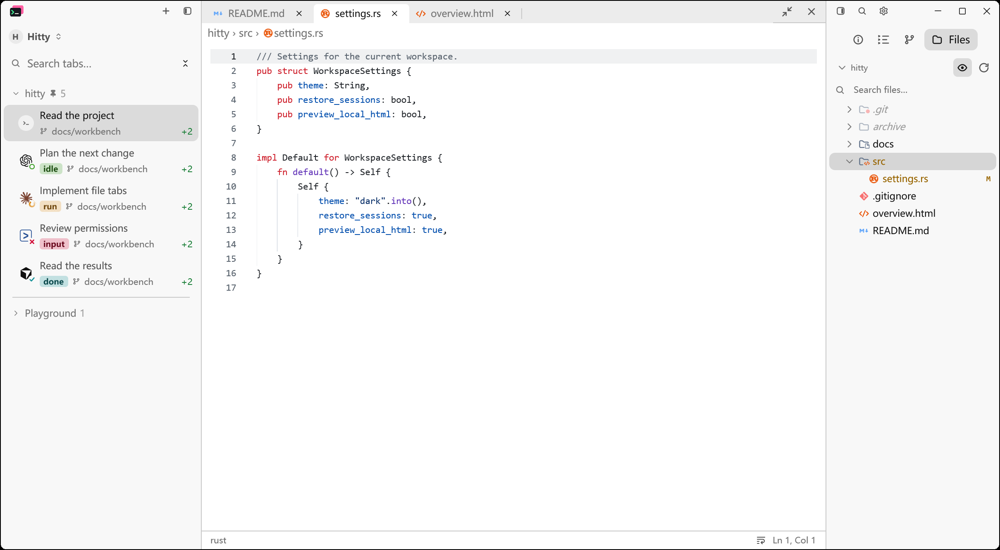
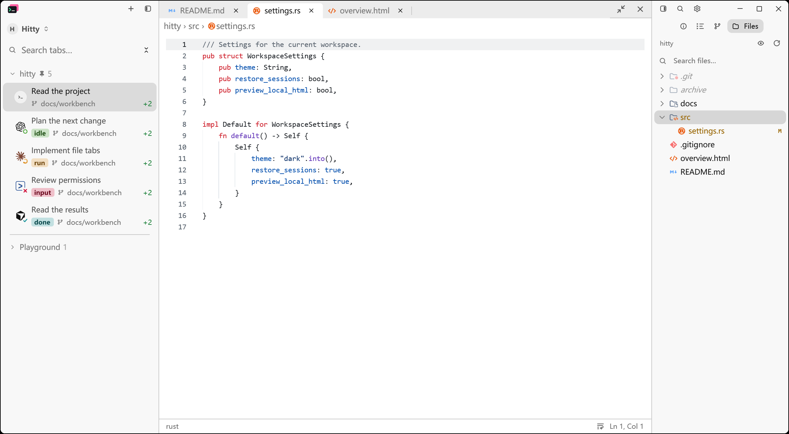
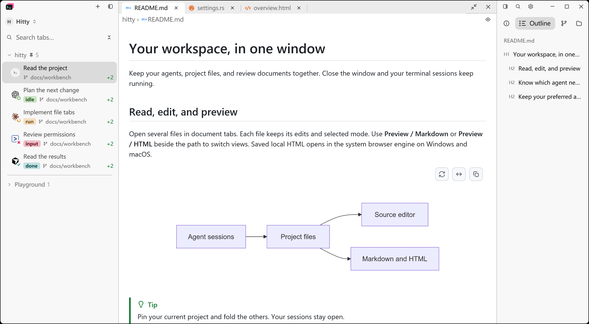
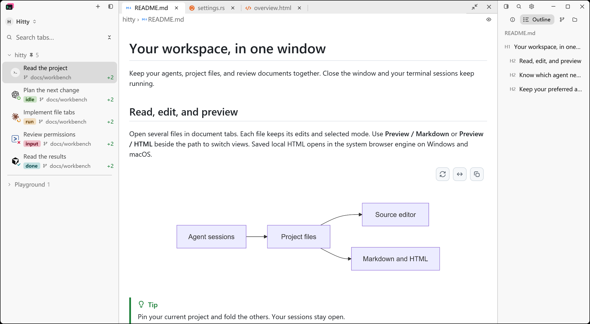
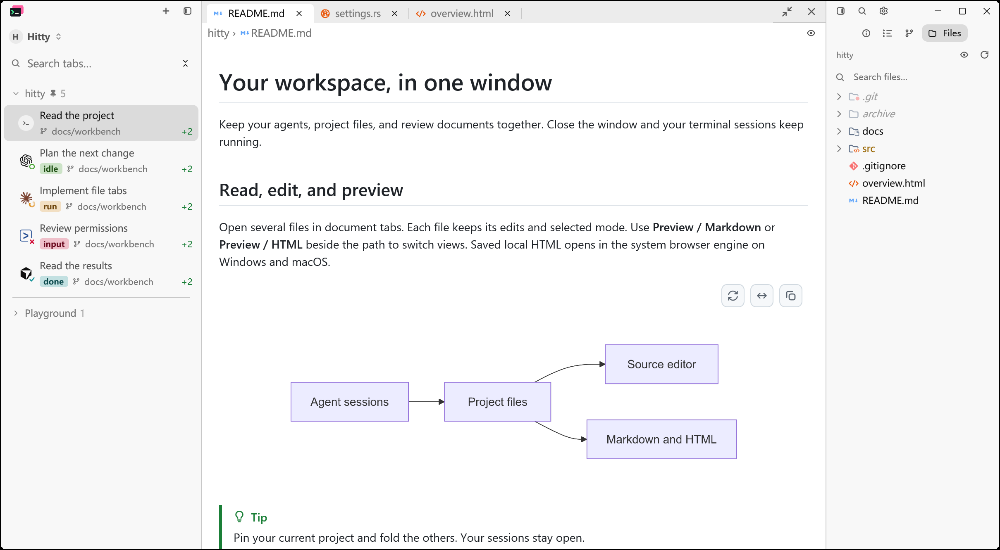
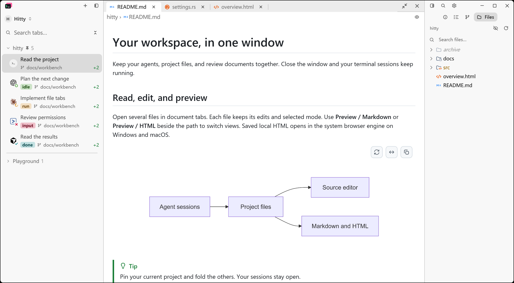
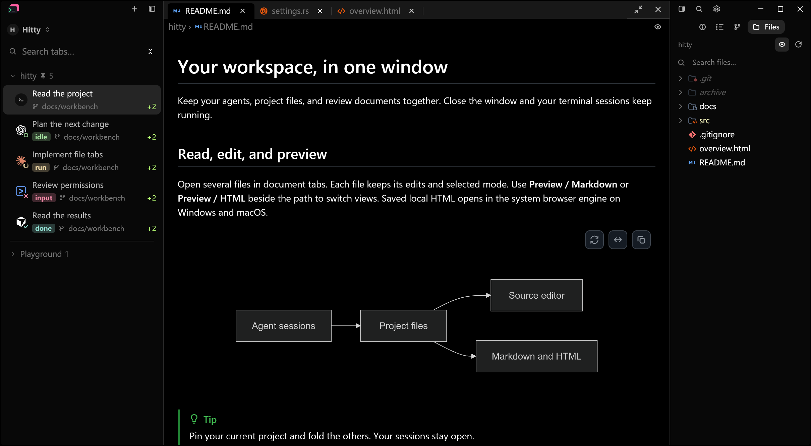
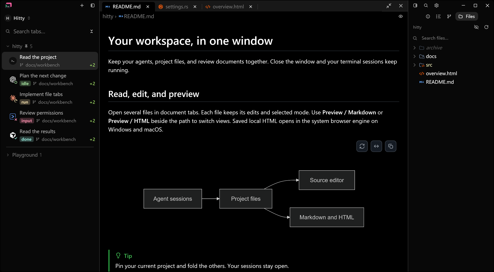

# Compact right panel and aligned file tree

The maintainer approved these refinements to the four-mode panel on
November 9, 2026. Comparison baseline: `9e6fd34`. The earlier prototype's larger
16 px mode icons and 30 px controls are superseded by the original Hitty scale.

| Element | Before | After |
| --- | --- | --- |
| Mode glyph | 16 px | 13 px, matching surrounding chrome |
| Active mode label at default UI size | 14 px | 12 px |
| Mode control height / minimum width | 30 px | 24 px |
| Mode row height | 46 px | 28 px |
| Hidden-file / refresh control | 16 px glyph / 26 px target | 13 px / 24 px |
| Hidden-file state | Eye with selected background when shown | Open/crossed-out eye with no persistent background |
| Single-root title | Disclosure glyph and its gap | Name without glyph/gap |
| Single-root descendants | Extra 14 px root-level inset | Begin at the first visual level |
| File icons / file names | 16 px / 13 px | Unchanged |

The four modes, active-only localized labels, file actions, root folding,
keyboard navigation, context menus and drag/drop retain their behavior. Text
continues following the UI font setting. Outline content and left-sidebar
sessions are unaffected. Search results and multi-root trees retain their
existing indentation. Empty/loading notes and inline creation inputs use the
same adjusted inset as file rows.

The implementation reuses the existing `TILE_GLYPH`, `TILE_SIZE_SM`,
`SECONDARY_BAR_HEIGHT` and `META` constants. The label size is applied to the
child text node because Button assigns its own inner label size. The file tree
changes its rendered depth, not its data structure or selection identity.
The hidden-file action reuses the editor's `Eye` / `EyeOff` icons with the
unselected chrome style in both states. The existing hover feedback, localized
action tooltip and click handler remain in place.

## Native evidence

Actual Windows PrintWindow captures use the existing document fixture with
isolated configuration: 1380 × 760 logical viewport, 175% display scale,
16 px UI base, 240 px panel, the same files and pointer position `(1,1)`.
The minimum-width Outline pair uses a 216 px panel. Fixed session labels come
from the same fixture in both versions. Capture metadata records binary and
image hashes. No personal workspace or live Agent is represented.

| Before | After |
| --- | --- |
|  |  |
|  |  |
|  |  |
|  |  |

Reproduce with a fresh scene from `scripts/prepare-readme-captures.py`, then
run `hitty-app --config-dir <isolated-directory> --document-visual <options>`.
Set `hover_at: [1, 1]`; use `panel_mode: "outline"` and `panel_width: 216` for
the minimum-width pair. Capture using `scripts/capture-native-window.ps1`.
The expanded pair selects `src/settings.rs` and opens its parent directory.
At the recorded display scale, click `(2180,390)` in Before and `(2180,360)`
in After to expand `src`, then send the pointer message back to `(1,1)`.
The coordinates differ because the shorter mode row moves the tree upward.

### Hidden-file visibility

The follow-up comparison uses `d04006b` as Before, isolating the hidden-file
button change from the sizing and indentation work above. Both eye states use
the same unselected button surface; the active Files mode retains its fill.
The same fixture, viewport, scale and appearance settings are used in each pair.

| State | Before | After |
| --- | --- | --- |
| Light, hidden files shown |  |  |
| Light, hidden files hidden |  |  |
| Dark, hidden files shown |  |  |
| Dark, hidden files hidden |  |  |

Start the Files fixture with a fresh isolated configuration. At 175% display
scale, use `scripts/capture-native-window.ps1 -ProcId <pid> -Click
-MoveTo "2327,133" -Out <temporary.png>` to toggle hidden files, then capture
with `-MoveTo "1,1"` to clear hover. A second click restores the initial listing.
Capture metadata records the state, coordinates and image/executable hashes.

## Validation

- `cargo fmt --all -- --check` passed.
- `cargo check --locked --workspace --all-targets --features updater` passed.
- `cargo test --locked --workspace --features updater` passed: all suites
  completed with 3,290 passed, 0 failed and 13 existing ignored. This includes
  1,861 application tests, 32 updater tests, 138 CLI unit tests, 1,240 core
  tests and 19 server/integration tests. All 32 file-tree regressions passed
  both in the focused run and within the application suite.
- The custom CLI end-to-end harness completed all 13 cases successfully.
- The locked native build, all-target check and full workspace/updater suite
  passed again after the hidden-file icon refinement. Native clicks hid and
  restored the dotfile entries in both themes; the eye's two resting states
  have no persistent fill. Independent Standards and Spec reviews found no
  issues in the follow-up.
- `python scripts/sync-agent-detection.py --check` and its four Python tests
  passed; all 15 manifests matched the recorded revision.
- `.github/scripts/check-host-boundary.sh` passed for 116 UI/terminal files.
- Native PrintWindow Before/After captures were inspected at the same
  1380 × 760 logical viewport, 175% display scale, 16 px UI base and isolated
  fixture data. The final evidence includes light and dark Files views, an
  expanded folder, and Outline at the 216 px minimum panel width.

Windows native appearance is verified. macOS and Linux native appearance has
not been inspected locally.

All production changes are confined to three UI files. Dependency versions,
settings defaults, file actions and published releases are unchanged.
