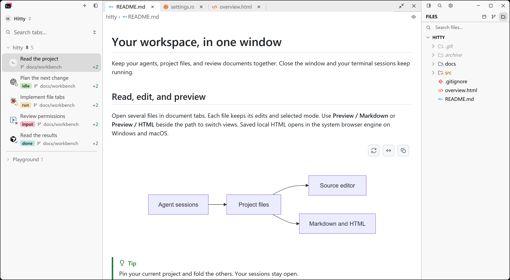
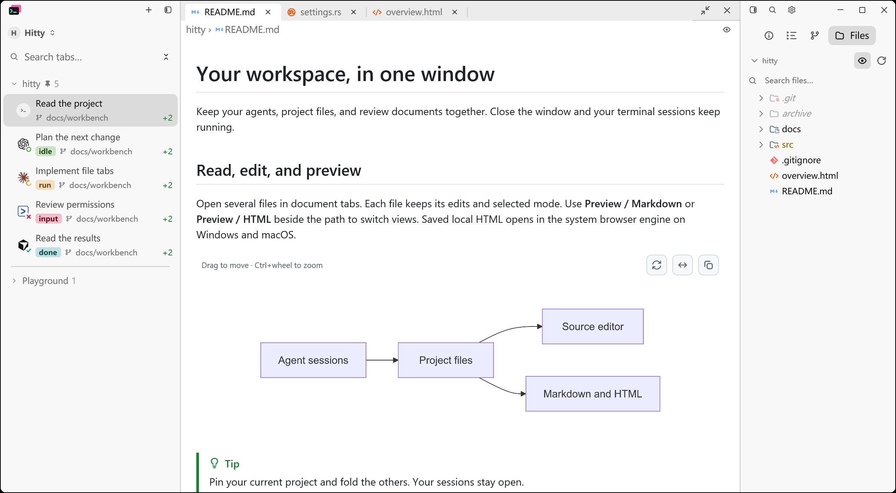
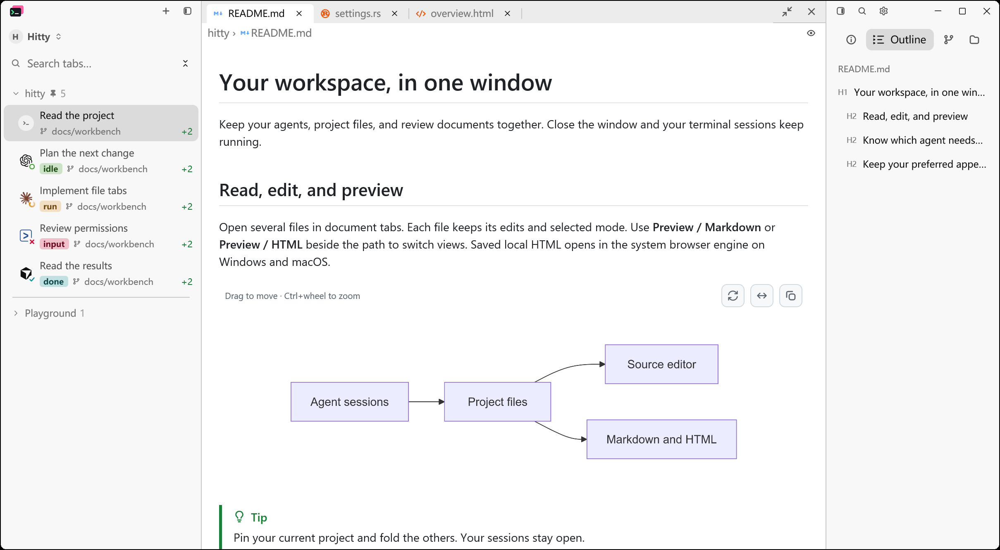

# Right panel and contextual outline

Specification: Hitty issue #15. Implementation tickets: #16–#20.
The implementation uses the accepted right-panel prototype and preserves the
existing left session sidebar, file viewer, Info content and Git operations.

## Behavior checked

- The mode group exposes Info, Outline, Git and Files, with active-only text.
- File root folding, hidden-file toggle and refresh remain within the owning session.
- Markdown headings appear from the current preview and navigate through the
  existing renderer's anchor API without changing the document or session.
- Agent Outline reuses existing turns. Shell command entries use OSC 133 stream
  boundaries, retain exit state and scroll rather than execute commands.
- Command anchors retire when scrollback or geometry no longer supports their
  recorded position. Full-screen programs do not receive false jump promises.
- HTML heading targets retain DOM-node identity and navigation generation.
  Reloaded or removed targets cannot redirect a stale entry.

Application-level regression checks cover panel toggles, file controls,
Markdown navigation and command navigation. Lower-level checks cover chunked
shell integration and repeated, formatted, nested and Unicode Markdown headings.

## Native captures

Use the existing document fixture and `scripts/capture-native-window.ps1`.
These Windows captures use matching sample files, a 1380 × 760 logical viewport,
175% display scale and light appearance. The shell/Agent content is controlled
fixture data. Separate config directories bypass ordinary startup and hook refresh.

These are actual native application captures, not browser mockups. The original
prototype remains under `docs/prototypes/right-panel/` for design reference.

## Documentation review

The complete inventory was assessed against current source and references.
Obsolete inherited releases, finished proposals, historical run reports and
unused captures were removed. Active user guides, compiled test fixtures,
third-party notices, source provenance and Hitty release verification remain.
The per-file review inventory and raw command logs are working artifacts rather
than additions to the durable documentation tree.

Final workspace test and native HTML results are recorded after validation.
