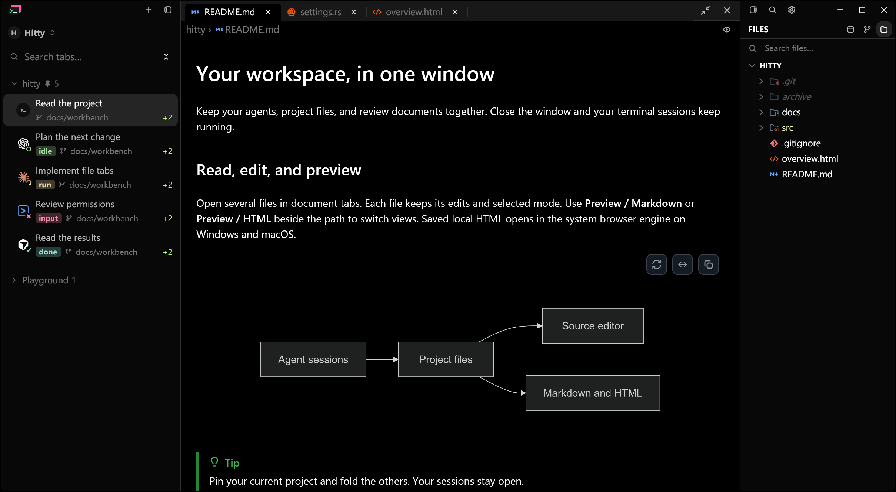
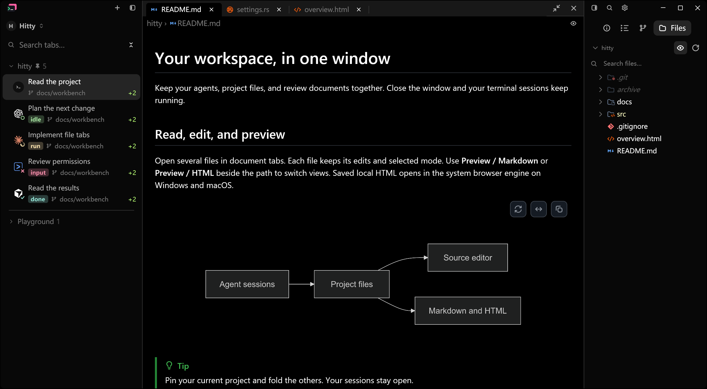
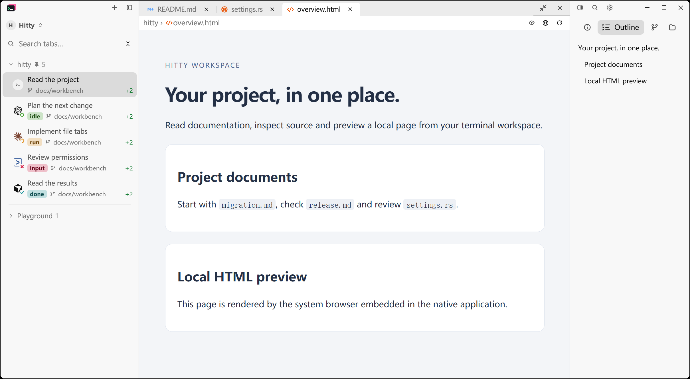
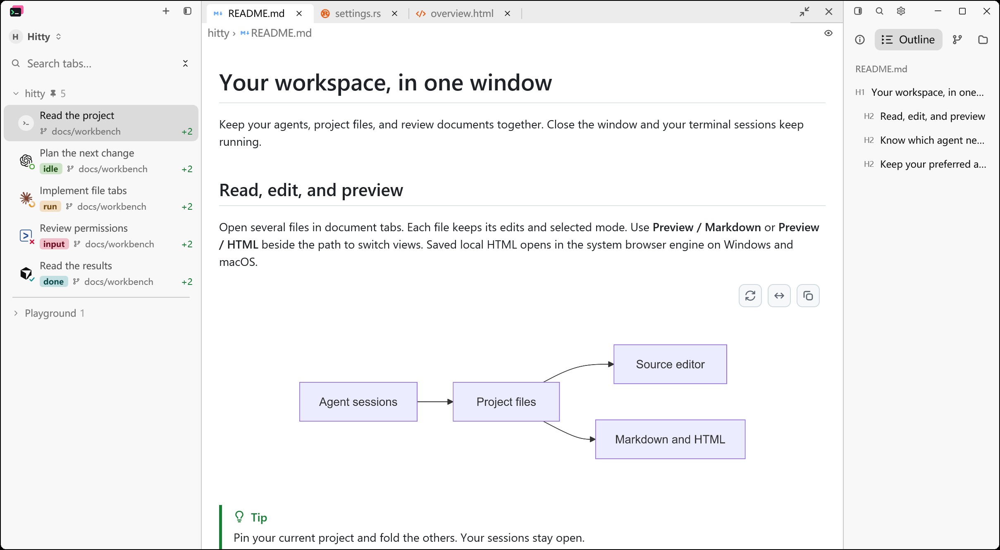

# Right panel and contextual outline

Specification: Hitty issue #15. Implementation tickets: #16–#20.
The implementation uses the accepted right-panel prototype and preserves the
existing left session sidebar, file viewer, Info content and Git operations.

## Behavior checked

- The mode group exposes Info, Outline, Git and Files, with active-only text.
- File root folding, hidden-file toggle and refresh remain within the owning session.
- Markdown headings appear from the current preview and navigate through the
  existing renderer's anchor API without changing the document or session.
- Agent Outline reuses existing turns. Shell command entries use OSC 133 stream
  boundaries, retain exit state and scroll rather than execute commands.
- Command anchors retire when scrollback or geometry no longer supports their
  recorded position. Full-screen programs do not receive false jump promises.
- HTML heading targets retain DOM-node identity and navigation generation.
  Reloaded or removed targets cannot redirect a stale entry.

Application-level regression checks cover panel toggles, file controls,
Markdown navigation and command navigation. Lower-level checks cover chunked
shell integration and repeated, formatted, nested and Unicode Markdown headings.

Review regressions additionally cover inline HTML formatting, mixed HTML and
Markdown heading numbering, footnote definitions, PowerShell URI-encoded labels,
Clink prompt completion, live scrollback-limit changes, and Agent-to-shell
context changes while retaining Info history. Command anchor validation and
scrolling hold the same terminal lock.

## Reproduction

```sh
cargo test --locked --workspace --features updater
cargo build --locked --features markdown-visual-tests --bin hitty-app
python scripts/prepare-readme-captures.py <new-temporary-scene-directory>
```

Run the generated workspace options through `--document-visual` with an
isolated `--config-dir`. Use `panel_mode: "outline"` for Outline, `active: 2`
for the sample HTML file, and the generated dark option for dark appearance.
Use `panel_width: 216` to exercise the minimum supported panel width.
Set `hover_at: [1, 1]` in both fixtures to clear diagram hover state.
Capture the process with `scripts/capture-native-window.ps1 -ProcId <pid>
-Out <image.png> -MoveTo "1,1"`. The pointer message is synthetic; it does not
move the user's pointer. The Before executable uses baseline `6ec847b`.

The saved session labels are fixture data already present in both versions;
opening a document does not create those sessions.

All 1,268 externally sourced locked package records match the baseline,
including versions, source revisions, checksums and dependency edges. The app
adds direct access to three packages already used by the pinned renderer:
`markdown 1.0.0`, `html5ever 0.27.0` and `markup5ever_rcdom 0.3.0`.

## Native captures

Use the existing document fixture and `scripts/capture-native-window.ps1`.
These Windows captures use matching sample files, a 1380 × 760 logical viewport,
175% display scale and light appearance. The shell/Agent content is controlled
fixture data. Separate config directories bypass ordinary startup and hook refresh.


<details>
<summary>Dark appearance, HTML and minimum-width checks</summary>









</details>

These are actual native application captures, not browser mockups. The original
prototype remains under `docs/prototypes/right-panel/` for design reference.

## Documentation review

The complete inventory was assessed against current source and references.
Obsolete inherited releases, finished proposals, historical run reports and
unused captures were removed. Active user guides, compiled test fixtures,
third-party notices, source provenance and Hitty release verification remain.
The per-file review inventory and raw command logs are working artifacts rather
than additions to the durable documentation tree.

The inventory reviewed 662 files and removed 549 obsolete files/assets.
The documentation was 30,727,318 bytes before this cleanup. It now contains
119 files totaling approximately 4.1 MB, including the final native images.

## Validation results — 2026-11-09

Windows x86_64, isolated fixture data:

| Check | Result |
| --- | --- |
| Locked workspace tests with updater | 3,288 passed; 0 failed; 13 existing ignored |
| Custom CLI end-to-end harness | 13 passed |
| Locked native application build | Passed with `markdown-visual-tests` |
| Native HTML acceptance fixture | Two consecutive standalone runs passed |
| Agent manifests / sync-script tests | 15 manifests verified; 4 tests passed |
| Host boundary | 116 UI/terminal files checked; no direct filesystem/git violations |
| Local documentation links and site navigation | 243 links checked; none broken |
| Formatting and diff whitespace | Passed |

The Standards review's four original findings and the Spec review's four
original findings were resolved and rechecked. Follow-up Markdown traversal
cases were also fixed; neither review reported an outstanding defect.

The native HTML fixture verifies reading positions across file tabs, Markdown,
source view and sessions, rapid switching, duplicate heading targets, removed
nodes, reload generations and recovery from a failed navigation. An earlier
run during concurrent compilation failed its reading-position assertion. The
baseline fixture passed, and both final standalone runs passed without changing
the production scroll-restoration code or weakening its assertions. The initial
failure's cause was not established; diagnostic state is now reported on failure.

PR #21 passed all cross-platform checks before its squash merge as `2df4c05`.
CI run [42530978237](https://github.com/cloudy-liu/hitty/actions/runs/42530978237)
passed on Windows x86_64, Linux x86_64, macOS ARM64 and macOS Intel, including
their applicable native fixtures and remote-server checks. Packaging run
[42530978171](https://github.com/cloudy-liu/hitty/actions/runs/42530978171) passed
the four desktop builds, packaged runtime/session-reconnect checks, Windows
installation/removal and complete asset verification.

macOS/Linux native appearance has not been inspected locally. The published
v0.1.0 tag and assets remain unchanged.
