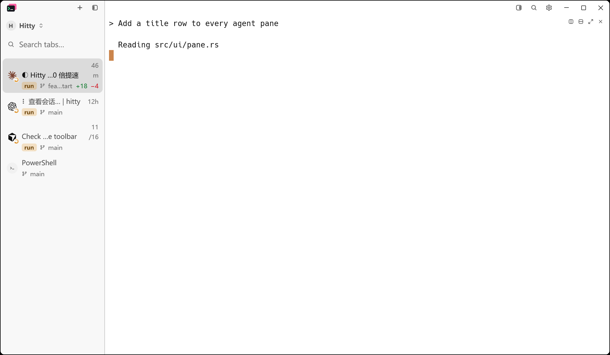
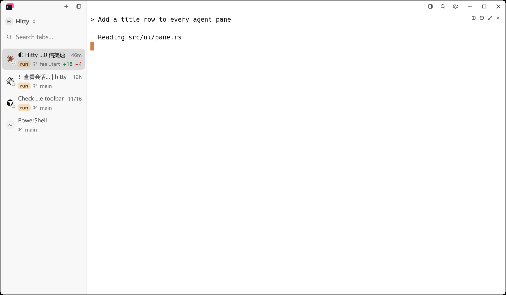
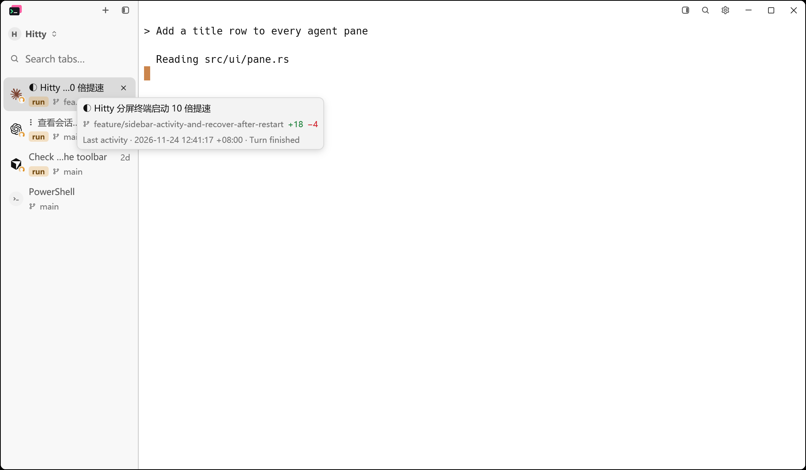
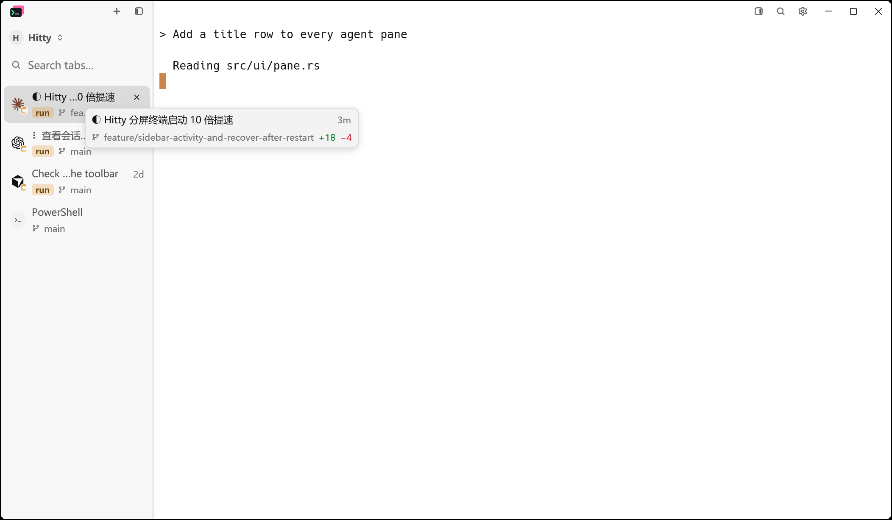

# Sidebar activity labels

The activity label could wrap inside its measured slot. On Windows, a short
duration and a calendar date each increased the session row height. The row now
keeps the label on one line. The hover card displays the same label on the
right of the full session title. Expanded Git information stays below it.

## Windows native evidence

The baseline is `cbc800b` with the same fixture inputs. Both versions use
isolated profiles, a 1200 x 700 logical viewport, 175% display scaling, and
matching synthetic pointer positions. The fixture records row heights before
and after activity is seeded. The capture script rejects an After run when a
label increases the height of any row.

| Scenario | Before: affected row heights | After: all row heights |
| --- | --- | --- |
| Light and dark, 206 px sidebar, 16 px font | 50.29 to 68 px | 50.29 px |
| Minimum sidebar width (180 px), 24 px font | 73.71 to 100.57 px | 73.71 px |

| State | Before | After |
| --- | --- | --- |
| Pointer outside the sidebar |  |  |
| Pointer over the first session |  |  |

Hover checks include a short title, dark theme, and minimum sidebar width with
the largest UI font. After moving the pointer away, the label returns to the
session row. The existing Git count clipping remains visible in the minimum
width and largest font fixture.

The full captures, configuration metadata and measured row heights are in
the [side-by-side evidence folders](images/sidebar-activity-labels/).

## Reproduce

```powershell
cargo build --locked --features markdown-visual-tests --bin hitty-app
python scripts/agent-pane-native-visual.py capture target/debug/hitty-app.exe target/sidebar-activity --phase after --scale 1.75 --only session-activity-wrap-light session-activity-wrap-dark session-activity-wrap-large session-activity-hover-light session-activity-hover-dark session-activity-short-hover-light session-activity-wrap-hover-large
```

## Test results

- Locked visual fixture build and Windows native captures passed.
- `cargo test --locked --workspace --features updater --no-fail-fast` passed
  3,361 tests, including 32 updater tests. It reported 14 ignored tests.
- `cargo fmt --all -- --check` and `git diff --check` passed.
