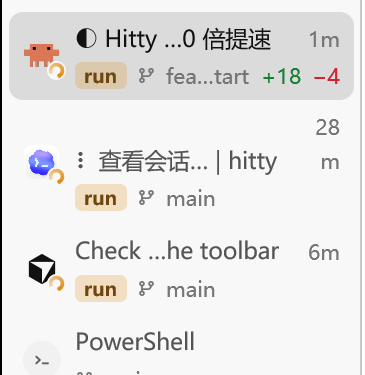
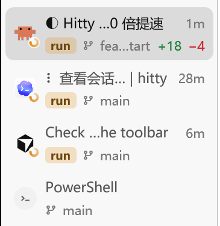

# Sidebar activity labels

The activity label could wrap inside its measured slot. On Windows, a short
duration and a calendar date each increased the session row height. The row now
keeps the label on one line. The hover card displays the same label on the
right of the full session title. Expanded Git information stays below it.

## Windows native evidence

The original scenes use `cbc800b` as their baseline. The captures use matching
fixture inputs, isolated profiles, a 1200 x 700 logical viewport, 175% display
scaling, and matching synthetic pointer positions. The fixture records row
heights before and after activity is seeded. The capture script rejects an After
run when a label increases the height of any row.

| Scenario | Before: affected row heights | After: all row heights |
| --- | --- | --- |
| Light and dark, 206 px sidebar, 16 px font | 50.29 to 68 px | 50.29 px |
| Minimum sidebar width (180 px), 24 px font | 73.71 to 100.57 px | 73.71 px |
| Codex at `28m`, with `1m` and `6m` on adjacent rows | 50.29 to 68 px | 50.29 px |

| State | Before | After |
| --- | --- | --- |
| Pointer outside the sidebar |  |  |
| Pointer over the first session |  |  |
| Codex at `28m` |  |  |

The `28m` split moves the title down while the tab avatar stays centered in the
taller row. The two-digit minutes scene compares `f414eb5`, the parent of the
fix, with `59ae9b4` (v0.5.2). It uses a 206 px sidebar and a 16 px UI font.
The fixture seeds the same relative activity ages before each draw. Both
images use the same crop of the native captures.

Hover checks include a short title, dark theme, and minimum sidebar width with
the largest UI font. After moving the pointer away, the label returns to the
session row. The existing Git count clipping remains visible in the minimum
width and largest font fixture.

The [evidence folders](images/sidebar-activity-labels/) hold the native images,
configuration metadata and measured row heights.

## Reproduce

```powershell
cargo build --locked --features markdown-visual-tests --bin hitty-app
python scripts/agent-pane-native-visual.py capture target/debug/hitty-app.exe target/sidebar-activity --phase after --scale 1.75 --only session-activity-wrap-light session-activity-wrap-dark session-activity-wrap-large session-activity-hover-light session-activity-hover-dark session-activity-short-hover-light session-activity-wrap-hover-large
```

To compare the two-digit minutes scene with the parent of the fix, capture
both builds with separate temporary profiles using the same scene.

```powershell
git worktree add --detach ../hitty-pre-nowrap f414eb5
python scripts/agent-pane-native-visual.py prepare-before ../hitty-pre-nowrap
cargo build --manifest-path ../hitty-pre-nowrap/Cargo.toml --locked --features updater,markdown-visual-tests --bin hitty-app
python scripts/agent-pane-native-visual.py capture ../hitty-pre-nowrap/target/debug/hitty-app.exe target/sidebar-activity-28m --repository ../hitty-pre-nowrap --phase before --scale 1.75 --only session-activity-two-digit-minutes-light
cargo build --locked --features updater,markdown-visual-tests --bin hitty-app
python scripts/agent-pane-native-visual.py capture target/debug/hitty-app.exe target/sidebar-activity-28m --phase after --scale 1.75 --only session-activity-two-digit-minutes-light
```

## Test results

- Locked visual fixture build and Windows native captures passed.
- `cargo test --locked --workspace --features updater --no-fail-fast` passed
  3,361 tests, including 32 updater tests. It reported 14 ignored tests.
- `cargo fmt --all -- --check` and `git diff --check` passed.
