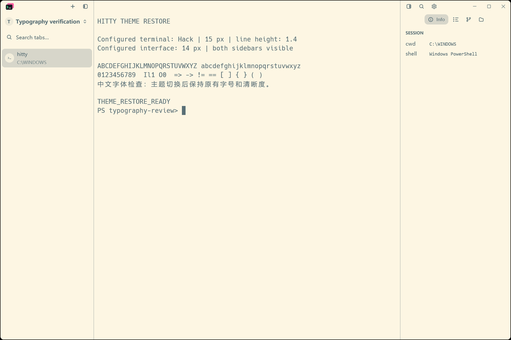
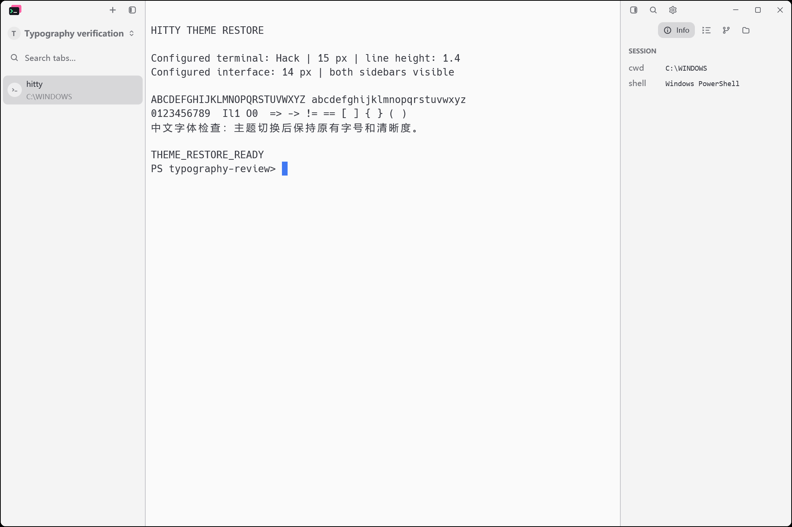

# Retained theme: Solarized Light

November 10, 2026. Final scope for PR #34 after the maintainer reviewed the
25 candidates using full application images with both sidebars visible.

## Result

- Retain **Solarized Light**, displayed without the Otty suffix.
- Remove the other 24 imported profiles from bundled assets and the picker.
- Keep all 13 original Hitty themes.
- Retain the internal `otty-solarized-light` ID so an existing selection works.
- Use the existing default-theme fallback for a removed ID in old preferences.
- Limit regeneration to `solarized-light.ottytheme` so it cannot restore the
  rejected profiles. Source provenance remains in the asset manifest.

The reviewed palette and appearance are unchanged. Only the display name
changes in the retained YAML. Hitty continues to own interface and terminal
font settings, font metrics and native HiDPI rendering. Declarative styling
support remains available for user-authored theme files; generic tests use
small synthetic fixtures instead of depending on removed built-in themes.

`otty-theme-selection.json` preserves the historical candidate catalogue and
the maintainer's keep/remove decision. Those records and old screenshots are
test evidence, not bundled theme definitions. To rebuild the offline review:

```powershell
python scripts/build-otty-theme-review.py
```

The generated HTML embeds the historical captures and the final 1-keep /
24-remove decision. Its final browser check and full-height sidebar crops
are recorded in `images/otty-hidpi/review-final-verification.json`.

## Native visual evidence

```powershell
python scripts/otty-typography-native.py --stage retained --bin-dir D:/tmp/hitty-build/debug
```

The rebuilt application uses a fresh isolated profile, the same terminal
sample, a 1200 x 800 logical viewport, Windows 175% / DPI 168, terminal Hack
15 px, interface 14 px and line height 1.4. The Left-layout scene shows the
complete left session sidebar and right Info panel. Top layout is a separate
switching check, not the dual-sidebar review scene.

All eight capture events passed. Both selected-theme images are byte-identical
to the corresponding pre-pruning adapted images. Both immediate returns and
both final return rechecks are byte-identical to the Hitty baselines. All eight
terminal text hashes match. The saved images were visually inspected.

| Before pruning | After pruning and display-name change |
| --- | --- |
|  |  |



Solarized Light does not request acrylic/glass backdrops. The deleted themes'
unverified compositor materials are outside this final selection. Native
macOS/Linux visuals and Windows display scales other than 175% remain
unverified; the PR remains draft. GPUI application tests exercise 200% scale.

## Automated verification

Results and log hashes are in `solarized-light-selection-verification.json`.
The locked workspace suite passed 3288 tests (13 ignored), and the updater
suite passed 32 tests (1 ignored), with no failures.
Checks cover the locked workspace build/tests, updater tests, the exact
14-theme catalogue and display name, duplicate/edit round trip, typography
with default/custom settings, 26 selection/preview-cancel paths back to all
13 originals, and all 24 deleted IDs falling back without a residual style.
Importer checks also regenerate from the full installed source export and
confirm that only the retained profile is emitted.
