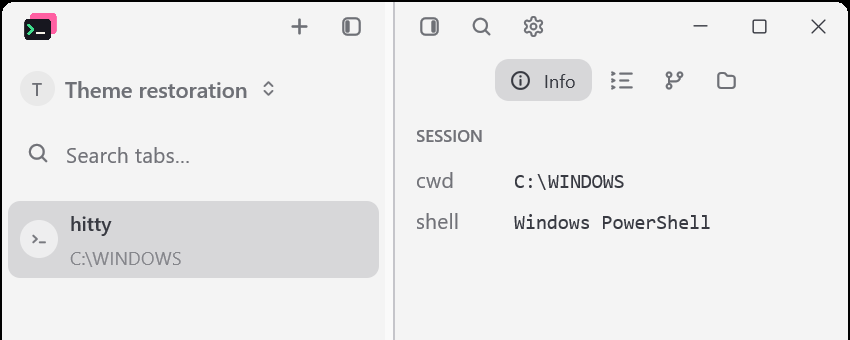
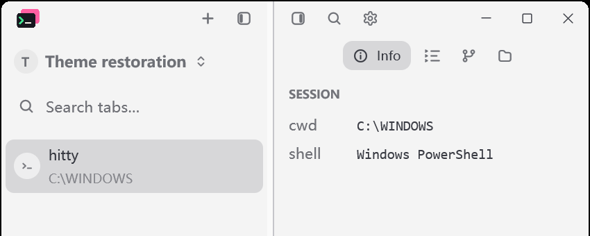

# Otty theme PR revert verification

Date: 2026-11-10. Reverts the squash commit for Hitty PR #31,
`1cd00a4bc577b36500dbb52b294cc7839b082835`.

## Scope

The application sources, core configuration and CI workflow match the parent
of #31 (`d73a736`) exactly. This includes removing all 25 bundled profiles,
their style parser, typography overrides, material/card/tab rendering and
review/import scripts. The original 13 built-in themes remain. The complete
revert also restores the earlier CI cache key and Intel timeout values.

The only conflict was CHANGELOG.md: retain the published v0.3.0 history and
record the revert under Unreleased. Keep the subsequent release version and
herdr-core integration. No dependency or lockfile changes.

## Native visual evidence

Run `python scripts/theme-removal-native.py --stage before --bin-dir <v0.3.0-bin>`
and `python scripts/theme-removal-native.py --stage after --bin-dir <reverted-bin>`.
Both runs use fresh isolated configuration/data directories, a 1200 x 800
logical window at 175% display scale, Hack 15 px, UI 14 px, line height 1.4,
the same static English/Chinese terminal sample and both sidebars visible.
PrintWindow captures are 2104 x 1402 physical pixels; no pointer movement.

Before uses the official v0.3.0 Windows portable build. Its ZIP SHA-256 is
`40f6bba2d904a21858ca77977b52f357837ee2b656bb3a711e33b76f4e2a216c`,
matching the published checksums. After uses the locally built reverted source.
Per-image and executable hashes are in each stage's `captures.json`.

The saved starting selection is `otty-april`, including the retired
`theme_style_legible_palette` setting. After reverting, this resolves to the
original default Light theme. Both runs then switch to One Light, Dark and
One Light again. All scenes retain the terminal sample. The final One Light
capture and terminal text match the first One Light capture within each run.

The images were inspected. After reverting, sidebar typography uses the
original Hitty font treatment, and selecting the removed theme does not apply
Otty's font-size or sidebar overrides. This verifies the Windows scene; it
does not claim a new macOS or Linux visual acceptance run.

Saved Otty selection before / default Light fallback after:

One Light after switching away from Otty, before / after:

Sidebar detail at native pixel size (left and right crops joined without scaling):

## Validation

- `cargo build --locked --workspace`
- `cargo test --locked --workspace`: 3293 passed, 13 ignored (including 13 CLI end-to-end cases)
- `cargo test --locked --features updater --bin hitty-updater`
- `cargo fmt --all -- --check`
- `actionlint .github/workflows/ci.yml`
- `python scripts/sync-agent-detection.py --check`
- `python -m unittest discover -s scripts -p test_sync_agent_detection.py`
- `git diff d73a736 --exit-code -- src crates .github/workflows/ci.yml`

An initial workspace run encountered a `SendError` in the unchanged
`markdown_edits_release_image_budget_and_ignore_old_completions` test.
The final-source application suite passed on rerun: 1861 passed, 7 ignored.
The updater suite passed: 32 passed, 1 ignored. All format, manifest and
workflow checks above passed; the host-boundary check also passed.
