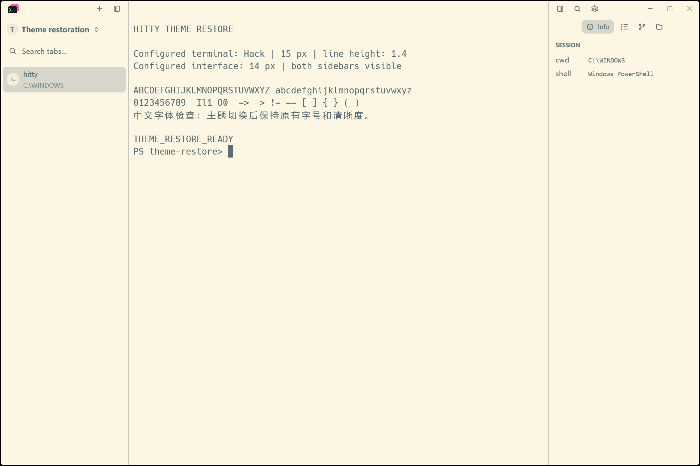
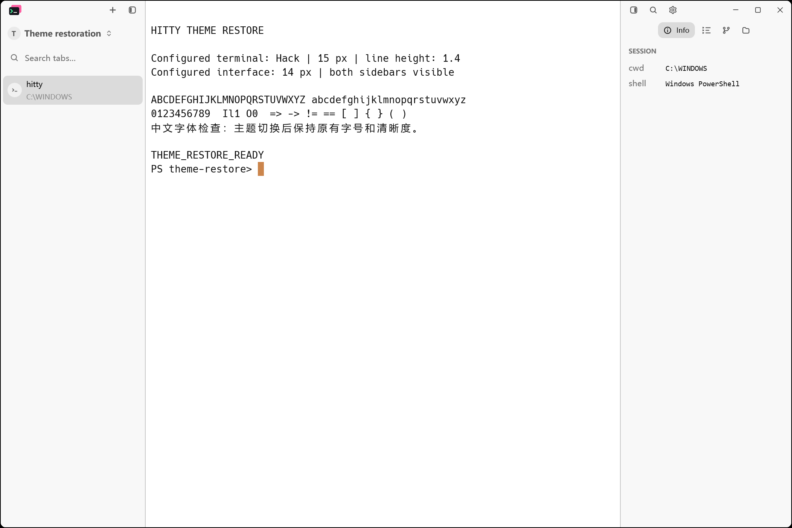
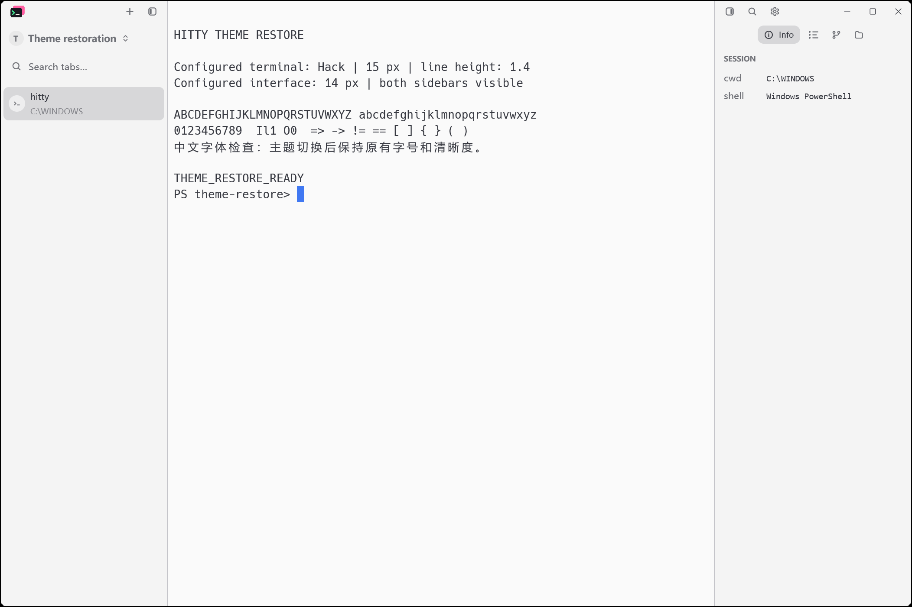

# Restore the original Hitty themes

2026-11-12. Revert PR #34 (`b4de21b`) followed by PR #31 (`1cd00a4`).
Reverting #34 alone would restore the other 24 imported presets.

The final preset implementation is byte-identical to the source before #31:
13 original Hitty presets, no bundled Otty themes or imported style renderer.
Later application fixes, dependency pins, CI timeouts and release history remain.
An existing `otty-solarized-light` selection resolves through the existing unknown-ID
fallback to Hitty Light. No user configuration migration is performed.

## Native verification

Both builds use `cargo build --locked --workspace`. The Before build is main at
`9922cac`; After is the combined revert. Each stage uses fresh isolated user data,
1200 x 800 logical window, Windows 175% display scale, 2104 x 1402 physical frame,
Hack 15 px, 1.4 line height, 14 px interface text and both sidebars visible.
Capture uses `scripts/capture-native-window.ps1` (PrintWindow, no pointer movement).

- All 10 actual captures were inspected, including identical images by SHA-256.
- Original Light, One Light and Dark images match Before byte-for-byte.
- One Light -> Dark -> One Light restores identical pixels and terminal output.
- After's retired Solarized Light selection renders exactly the default Light.

| Scene | Before | After |
| --- | --- | --- |
| Stored Solarized Light selection |  |  |
| Original One Light |  |  |

Reproduce with binaries and their matching CLI/server in each directory:

```powershell
python scripts/theme-removal-native.py --stage before --bin-dir <before-bin>
python scripts/theme-removal-native.py --stage after --bin-dir <after-bin>
```

[Source, build and capture records](theme-removal-verification.json) include hashes.
Workspace and updater test outcomes are recorded in the pull request and CI.
Native visual verification here covers Windows at 175% scale.
