# Tooltip density

November 12, 2026. Baseline: `f36c167` (Hitty v0.3.1).

Hover tooltips are smaller and, when they belong to a control, sit nearer to
it. The label drops one type step to 12px, the horizontal padding to 8px and
the shadow from large to medium. A tooltip anchored to a control now opens 6px
from it instead of 12px. The chrome tiles that advertise a chord hand it to the
tooltip's own key slot, which draws it in the muted foreground instead of
concatenating it into the label. Show delay, dismissal, placement side and the
words themselves are unchanged.

A tooltip anchored to the pointer keeps its 12px margin. gpui opens it one
pixel off the cursor, so that margin is what holds the box clear of the arrow;
only its type step, padding and shadow change.

The tooltip is drawn by the component fork, so the change also moves Hitty's
pin from `f95e3b8` to `e7663b3` in `cloudy-liu/gpui-component`. The three
commits between them touch `crates/ui/src/tooltip.rs` and
`crates/ui/src/button/button.rs` and nothing else.

## Native evidence

Both stages launch the real application with separate temporary profiles, the
same CMD shell, `C:\WINDOWS` working directory, One Light theme, default 16px
interface size, the default `"tab_bar_position": "left"` (the left sidebar),
1100 × 700 logical window and 175% display scaling.
`scripts/capture-native-window.ps1` posts a synthetic pointer move to each
control and captures with PrintWindow after the tooltip's 500ms delay, so the
real pointer never moves and no window overlaps the capture. Each scene saves
the full window and a crop around the tooltip.

| Tooltip | Before | After |
| --- | --- | --- |
| Hide Sidebar (`Ctrl+Shift+B`) | 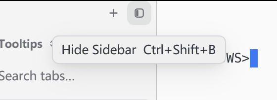 | 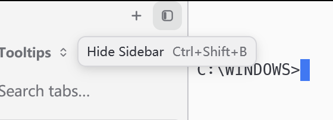 |
| New Tab (`Ctrl+Shift+T`) | 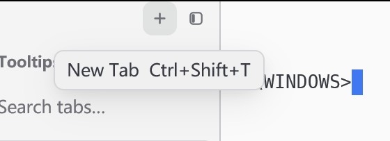 | 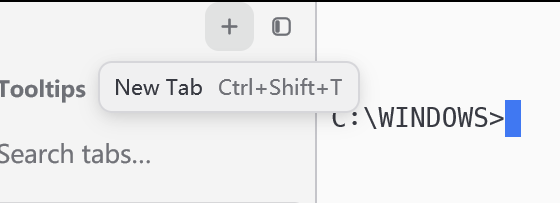 |
| Settings (`Ctrl+,`) | 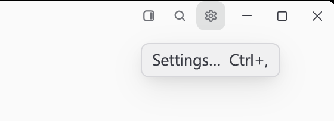 | 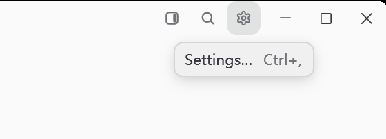 |
| Switch Workspace, chord unbound | 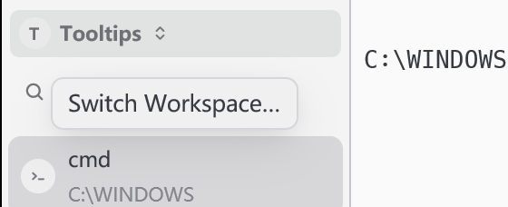 | 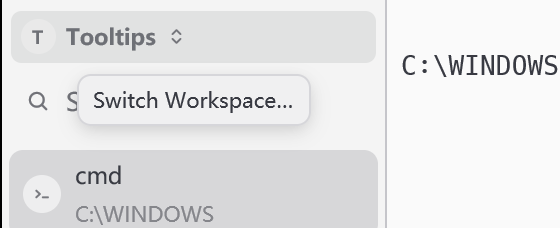 |
| Close Tab, plain text | 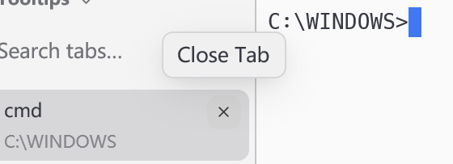 | 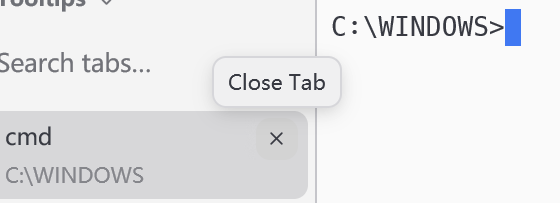 |
| Tab card, anchored to the pointer | 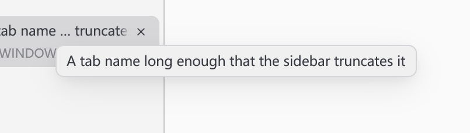 | 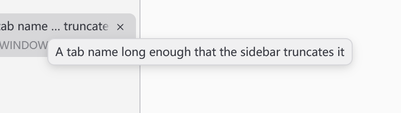 |

Full windows for the first row: [before](images/tooltip-density/before/hide-sidebar-window.png),
[after](images/tooltip-density/after/hide-sidebar-window.png).

Painted tooltip box — border to border, without the shadow — and its distance
from what it is anchored to, measured from the saved captures in logical
pixels. One physical pixel is 0.57 of a logical one at this scaling.

| Tooltip | Box before | Box after | Distance |
| --- | --- | --- | --- |
| Hide Sidebar | 201 × 33 | 173 × 30 | 12 → 6 from the tile |
| New Tab | 173 × 33 | 150 × 30 | 12 → 6 from the tile |
| Settings | 134 × 33 | 117 × 30 | 12 → 6 from the tile |
| Switch Workspace, unbound | 156 × 33 | 134 × 30 | 13 → 6 from the tile |
| Close Tab | 88 × 33 | 74 × 30 | 12 → 6 from the × |
| Tab card | 354 × 31 | 350 × 31 | 14 right and 13 below the pointer, unchanged |

Three rows are controls for the rest. `close-tab` has no chord, so its
reduction is the type step and padding alone. `switch-workspace-unbound` runs
the same tile path as `hide-sidebar` in a profile that sets
`"keybindings": {"ToggleSwitcher": ""}`: the label stands alone and no empty
key slot is drawn. `tab-card` is anchored to the pointer and stays where it
was.

In every scene the full window differs from a pointer-at-rest capture of the
same launch only inside the saved crop.

## Reproduce

Build the baseline and the changed sources with their locked dependencies. Run
each stage against its corresponding binary directory; `--scale` is the display
scale the captures were taken at, and the hover points in the script are
logical coordinates in the 1100 × 700 window.

```powershell
cargo build --locked --workspace --bins --features updater --target-dir D:/tmp/hitty-tooltip-build
python scripts/tooltip-density-native.py --stage before --bin-dir <baseline-bin> --scale 1.75
python scripts/tooltip-density-native.py --stage after --bin-dir D:/tmp/hitty-tooltip-build/debug --scale 1.75
cargo fmt --all -- --check
cargo test --locked --workspace --features updater --target-dir D:/tmp/hitty-tooltip-build -- --test-threads=4
```

The HTML preview hides its native page under a tooltip's footprint, so that
check is part of the affected flow:

```powershell
cargo build --locked --features markdown-visual-tests --bin hitty-app --target-dir D:/tmp/hitty-tooltip-build
python scripts/html-tooltip-native.py D:/tmp/hitty-tooltip-build/debug/hitty-app.exe <output-directory>
```

## Validation

- `cargo fmt --all -- --check`: passed.
- `cargo check --locked --workspace --all-targets --features updater`: passed.
- Locked workspace binaries with the updater feature: built successfully.
- Locked workspace and updater tests: 3,320 passed, 0 failed, 14 ignored.
  The ignored cases are the existing platform/manual tests.
- Component fork at `e7663b3`, `cargo test --locked -p gpui-component --lib`:
  304 passed, 0 failed, including the seven tooltip tests; two of them are new
  and cover the 6px placement above and below a control. One test,
  `text::state::tests::update_future_yields_before_coalescing_all_queued_updates`,
  was skipped: it overflows its stack on this Windows machine at the previous
  pin `f95e3b8` as well, and does not touch the tooltip.
- Native tooltip occlusion (`scripts/html-tooltip-native.py`): both stages
  passed. The unclipped stage still reproduces the native child covering the
  tooltip, and the fixed stage restores the page region on dismissal.
- All twelve crops were inspected, and each full window was compared against
  its pointer-at-rest capture as described above.

Not verified: macOS and Linux rendering, dark themes and non-default interface
sizes. The change is geometry plus a foreground colour the theme already
supplies, but only the Windows One Light captures above were taken. The
maintenance rule for moving the component pin asks for native rendering on
every supported platform, so that part of the rule is open.